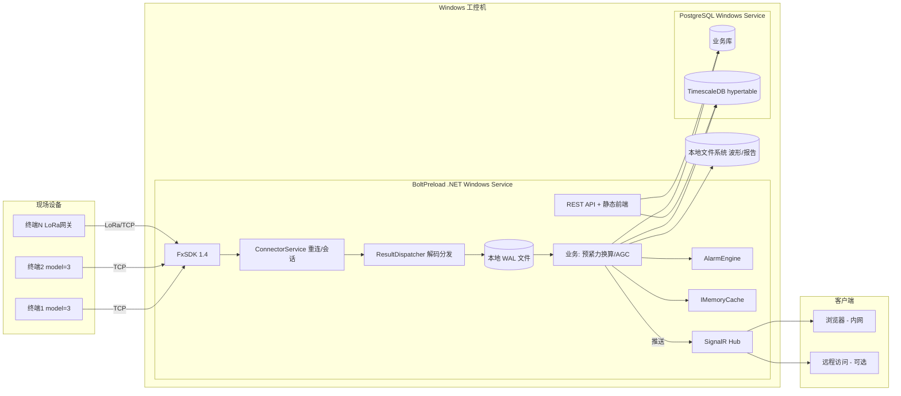

# 螺栓预紧力在线监测系统 — 总体方案

## 零、商用底线原则（任何阶段都不能违背）

本系统监测的是关键基础设施（风电塔筒、桥梁、压力容器法兰等），失效后果可能是**人员伤亡和重大财产损失**。整套方案的设计、开发、部署都必须严守下面 6 条，违反任意一条都是给未来的灾难性事故埋雷：

1. **任何无依据的数字都是商业风险** — 凡是写在合同、UI、报告里的数字，都要能追溯到国标、SDK 源码、实测数据或现场标定。"我觉得"、"应该是"、"差不多"这种表达不能进系统
2. **任何单一算法 / 组件失效都不能让系统瘫痪** — §8.14 算法降级、§9.15.2 系统级 FMEA 是硬要求
3. **任何报警判定不能 100% 自动化** — 紧急级报警必须经人确认才能关闭，监测系统输出**不能直接联动控制**（详见 §9.7 功能安全边界）
4. **任何数据修改都要有审计追溯** — append-only 数据库 + 双人复核（关键操作）+ 电子签名
5. **任何超出能力的事不要承诺** — 不预测失效时间、不保证零漏报、不替代结构工程师判断、不替代国标规定的定期人工巡检
6. **任何不严谨的算法不能上线** — 经验值要明确标"经验值"，国标值要标国标号，论文值要标 DOI

整套方案的算法（§8）和合规（§9）章节都是围绕这 6 条展开的。在执行过程中如果遇到取舍冲突，按上面 6 条优先级判断。

## 一、要做的事

简单说，就是把厂家的超声波螺栓预紧力测量仪接起来，长期 7×24 跑着，数据存下来，能看趋势、能报警、能出报告。典型场景是风电塔筒法兰、桥梁支座、压力容器法兰这种地方——螺栓松了不能等到出事才知道。

**这是商用关键基础设施监测系统，不是实验室原型或概念验证**。这点必须从一开始就贯彻：

- 监测对象的失效后果是人员伤亡和重大财产损失（风电塔筒倒塔单台损失数千万、桥梁支座失效后果更严重）
- 系统出问题的"宽容度"低 — 学术系统漏报一次没事，商用系统漏报一次可能就是事故
- 所有技术决策都要能经得住"出了事后被追责"的质问 — 谁拍板的、依据什么、为什么没考虑某种情况

整套方案按"商用 + 关键基础设施"标准做，不按"互联网产品快速迭代"标准做。两者的工程取舍完全不同。

规模目标按两个层次：

- **单工控机部署**（最常见）：1~50 台终端、50~500 个通道，单通道采样 1~10 Hz
- **全系统多工控机**（大规模业主）：50~200 台终端、几千个通道，分布在多个工控机/服务器

我们 Phase 1~5 按单工控机部署做。多工控机集群是 Phase 6+ 的扩展点（采集 Worker 按一致性哈希分片，业务库可以统一），跟单机版用同一套代码和数据库 schema。

比 SCADA 的 IO 密度低很多，但波形数据量不小，得专门规划存储（详见附录 D.5 容量估算）。

几个硬约束：

- 设备断网/抖动得自己恢复，数据不能丢。这点决定了采集端必须有本地缓存，不能依赖网络稳定
- 现场基本没人值守，所有事件得能通过站内/邮件/企微推出去
- 后期要能横向扩，单节点扛不住时不至于推倒重来
- **任何商用承诺都要写得保守**（详见 §9.15 商用部署的责任边界）

## 二、技术选型

后端定 .NET 8，几个原因：

第一，C# 版 SDK 已经到 1.4 比较成熟了，Java 那个还是 1.0-Beta，缺少业务层最佳实践参考。
第二，厂家直接给了一份 `业务层面重连部分.txt`，里面 `MediatR`、`ConcurrentDictionary`、`UDevice` 那套就是 .NET 风格，照着搬就行，能省不少时间。
第三，部署目标是 Windows 工控机，.NET 8 Windows Service 是最顺的路。
第四，长期常驻的后台服务用 `BackgroundService` + `IHostedService` 比 Java 那套 `@Scheduled` 干净。

如果团队 Java 经验更多，Spring Boot 也能做，但 SDK 这边要自己补不少东西，工期会拉长 3~4 周。

### 部署环境的特殊约束

开发机 macOS，**部署目标 Windows 工控机，且工控机用不了 Docker**。这条决定了整个中间件选型要重做——很多互联网默认方案在工控机上行不通。

工控机的现实是：

- 内存通常 8~16G，CPU 不强，不能堆服务
- 没有 Docker，所有组件得能跑 Windows 原生二进制
- 一年到头不重启，组件得稳得不能再稳
- 没有运维人员，所有组件得能跟主程序一起被 Windows Service 拉起来
- 故障现场不一定有外网，所有 Bug 排查得能离线进行

### 研发环境和现场环境是分离的

实际上有两套环境，方案要同时支持：

- **研发环境**：实验室一台真机 `192.168.0.7:23`（model=3 多通道监测型），Mac 开发机直连。配合自己写的设备模拟器，可以做绝大部分功能的开发和回归测试
- **现场环境**：张北实验风场，Windows 工控机 + 一台真机部署在一起。这是真正长期跑的生产环境

研发期间，全部在 Mac 上开发：用本地 brew 装 PG + Timescale，连实验室那台真机做联调，CI 跑模拟器。等功能稳定后再做 Windows 打包，到张北部署。这个分工很重要，避免一边写代码一边折腾 Windows。

### 具体栈

后端运行时：

- Web 框架：ASP.NET Core Minimal API，后台用 `BackgroundService`
- Windows Service 化：`Microsoft.Extensions.Hosting.WindowsServices` 包；或者外面套 NSSM 兜底
- 设备 SDK：[FxSDK.csproj](FxSDK%20C%23%2BJava%E6%BA%90%E7%A0%81%2B%E4%BD%BF%E7%94%A8%E7%A4%BA%E4%BE%8B/c%23/1.4.0%20%E6%BA%90%E7%A0%81/FxSDK.csproj) 直接引（C# 项目，无依赖问题）
- 实时推送：SignalR，前端订阅监测组维度
- 进程内消息：MediatR

存储：

- 业务库：**PostgreSQL 16 Windows 原生版**，用 EDB 提供的 Windows 安装包，可以注册成 Windows 服务自启动
- 时序库：**TimescaleDB Windows 二进制**（v2.27 已支持 PG 16~18），跟 PG 装在一起。注意：官方文档明确说 Windows 版本"for development and testing"，生产推荐 Linux。我的判断是：单工控机、几百通道的规模够用，但需要在用户合同/交付文档里写清楚这点；如果未来上百节点、TB 级数据，迁到 Linux 上跑
- 兜底方案：如果 TimescaleDB 装不上或者遇到怪问题，降级到 PG 原生月度分区表，丢掉自动压缩和连续聚合，业务功能不受影响
- 缓存：**进程内 IMemoryCache** 替代 Redis。单节点不需要 Redis，省一个组件就少一个故障点；后期真的多节点再上 Redis（Windows 上的 Redis 用 Memurai 这种第三方端口，能省则省）
- 对象存储：**本地文件系统** + 按 `年/月/设备/通道/` 组织目录，波形 JSON 压缩存。等迁 Linux 时再换 MinIO
- 文件搜索/索引：SQLite 本地索引波形文件元数据

前端：

- Vue 3 + TypeScript + Element Plus + ECharts
- 部署方式：构建后的静态文件由 ASP.NET Core 直接托管（`UseStaticFiles`），不另装 nginx，减少工控机上的运维负担

日志与监控：

- 日志：Serilog 写本地滚动文件（每天一份、保留 90 天）；如果允许外联，再加 Seq/Loki 远程采集
- 指标：`prometheus-net` 暴露 metrics 端点，本地装个 Windows 版 Prometheus + Grafana 选装。如果不允许装，至少在 UI 里做几个核心健康指标的展示页

### 为什么这么选

主要权衡是"省运维"和"够用"。Windows 工控机最怕的就是堆一堆组件，每个组件都可能在某个 Windows 更新后出问题。

- 不上 Redis：单节点根本不需要，IMemoryCache + PG 表就能解决
- 不上 MinIO：本地文件系统就够，NTFS 几百万小文件没问题，按目录分散
- 不上 Kafka：本地 WAL 文件就能保证不丢数据，订单系统才需要 Kafka
- 不上 nginx：ASP.NET Core Kestrel 单进程托管前端足够

整体下来工控机上只跑两个服务：PostgreSQL（含 Timescale）+ 我们自己的 .NET 服务。简单可控。

## 三、架构

数据从设备进来到展示在前端，中间这条链路是整个系统的命脉。Windows 工控机部署形态下，整个架构其实很扁：



工控机上只跑两个 Windows Service：PostgreSQL（含 Timescale 插件）+ 我们的 .NET 服务。前端静态文件由 .NET 直接托管，不另装 nginx。

关键一点：解码完先落本地 WAL（append-only 文件 + 简单索引），再写时序库。这样 PG 抖动、文件系统抖动都不至于丢数据。如果上 Kafka 太重，自己写一个简单的 WAL（按小时滚动 + checkpoint）就够。

## 四、领域模型

业务层别被设备和通道带跑偏，中心还是"螺栓"。设备和通道是采集介质，螺栓才是被监测的对象。这个边界一开始划清楚，后面换型号设备、合并/拆分通道都不会动到业务表。

主要实体：

- Project — 项目，相当于租户边界，比如 "XX 风电场"、"XX 大桥"
- Site / Group — 业务分组，比如 "3 号风机塔筒上法兰"，里面 12 颗螺栓为一组
- Device — 物理终端，对应 SDK 的 sessionId，存通讯方式、地址、IP、是否启用、是不是 LoRa
- Channel — 通道，1 个设备 N 个，存增益、探头频率、阈值、脉冲参数、refTime / refTemp、温度补偿模式
- Bolt — 螺栓，业务上 1:1 绑到 Channel。存基本物理参数（型号、规格 M16/M20、有效受力长度 L_e、夹紧长度 L_g、总长 L、材料牌号、性能等级如 8.8/10.9/12.9、屈服强度 Rp0.2、弹性模量 E、横截面积、声速）+ 安装信息（安装扭矩、初始预紧力 F₀、最小允许预紧力 F_min）+ GB/T 43232 适用性标记 + 当前状态（uncalibrated/calibrated/expired）。**注意**：标定参数 K_L 和温度补偿系数 tempCoefficient **不存在 Bolt 表**，而是分别在 CalibrationRecord（历史档案）和 Channel（当前生效值）里——见附录 D
- CalibrationRecord — 标定档案（操作人、复核人、加载装置、采样点列表、拟合 K_L、扩展不确定度、R²、是否通过、签字时间、有效期），**永久保存不可删**，每次标定生成一条，新标定通过 superseded_by 链接到旧档案
- Channel — 通道存当前生效的标定参数（refTime / refTemp / tempCoefficient / 选用的 TOF 算法），从最新通过的 CalibrationRecord 拷贝过来；这样监测时不需要每条数据都关联 CalibrationRecord
- MeasurementRecord — 时序数据（hypertable），字段见附录 D.3 measurements 表完整列表
- MeasurementAnomaly — 异常状态码（< 0）的测量单独入此表，详见附录 D.3
- WaveSnapshot — 波形归档元数据，波形文件本身存本地文件系统（§2 部署方案）
- AlarmRule / AlarmEvent — 规则和触发的事件，详见附录 D.2 和附录 E DSL
- User / Role / AuditLog — 基础设施（含双人复核机制）

完整数据库表定义见**附录 D**。这里只列业务概念，避免重复。

### 国标适用性检查

GB/T 43232-2023 对超声波法的适用条件是有边界的，系统在新增螺栓时必须卡这几条：

- 单波法：公称直径 ≥ M5
- 双波法：公称直径 ≥ M12
- 长径比（L/d）≥ 3:1
- 性能等级 ≥ 8.8 级
- 材料为声学各向同性（碳钢、合金钢 OK，奥氏体不锈钢谨慎）
- 应力范围 (30%~90%) × Rp0.2

不满足时系统不阻止用户添加（现场有特殊情况），但要明确标"不符合 GB/T 43232 适用范围"，并在监测结果上加 disclaimer。

### 预紧力换算（按 GB/T 43232-2023）

国标推荐的核心公式（单波/纵波法）：

```text
P = Δt / (t₀ / K_L)
```

其中：

- `P` — 螺栓轴力（预紧力）
- `Δt = t_σ - t₀` — 拧紧前后纵波传播时间差
- `t₀` — 未拧紧时纵波传播时间（零应力基线）
- `K_L` — 载荷因子（单位轴力引起的声时相对变化），需要标定

> **K_L 量纲约定（最终裁定，以 `docs/sdk-api-facts.md §12` 为准）**：
> 本节及 §8.5/附录 C 用的是国标对照写法 `K_L = Δt/(F·t₀)`（单位 1/N）。
> **实现与存量数据统一用 `K_L = Δt/F`（单位 ns/N，量级 ~1e-4），`F = Δt/K_L`。**
> 另外，本行上方公式 `P = Δt/(t₀/K_L)`（= `Δt·K_L/t₀`）在 1/N 约定下是**错误反解**，正确应为 `F = Δt/(K_L·t₀)`。两套约定换算：`K_L(ns/N) = K_L(1/N)·t₀`。

考虑温度后（综述论文 Eq.6）：

```text
Δt = (2·L_e / v₀) · (A(T) + 1/E(T)) · σ_b
   + (2·L / v₀) · (b(σ)/v₀ + β(σ)) · ΔT
```

- 前一项是应力贡献，后一项是温度贡献
- 工程上简化为线性叠加：`σ_b ≈ (Δt - α·ΔT) × E / (1 + A·E) / (2·L_e/v₀)`
- 预紧力 `F = σ_b × A_e`（A_e 是有效横截面积）

实际实现里我倾向于：

- 优先用厂家提供的 `tcMode` 让设备做硬件温度补偿，软件只做兜底
- 标定结果用 K_L 而不是自己重新推导每个常数，K_L 是国标里直接用的工程量
- 温度补偿系数 α 跟螺栓材料强相关，可在材料库里预置常用钢号的典型值，再由现场标定细化

## 五、关键模块

### 5.1 SDK 适配层

抽一个 `IFxConnector` 接口出来，把 SDK 的 `event OnResultReceived` 转成内部的 `Channel<DecodedResult>`（`System.Threading.Channels`）。这一步看起来是多此一举，实际很重要：

- 业务代码不再依赖 SDK 的事件模型，可以单测
- 后面换 SDK 版本、切语言版本，业务层不动
- 设备模拟器和真实 SDK 共用同一个接口

### 5.2 连接服务

厂家 [业务层面重连部分.txt](FxSDK%20C%23%2BJava%E6%BA%90%E7%A0%81%2B%E4%BD%BF%E7%94%A8%E7%A4%BA%E4%BE%8B/c%23/%E4%B8%9A%E5%8A%A1%E5%B1%82%E9%9D%A2%E9%87%8D%E8%BF%9E%E9%83%A8%E5%88%86.txt) 那套已经很完整了，直接搬就行。要点：

- `Timer` 每 10 秒巡检一次
- 重连间隔指数退避（×1.2），封顶 20 分钟
- `ConcurrentDictionary<deviceId, Task>` 防止同一台设备并发连接
- 跳过计数到 30 强制重置，避免某个长任务卡住整个循环

需要在这个基础上加的东西：

- 设备的 enable/disable，关闭的设备不参与巡检
- 三层 Watchdog：进程级（Windows Service 崩溃自启）、业务级（某设备 N 分钟没数据）、设备级（SDK 心跳超时）

### 5.2.x 通道自动发现

设备启用了哪些通道这件事，**不要在配置文件里硬编码**——客户改了 MCRConfig 程序就崩了，运维体验会很差。

机制：

1. 连上设备后，先调用 `setDeviceModeAsync(STANDBY)` 进入待机
2. 调用 `readDeviceParamAsync(sessionId, DeviceConfig.PROP_MCR_CONFIG, address)`，等回调里返回 `enabledChannels` 列表
3. 对每个启用的通道再调 `readChannelParamAsync` 读出当前配置（refTime、refTemp、gain、probeFreq 等）
4. 把这些通道作为 `Channel` 实体写入业务库（首次发现）或更新（已存在）
5. 切到 `MULTI_MEAS` 开始正常采集

如果设备拒绝 `read MCRConfig`，降级方案：发 `MULTI_MEAS` 直接跑起来，从 `OnResultReceived` 回调里看哪些 channel 号有数据回来，反向推断启用列表。这个降级很重要——不同型号、不同固件版本对参数读支持度不一样。

通道首次发现后，业务系统不一定有"螺栓"绑上去（标定还没做），这时通道是"裸"状态——只采集和显示原始数据，不算预紧力。给用户提示"该通道需要标定后才能监测预紧力"。

### 5.3 解码与持久化

`OnResultReceived` 回来的是 `DecodedResult[]`，按 SDK 源码可能有 4 种类型，全部要处理：

- `ChannelResult` — 单通道结果，含 echoTime/deltaTof/spTemp/echoWave/statusCode（详见 §5.4 状态码）
- `MultiChannelResult` — 多通道聚合结果，是 `Map<channel, ChannelResult>`，**各通道时间戳独立**（见 §8.7.3 时序对齐说明）
- `DeviceParameter` — 设备/通道参数读取的响应
- `EchoWave` — 独立的回波数据（也可能嵌在 `ChannelResult.echoWave` 里）

分发流程：

- `MultiChannelResult` → 拆成 N 个 `ChannelResult` 按下面流程处理
- `ChannelResult` → 状态码 ≥ 0 才算正常 → 算预紧力 → 写 WAL → 批量写时序库 → 更新 IMemoryCache 最新值 → 推 SignalR → 喂报警引擎；状态码 < 0 → 进异常表
- `DeviceParameter` → 更新设备/通道配置缓存
- `EchoWave` → 按"健康度评分 + 是否报警相邻"决定是否写本地文件归档，元数据进 PG

写时序库用 PostgreSQL `COPY` 或者批量 `INSERT ... VALUES (...), (...)`。5k pts/s 是基准目标。单条 INSERT 千万别碰，工控机磁盘会炸。

### 5.4 业务计算

预紧力计算这块不复杂，难点是温度补偿和异常状态码处理。

**异常状态码必须按 SDK 定义严格处理**（来自 C# SDK 1.4 `ChannelResult.statusCode` 注释，注意跟 Java 1.0 略有差异）：

```
 0  正常        → 进时序库，参与所有计算
-1  信号过小    → 进异常表，提示"信号过小，建议检查耦合或增益"
-2  阈值异常    → 进异常表，提示"阈值异常，建议调整 threshold 或 AGC"
-3  信号溢出    → 进异常表，提示"信号溢出（增益过大），建议降低 gain"
-4  相似度低    → 进异常表，提示"波形与模板差异大，可能耦合不良或螺栓状态异常"
-5  未知异常    → 进异常表，进一步排查
-6  信噪比低    → 进异常表，提示"SNR < 6dB，强制屏蔽，建议重涂耦合剂"
```

所有 < 0 的数据**不能**进时序库当正常数据用，否则会污染历史趋势。但要在异常表里完整保留，方便事后追溯故障原因。

设备本身的温度补偿模式（`tcMode`）和软件层的补偿要区分开，要不然容易补两遍。SDK 已经在 `CalculateExtensions.calculateDeltaTof` 里实现了除法归一化模型（详见 §8.4）。我倾向于：硬件 `tcMode=1` 用默认材料系数让设备做，软件不重复处理。

### 5.5 AGC

`RunAgcControlAsync` 厂家已经实现好了（见 `AgcContext.calcNextGain` 源码），封装两种用法就行：

- 手动一键 AGC（前端按钮触发）
- 定期巡检（默认每天凌晨 3 点，可关）

**SDK 的 AGC 算法事实（读源码确认）**：

- 收敛容差：`|currentPeak - targetPeak| < targetPeak × 10%`
- 增益更新：`newGain = gain × (targetPeak/currentPeak)^0.6`（指数 0.6 平滑收敛，避免震荡）
- 信号过小时（peak < 0.001）：增益倍增（newGain = gain × 2）
- 提前终止：增益稳定（前后相同）+ 已过半迭代次数 → 完成

10% 容差是硬编码在 `AgcContext` 里的，不能改。如果业务上需要更严格容差（比如 5%），得让厂家改 SDK，或者我们自己实现 AGC（不推荐）。

注意 AGC 跑的时候不要触发报警，要给报警引擎一个"维护中"信号。

### 5.6 报警引擎

这块单独展开（算法见 §8.7，工程规范见 §9.1），因为坑特别多。

### 5.7 API 和实时通道

REST 走 Minimal API。SignalR 两个 Hub：

- `/hubs/realtime` — 按 group 订阅，推实时值
- `/hubs/alarm` — 推报警事件

角色四级：超管 / 项目管理员 / 操作员 / 只读，权限按项目隔离。

### 5.8 前端关键页面

- 大屏 — 项目级俯瞰，监测组色块矩阵，报警跑马灯
- 监测组详情 — 一组螺栓的卡片视图，颜色按"当前预紧力 / F₀"比值
- 螺栓详情 — 实时曲线、历史趋势、波形对比、报警时间线
- 设备管理 — 拓扑、连接状态、远程配置下发
- 报警中心 — 列表、过滤、确认、派单、声音提示
- 标定向导 — 装好 → AGC → 采参考值 → 写设备 → 完成基线
- 报表 — 日/周/月报，Excel + PDF 导出

## 六、横切关注点

配置安全方面，设备地址、JWT 密钥、DB 密码这些走 `dotnet user-secrets` 或环境变量，绝对不能提交到仓库。

多租户最简单粗暴的做法就是所有表加 `project_id`，所有查询都带条件过滤，超管角色绕过。前期不上 schema 隔离，等真有强隔离需求再说。

时间同步用厂家自带的 `CalculateExtensions.toSyncTime(...)`，每次连上设备就下发一次，再定期校。这块容易被忽视，但工业系统一旦时间错乱排查起来非常头疼。

数据保留：测量数据热数据保 1 年，TimescaleDB 自动压缩（一般能压到 1/10）；波形按需归档，正常情况下每天采样几份、报警前后 ±5 分钟全留。

## 七、标定方案（基于 GB/T 43232-2023）

这是整个系统业务正确性的根基，单独展开。标定做得糙，后面所有曲线和报警都是空中楼阁。

### 7.0 K_L 怎么来：三条路

载荷因子 K_L 是单位轴力引起的纵波声时相对变化，单位通常是 `1/N` 或 `μs/N`。三条获取途径：

**路径 A：厂家提供。** 厂家如果对常用螺栓型号（如 M16 8.8 级、长度 80mm）有标定数据库，直接用。最省事但最不准——同批次螺栓因为材质波动 K_L 能差 5%~10%。

如果厂家连 K_L 都给不出来，只给得到 v / E / S / L₀，那系统降级用 §8.3 的简化模型 A 跑起来，精度 ±15%~25%，先满足"看趋势"的需求，等后续标定到位再升级。这个降级路径很重要——不能因为没标定就让系统完全趴下。

**路径 B：实验室拉伸标定（最准）。** 把螺栓装在拉伸试验机上，按阶梯施加轴向力 F_i（如 0、20%、40%、60%、80% × F_目标），每一档同步测 TOF_i，线性拟合 `ΔTOF vs F` 得 K_L。精度 ±3% 以内。要求实验室有拉伸机和配套夹具，单颗螺栓标定 30~60 分钟。

**路径 C：现场分级拧紧标定（推荐 MVP 用）。** 没有拉伸机时的工程做法：

1. 螺栓未拧紧，超声采 t₀ 和温度 T₀（作为零应力基线）
2. 用精密扭矩扳手或液压拉伸器，按目标预紧力的 30% → 50% → 70% → 90% 分四档加载
3. 每一档稳定后，由实际加载装置读出 F_i，超声同步采 t_i 和 T_i
4. 软件做温度修正后，对 `Δt_i' vs F_i` 做线性最小二乘拟合，得到 K_L 和 R²
5. R² < 0.98 提示标定失败，要求重做

精度比路径 B 略差（±5%~10%），但完全可现场操作，不需要实验室。

如果连扭矩扳手都不准（廉价扳手误差 ±20%~25%），那就用 **路径 C 的变种**：在垫圈位置加一个测力垫圈（load cell washer），由测力垫圈给出 F_i 的真值。成本不高（千元级），精度能拉回到 ±3%。

### 7.1 MVP 阶段做哪个

MVP 阶段实现 **路径 C**（分级拧紧 + 温度同步），这是最有工程实用性的方案。具体到代码：

- 标定向导是一个状态机：选螺栓 → 装探头 → AGC 调增益 → 采 t₀/T₀ → 进入加载循环 → 输入实际预紧力 → 采点 → 至少 4 档后拟合 → 显示 K_L 和 R² → 确认/重做
- 每个标定点都要存原始数据（t、T、F、波形快照），不只是存最后的 K_L。后面争议时能复盘
- 标定完成时生成 `CalibrationRecord`，操作人电子签名，永久保存
- 同时把当前的 t_当前 写成 `refTime`、T_当前 写成 `refTemp`，后续监测以这次状态为零点

### 7.2 温度补偿

温度对超声测量的影响和应力的影响是同一个量级的（10°C 温差能造成几十 MPa 的等效应力），不补绝对不行。

- 厂家 SDK 里 `ChannelConfig.tcMode` 是温度补偿模式，先让设备硬件做。设备能拿到探头紧贴位置的温度（Pt1000），比环境温度更准
- 软件层留兜底：每条记录都存 `sp_temp`（设备读到的螺栓温度），换算时用 `T - refTemp` 做线性修正
- 温度补偿系数 α 来自标定时不同温度下的多组采样（如果客户允许做温度循环），否则用材料典型值表（碳钢约 0.7~1.0 × 10⁻⁴ /°C 的声速温度系数）
- 极端温度变化（>±20°C）超出线性范围时报警，提示用户重新标定

### 7.3 重新标定的触发

国标和工程实践要求几种情况必须重新标定，系统要主动提示甚至强制：

- 周期到期（默认 1 年，可配置）
- 探头更换或拆装过
- 螺栓更换
- 现场维修后（拧松过再重新拧紧）
- 报警后，业主确认是误报想关闭
- 校准证书过期

强制的意思是：如果不重新标定，监测结果带"未标定/标定过期"标签，预紧力数值变灰，报警规则只触发"建议复检"级别。

### 7.4 标定档案

标定档案是事故追溯和合规验收的关键证据，永久不能删。最少包含：

- 螺栓的完整信息（型号、规格、性能等级、批号、安装位置）
- 标定时间、操作员、复核员（双签）
- 标定方法（路径 A/B/C 哪个）、加载装置型号和校准证书
- 每个标定点的原始数据（t、T、F、波形）
- 拟合参数 K_L、R²、置信区间
- 环境条件（温度、湿度）
- 通过/失败判定
- PDF 报告（带电子签名）

这一套不是 MVP 必须，但表结构和文件存储路径要先留好，Phase 2 直接补 UI 就能用。

## 八、核心算法详解（对标 GB/T 43232-2023 等中国标准）

这块是整个系统的技术含量所在，必须严谨。所有算法都尽量对标中国标准，工程实践引用近三年国内顶刊论文（无损检测、机械工程学报等），不凭空捏造。

### 8.1 引用的中国标准清单

下面这些标准都已经核实存在且现行有效（截至 2026-05）。引用时给出确切的标准号和年代，避免歧义。

**核心测量类**

- **GB/T 43232-2023**《紧固件 轴向应力超声测量方法》— 整个系统的核心依据，2024-06-01 实施
- **GB/T 44512-2024**《大型游乐设施检验检测 超声应力测试》— 工程实施旁参，2025-01-01 实施

**测量数据处理类**

- **JJF 1059.1-2012**《测量不确定度评定与表示》— 测量结果出报告必依
- **GB/T 22553-2023**《利用重复性、再现性和正确度的估计值评定测量不确定度的指南》— 不确定度评定的补充指南（2023 新出的）
- **GB/T 4883-2008**《数据的统计处理和解释 正态样本离群值的判断和处理》— Grubbs 检验等离群值方法，注意标准建议 n≥20 时使用（详见 §8.5.1）
- **GB/T 17989.4-2020**《控制图 第4部分：累积和（CUSUM）控制图》— 等同采用 ISO 7870-4:2011，CUSUM 国标依据
- **GB/T 17989.6-2022**《控制图 第6部分：指数加权移动平均（EWMA）控制图》— 等同采用 ISO 7870-6:2016，EWMA 国标依据

**报警与系统管理类**

- **GB/T 41261-2022**《过程工业报警系统管理》— 等同采用 IEC 62682:2014（也就是 ISA-18.2 的国际化版本），报警工程的中国国标依据

**校准类**

- **JJF(机械) 1056-2021**《残余应力超声检测仪校准规范》— 设备校准
- **JJF(机械) 1059-2021**《机械手超声检测系统校准规范》— 系统校准

**装配工艺与行业类**

- **GB/T 16823.3-2010**《紧固件 拧紧试验方法》— 标定加载流程
- **NB/T 31082**《风力发电机组连接螺栓应用规范》— 风电场景适用
- **DL/T 5418**《风力发电场设计技术规范》— 风场部署依据

**国内顶刊参考文献**

- 程芳玲等 (2024)《基于阈值和互相关的螺栓超声轴向应力测量算法》, 无损检测 46(9): 75-82 — 阈值互相关 + 小波降噪的工程实测
- 吴向阳等 (2023)《横纵波法测量螺栓轴向应力的温度修正》, 无损检测 45(5): 37-40 — 温度补偿模型

#### 写算法时必须遵守的原则

- 国标里有明确规定的（如 GB/T 43232 的应力公式、JJF 1059.1 的不确定度评定流程），严格照搬，不自创公式
- 国标推荐范围有的（如 GB/T 17989.6 的 λ 范围），用国标推荐范围；超范围要给出依据
- 国标没规定的（如小波母函数选择、卡尔曼 Q/R 取值），明确标"经验值"或"工程推荐"，不冒充国标
- 物性常数（声速、温度系数、衰减系数）尽量来源于权威手册（《机械工程材料性能数据手册》《无损检测手册》）或现场实测，无可靠来源的标"工程估值，以现场标定为准"
- **SDK 已实现的不要重复造轮子**，先读源码确认能力边界（见下面 SDK 关键事实）

#### 厂家 SDK 已经实现的关键能力（读源码确认）

读过厂家 [CalculateExtensions.java](FxSDK%20C%23%2BJava%E6%BA%90%E7%A0%81%2B%E4%BD%BF%E7%94%A8%E7%A4%BA%E4%BE%8B/java/1.0%20%E6%BA%90%E7%A0%81/src/main/java/com/ifast/fxsdk/utility/CalculateExtensions.java) 和 [AgcContext.java](FxSDK%20C%23%2BJava%E6%BA%90%E7%A0%81%2B%E4%BD%BF%E7%94%A8%E7%A4%BA%E4%BE%8B/java/1.0%20%E6%BA%90%E7%A0%81/src/main/java/com/ifast/fxsdk/utility/AgcContext.java) 后，确认以下事实：

**关键硬编码常量（按 SDK 源码确认）**

通用常量（`CalculateExtensions.java`）：

- `DEFAULT_SOUND_VELOCITY = 5890.0` m/s（碳钢默认）
- `DEFAULT_TEMP_COEFF = 0.00010269` 即 **1.0269 × 10⁻⁴ /°C**（碳钢工程综合温度系数，已包含声速温度系数 + 热膨胀 + 弹模温变三者综合效应）
- `STANDARD_TEMPERATURE = 22.22°C`（标定参考温度）

多通道监测型 model=3 的协议常量（`MultiChIotProtocolHandler.java`）：

- **`SAMPLE_RATE = 8_000_000 Hz`（8 MHz，不是 100 MHz）**
- **`ORIGINAL_INTERVAL = 125 ns`（原始采样间隔，对应 8 MHz）**
- **`INTERPOLATION_INTERVAL = 25 ns`（SDK 内部插值到 40 MHz 等效）**
- `NOISE_BASE = 50`（信号噪声基线）
- `SIGNAL_MAX = 700`（信号最大幅值）
- `SIGNAL_AUTO = 600`（AGC 默认目标峰值）
- `GAIN_RANGE = [1, 47]`，`GAIN_STEP = 1.0`（多通道监测型增益）
- `QUANTIZATION_UNIT = 1000 ns`（回波窗口的量化单位）
- `STORAGE_MAX_PTS = 120`（设备本地存储最大条数）
- `BOARD_CHANNEL_MAX = 48`（单板最多 48 通道）
- `LORA_WAIT_MS = 400`，`LORA_CH_MAX = 79`（LoRa 相关）

`EchoWave` 的 `clockInt` 默认值 `10` 只是字段默认值占位，**实际数据由设备返回，model=3 设备实际 `clockInt = 125 ns`**。算法实现必须读 `EchoWave.clockInt` 实际值，不能写死。

**设备型号支持现状（按 SDK 版本和源码确认）**

`DeviceConfig.java` 注释（Java SDK 1.0-Beta）：

- 0 标准版 — 注释说未实现
- 1 专家版 — 注释说未实现
- 2 实时 24 通道版 — 注释说未实现
- 3 多通道监测版（含 LoraMesh）— 已实现

**但 C# SDK 1.4 实际四种型号都已实现**（Java 注释过时）：

- `StandardProtocolHandler.cs`（model=0，继承 GeneralProtocolHandler，覆盖 MultiMeas 模式 = 单通道）
- `ExpertProtocolHandler.cs`（model=1，继承 GeneralProtocolHandler）
- `IotR24ProtocolHandler.cs`（model=2，34KB，完整独立实现）
- `MultiChIotProtocolHandler.cs`（model=3，65KB，完整实现）

这是 **C# SDK 1.4 比 Java SDK 1.0 强的另一个关键理由**。我们的方案选 C# SDK 后，未来如果客户要接 24 通道实时版（model=2）也能直接支持。

**不同型号的协议常量差异极大（必须按型号路由算法参数）**

| 常量 | model=3 多通道监测版 | model=2 实时 24 通道版 |
|---|---|---|
| 原始采样间隔 | 125 ns | **10 ns** |
| 等效采样率 | 8 MHz | **100 MHz** |
| 噪声基线 | 50 | 10 |
| AGC 目标 | 600 | 90 |
| 信号最大 | 700 | 110 |
| 增益范围 | [1, 47] | **[0, 80]** |
| 增益步长 | 1.0 | 0.1 |
| 通道数 | 单板 48（实际启用 ≤8） | 固定 24 |
| 测量模式 | 全支持（自动/位置/阈值） | **只支持阈值法** |
| 量化精度 | — | EchoTime 0.625ns / Temp 0.00625℃ |
| 帧头 | 0xDE 0xDE 0xDE 0xDE | 编码 0xEF / 解码 0xDE×4 / 波形 0x70×4 / 全波 0x72×4 |

软件层必须按 `DeviceConfig.Model` 字段动态选协议处理器和算法参数。SDK 已经做了这层路由（按 model 实例化对应的 `ProtocolHandler`），我们只要在业务层不写死 model=3 的常量就行。

**对我们当前项目的影响**

实验室那台 `192.168.0.7:23` 是 model=3 多通道监测版，所有常量按上表第 2 列。

未来如果接 model=2 实时 24 通道版，**算法层的精度估算要重做**（100 MHz vs 8 MHz 差 12.5 倍），TOF 精度能轻松到 0.5 ns，应力精度能到 ±1 MPa。但 24 通道版只支持阈值法，不能用包络法、动态特征法。

**SDK 已实现的算法（不要重复造轮子）**

**注意：C# SDK 1.4 比 Java SDK 1.0 算法多得多，建议直接用 C# 版**。两版都有的：

- 6 种 TOF 算法（详见 §8.2）
- 希尔伯特包络（`hilbertEnvelope` / `HilbertEnvelope`，基于 FFT）
- 带通滤波（Java 是 FIR + Hamming 自实现；C# 用 `MathNet.Filtering` 的 IIR）
- 余弦相似度（`cosineSimilarity` / `CosineSimilarity`，等价于归一化互相关）
- 自动 SNR 计算（`calcSnrAuto` / `CalcSnrAuto`，完整含信号段分段、MAD 噪声估计、功率 SNR）
- 信号插值重采样（`interpolateAndResample` / `InterpolateAndResample`，三次样条，可达 1ns 精度）
- 温度补偿（`calculateDeltaTof` / `CalculateDeltaTof`，除法归一化模型）
- 截尾中位数、3σ 滤野点、滑动平均
- AGC（指数 0.6 收敛 + 10% 容差 + 增益稳定提前结束）

**C# SDK 1.4 独有的高级算法（Java 1.0 没有，是选 C# 的关键理由）**：

- `SignalProcessor.DenoiseSignal(signal, wavelet, level)` — **小波降噪**，VisuShrink 阈值 + MAD 噪声估计 + **针对超声优化的分层缩放**（详见 §8.2.2）
- `SignalProcessor.LightGaussianSmooth(y, gradientThreshold)` — 自适应高斯平滑（梯度大的位置不平滑，保留信号特征）
- `SignalProcessor.MedianSmooth(input, windowSize)` — 中值平滑（去尖刺）
- `SavitzkyGolayFilter.Smooth(y, windowSize=9, order=3)` — Savitzky-Golay 平滑（保留波形特征比简单滑动平均好）
- `SavitzkyGolayFilter.Differentiate(y, windowSize, order, delta)` — S-G 求导（用于过零点和波形特征检测）
- `WaveletTransform.FastForward1d / FastInverse1d` — 高性能 1D 小波变换（unsafe + stackalloc 优化）

**SDK 已定义的关键常量（必须用 SDK 的，不要自己定义）**

```java
// SignalProcessor 信号质量分级（dB）
SIGNAL_EXCELLENT = 30.0  // 优秀
SIGNAL_GOOD      = 20.0  // 良好
SIGNAL_FAIR      = 10.0  // 一般
SIGNAL_POOR      = 6.0   // 较差

// 默认探头中心频率
DEFAULT_FREQUENCY = 2_000_000 Hz (2 MHz)

// 默认 FIR 滤波器阶数
FILTER_ORDER = 21
```

**ChannelResult 状态码（按 C# SDK 1.4 源码定义；Java 1.0 略有差异，详见 `docs/sdk-api-facts.md`）**

```
 0  正常
-1  信号过小
-2  阈值异常
-3  信号溢出
-4  相似度低
-5  未知异常
-6  信噪比低（不满足 SIGNAL_POOR=6dB）
```

任何 < 0 的状态码的测量值都不能进时序库当正常数据，要存到异常表里供故障追溯。

**SDK 没做的（我们要补）**

- 阈值互相关 + 小波降噪（如果发现 SDK 6 种算法在现场不够用，再考虑）
- K_L 标定的最小二乘拟合 + R² + 不确定度评定
- CUSUM / EWMA / 卡尔曼 / 蠕变模型 / 多变量相关
- 信号特征工程
- 报警引擎（迟滞 / 抑制 / 泛滥保护，按 GB/T 41261-2022）
- 时序数据存储 + 历史趋势 + 报表

这个分工要在 Phase 1 第一周就确认下来，避免投入开发后再发现 SDK 已经做了。

### 8.2 渡越时间（TOF）精确测量

**这是整套系统精度的根基。TOF 错 1 ns，预紧力就能差几 kN。**

**先讲清楚 SDK 已经做了什么（避免重复工作）**：

读了厂家 SDK 源码（`CalculateExtensions.java`），SDK 已经实现了 6 种 TOF 算法：

| SDK 方法 | 算法 | 适用场景 |
|---|---|---|
| `calcZeroIndexBySimpleThr` | 简单阈值 + 线性插值过零 | 信号好的实验室环境 |
| `calcZeroIndexByThrSignal` | 阈值 + 2us 窗口插值 + 过零 | 通用工程场景 |
| `calcZeroIndexAuto` | 自动 SNR 估计 + 自适应阈值 + 过零 | 噪声未知 / 自适应 |
| `calcZeroIndexByEnv` | **希尔伯特包络 + 过零（30% 包络阈值）** | 强噪声环境 |
| `calcZeroIndexByAutoValley` | 自动找最大负峰 + 过零 | 倒相信号 |
| `calcZeroIndexByPosition` | 用户指定位置 + 过零 | 调试 / 手动复核 |

辅助工具：

- `SignalProcessor.hilbertEnvelope` — 希尔伯特包络变换
- `SignalProcessor.calcSnrAuto` — 自动 SNR 估计
- `SignalProcessor.interpolateAndResample` — 信号插值重采样到 1ns 精度
- `getSmoothingData` — 滑动平均平滑

**也就是说，我们不需要"从头实现 TOF 算法"。我们的任务是：**

1. 在 SDK 6 种算法上做一层封装，让上层代码用统一接口
2. 配置化：每个通道选哪个算法，可以现场调
3. 算法对比测试：用真机数据对比 6 种算法在不同噪声/温度下的稳定性，给出工程建议
4. 长期监控：跟踪每个通道用的算法 + 当前 SNR + 异常率，及时切换

GB/T 43232 没强制规定算法，但明确要求"时间测量分辨率优于应力变化对应的声学时间增量的 1/100"。SDK 的 `interpolateAndResample` 在不同型号上达到的精度不同：

- model=2 实时 24 通道版：原始 10 ns → 插值后 1 ns，精度高
- model=3 多通道监测版（我们这台）：原始 125 ns → SDK 内部插值到 25 ns，再叠加抛物线插值可到 1~3 ns（详见 §8.2.4）

是否"符合国标"取决于"应力变化对应的声学时间增量"是多少。对 80 mm 碳钢螺栓、200 MPa 应力范围，这个增量约 250~500 ns，1/100 即 2.5~5 ns。**model=3 在 SDK 插值后 25 ns 处于边缘，必须叠加抛物线插值才能稳过国标。这个事实必须在合规文档里写清楚**，并用真机实测验证（不能仅靠理论推算）。

#### 8.2.0 SDK 算法对比测试方案（Phase 2 必做）

在拿到第一批真机标定数据后，做这个对比：

```
对每个通道选择 5 颗螺栓（涵盖不同应力档）：
  for algo in [SimpleThr, ThrSignal, Auto, Env, AutoValley]:
    重复测 100 次
    统计：均值、标准偏差、最大偏离
对比指标：
  - 重复性（标准偏差/均值）
  - 抗噪性（人工加噪后误差）
  - 处理速度（ms/条）
按指标选出该通道默认算法
```

我的猜测（待实测验证）：

- 普通场景：`calcZeroIndexByThrSignal`（阈值 + 插值，平衡精度和稳定性）
- 强噪声/室外/电磁干扰：`calcZeroIndexByEnv`（包络法抗噪强）
- 信号质量不稳定：`calcZeroIndexAuto`（自适应）

#### 8.2.1 如果还要自己写 — 国内最新工程实践

以下内容仅作为"SDK 算法都不满足时的备选自研方向"，**不是 MVP 必做**。

GB/T 43232 没强制规定算法，工程上有三种主流方向：

**算法 A：阈值法（厂家 SDK 已实现）**

最简单。`ChannelConfig.threshold` 就是这个阈值。第一个超过阈值的采样点作为回波到达时刻。

工程上的关键技巧（来自程芳玲等 2024 实测）：阈值取回波峰值的 80% 时纵波线性度最好（R² = 0.9998），60% 和 40% 次之。阈值不要取固定电压值，要取**相对峰值的百分比**，这样不同增益、不同探头都能用同一套参数。

`数学描述`：

```
t_TOF = min { t | s(t) ≥ α · max(s) }
```

其中 α 通常取 0.7~0.8。

缺点：抗噪差，环境噪声、电磁干扰下结果会跳。10 dB SNR 时误差能到 200% 以上（程芳玲 2024 实测）。

**算法 B：互相关法**

把当前回波 `s_r(t)` 与零应力时的模板回波 `s_0(t)` 做互相关：

```
R(τ) = ∫ s_0(t - τ) · s_r(t) dt
```

R(τ) 取最大值时的 `τ` 就是两个信号的时延，即 `Δt = TOF_current - TOF_0`。

优点：利用整段信号的信息，抗噪强。即使 SNR 10 dB 也能稳定工作（程芳玲 2024 实测）。

缺点：只能算"相对于模板的延迟量"，算不出绝对 TOF。所以零应力基线 t₀ 还得用阈值法测一次。

**算法 C：阈值互相关 + 小波降噪（强烈推荐，国内最新工程实践）**

程芳玲等 2024 的方案，把两个算法的优点缝起来：

1. 先采无应力螺栓的回波 → 阈值法（80% 峰值）得 t₀
2. 之后每次测量先做**小波降噪**（用 Donoho 软阈值法，db5 或 sym8 小波，分解 5 层）
3. 用降噪后的当前波形和模板做互相关 → 得 Δt
4. TOF_current = t₀ + Δt

实测结果：噪声 SNR 从 60 dB 一直加到 10 dB，平均误差始终控制在 5% 以内。这是当前国内可见的最佳工程方案。

小波降噪比 FIR / 巴特沃斯 / 中值滤波都强：FIR 和巴特沃斯有相位偏移破坏 TOF 精度；中值滤波会失真。小波基于傅里叶变换理论无相位偏移（程芳玲 2024 对比实验证实）。

**算法 D：希尔伯特变换 + 包络 + 过零检测（精度更高）**

如果客户要求 ns 甚至 ps 级精度，再上这个：

1. 对回波做希尔伯特变换得到解析信号 `s(t) + j·H[s(t)]`
2. 取模得到包络 `E(t) = |s + jH(s)|`
3. 在包络峰值附近做过零检测，找过零点前后两个采样点 P 和 P+1
4. 用线性插值得到精确的过零时刻

这个加上 FPGA 硬件细分能做到 ps 级。但厂家 SDK 默认已经支持到 ns 级，软件层一般不用做。

**工程选型**

MVP 阶段先用 A（厂家 SDK 自带），Phase 2 软件层加 C（在 .NET 里实现小波降噪 + 互相关，输入是厂家给的 `EchoWave.waveData`）。D 留作 Phase 4+ 的精度优化方向。

#### 8.2.2 小波降噪 — 直接用 C# SDK 1.4 的实现

**核实 C# SDK 1.4 源码确认：小波降噪已经实现，而且做了针对超声的优化**（见 `SignalProcessor.DenoiseSignal()` 和 `WaveletTransform.cs`）。

我们不需要自研，直接用：

```csharp
// 直接调 SDK，wavelet 选 SDK 提供的 Daubechies/Symlets/Coiflets
double[] denoised = SignalProcessor.DenoiseSignal(signal, wavelet, level);
```

SDK 实际做的：

1. 截断到 2^N 长度（小波要求）
2. `WaveletTransform.Forward1D` 多层分解
3. 第 lev 层细节系数用 MAD 估计噪声：`σ = MAD / 0.6745`
4. 计算 VisuShrink 阈值：`universal = σ · √(2·log(N))`
5. **针对超声信号的分层缩放**（这是 SDK 的优化）：

```
第 1 层 α = 0.3   // 高频细节，含回波前沿 → 保留最多
第 2 层 α = 0.6   // 中频 → 中等去噪
第 3 层 α = 0.8   // 低频细节 → 可稍强去噪
第 4 层+ α = 0.9  // 接近噪声 → 接近原始
λ_lev = universal × α_lev
```

6. 软阈值处理：`detail = WaveletTransform.SoftThreshold(detail, λ_lev)`
7. `WaveletTransform.Inverse1D` 重构

**这个分层缩放策略 SDK 已经按超声场景调过了**，比我们自己拍 sym8 + 5 层 + SureShrink 靠谱得多。我们要做的是：

- 用真机数据对比 `DenoiseSignal` 不同 `wavelet` 和 `level` 参数的效果
- 决定每台设备每个通道的最佳参数（按信号特征）
- 推荐生产配置（一般 level=3 在 model=3 设备 8 MHz 采样下够用）

**分解层数选择（按实际采样率推算）**

```
J = floor(log₂(F_s / (2 · F_signal)))
```

**model=3 设备实际 F_s = 8 MHz（SDK 内部插值后等效 40 MHz）**，探头默认 2 MHz：

- 用原始 8 MHz：J = log₂(8/4) = 1 层（太少，没什么降噪空间）
- 用插值后 40 MHz：J = log₂(40/4) ≈ 3 层

**程芳玲 2024 论文用 5 层是因为他们用的实验室设备采样率更高（约 100 MHz 级）**。我们这台 8 MHz 的设备直接套 5 层是错的。SDK 的分层 α 表也只到第 4 层，第 5+ 层会按 0.9 处理，说明厂家也是按 3~4 层场景设计的。

实际选层数：

- 如果用 SDK 原始数据：分解 2 层
- 如果用 SDK 插值后数据：分解 3 层
- 一定要做参数对比试验，**不要照搬论文层数**

**小波母函数选择**。SDK 的 `Wavelet` 类支持多种（待读源码确认）。常用 Daubechies 系列：

- `db4` — 4 阶，紧支撑长度 7，平滑性中等
- `db5` — 5 阶，平滑性更好
- `sym8` — Symlet 8 阶，对称性好，相位失真小
- `coif5` — Coiflet 5 阶，对称性最好但支撑长度长

Symlet 族对称性比 Daubechies 好，对 TOF 测量的相位失真最小，**默认推荐 sym8**。但具体选哪个要做参数对比试验。

#### 8.2.3 互相关的 FFT 加速

互相关 R(τ) 的直接计算是 O(N²)，对 N=4096 点的回波要 1600 万次乘加，CPU 上要几十毫秒。用 FFT 转到 O(N·logN)：

```
R(τ) = IFFT( FFT(s_0)* · FFT(s_r) )
```

`FFT(s_0)*` 是 s_0 频谱的共轭。`MathNet.Numerics.IntegralTransforms.Fourier` 直接调，4096 点 FFT 在 .NET 8 单线程 < 1ms。

#### 8.2.4 亚采样点精度（抛物线插值）

R(τ) 取最大值时的 τ 是整采样点，分辨率 = 1/F_s。**model=3 设备实际采样率 8 MHz，对应原始采样间隔 125 ns（不是我之前误以为的 10 ns）**。直接用太粗，需要亚采样点细化。

SDK 已经做了第一层细化：内部插值到 25 ns（等效 40 MHz）。这是 SDK `MultiChIotProtocolHandler.INTERPOLATION_INTERVAL = 25` 的来源。

如果还需要进一步细化，用抛物线插值（也叫 parabolic interpolation 或 quadratic fitting）：

设 R 的峰值在第 k 个采样点，R(k-1)、R(k)、R(k+1) 三点拟合抛物线，顶点的精确位置：

```
δ = 0.5 · (R(k-1) - R(k+1)) / (R(k-1) - 2·R(k) + R(k+1))
τ_精 = (k + δ) · clockInt
```

`δ` 是子采样点偏移，范围 [-0.5, 0.5]。这样能把精度从原始采样间隔提升到大约 1/10~1/20 采样间隔（这个比例是数学性质，**具体可达到多少要看信号波形锐度，实测确认**）。

**精度估算（基于真实 8 MHz 采样）**：

- 原始：125 ns
- SDK 一次插值后：25 ns
- 抛物线再插值后：理论上 1~3 ns（视信号质量）

GB/T 43232 要求时间分辨率优于"应力变化对应的声学时间增量"的 1/100。这个"声学时间增量"取决于螺栓长度和应力范围——对 80mm 碳钢螺栓、应力范围 200 MPa，应力对应的 ΔTOF 约 250~500 ns，1/100 就是 2.5~5 ns。SDK 的 25 ns 精度处于边缘，叠加抛物线插值后才能稳过国标。这个事实必须在文档里说清楚。

FxSDK 里的 `EchoWave.clockInt`（数据点间隔 ns）实际值由设备返回，model=3 是 125 ns。抛物线插值后的精度 ≈ `clockInt × 0.05` 数量级，但**真实精度必须用真机标定试验验证，不能仅靠理论推算**。

#### 8.2.5 完整 TOF 计算流程（自研版备选，非 MVP）

```csharp
public double CalculateTOF(EchoWave currentWave, EchoWave templateWave, double t0_threshold)
{
    var s_r = WaveletDenoise(currentWave.WaveData, "sym8", 5);
    var s_0 = WaveletDenoise(templateWave.WaveData, "sym8", 5);
    var R = CrossCorrelationFFT(s_0, s_r);
    int kMax = ArgMax(R);
    double delta = 0.5 * (R[kMax - 1] - R[kMax + 1]) / 
                   (R[kMax - 1] - 2 * R[kMax] + R[kMax + 1]);
    double clockInt = currentWave.ClockInt;
    double deltaT_ns = (kMax + delta - templateLength / 2) * clockInt;
    return t0_threshold + deltaT_ns;
}
```

预算：单次约 5 ms（4096 点 sym8 5 层 + 8192 点 FFT 一对 + 抛物线），1 GHz CPU 单核足够支撑 200 通道 × 10 Hz。

### 8.3 轴向应力换算（GB/T 43232 公式）

实际工程里有两种精度档次的模型，简单的 vs 严格的，要分场景用。

**模型 A：经典弹性力学简化模型（教学版/兜底版）**

把"声速 v 不变"作为假设，仅考虑螺栓被拉长导致超声路径变长。这就是厂家 PPT 和很多入门资料里给的公式（**统一用 `Δt` 表示 TOF 差，避免和 §8.4 温度差 `ΔT` 混淆**）：

```
ΔL = (1/2) · Δt · v             (超声往返，所以 1/2)
F  = E · S · ΔL / L₀            (经典胡克定律)
合并：F = E · S · v · Δt / (2·L₀)
```

变量含义：

- `Δt = t₁ - t₀` — 拧紧前后纵波 TOF 差（注意是小写 t 表示时间，区别于大写 T 表示温度）
- `v` — 螺栓内纵波传播速度（碳钢约 5890 m/s）
- `ΔL` — 螺栓伸长量
- `E` — 弹性模量（碳钢约 206 GPa）
- `S` — 螺栓有效横截面积
- `L₀` — 夹持长度
- `F` — 预紧力

精度：±15%~25%，依赖于 v / E / S / L₀ 的参数准度。最大问题是**忽略了声弹性效应**（应力本身也会改变 v），高应力下误差会放大。

**重要符号约定（全方案统一）**：

- `t`（小写）= 时间 / TOF（纳秒）；`Δt` = TOF 差
- `T`（大写）= 温度（摄氏度）；`ΔT` = 温度差
- 代码里对应 `tofNs` 和 `tempC`

这个约定从这里开始，整个 §8 算法章节、附录 A 接口、附录 D 数据库字段都遵守。

**适用场景**：

- 厂家只给了螺栓型号的 v / E / S，没有标定的 K_L 时，用这个模型先把系统跑起来
- 现场临时巡检、不要求高精度的快速估算
- 给现场操作员看的"科普展示"页面（图配公式更直观）

**模型 B：GB/T 43232 严格模型（生产用）**

国标给出两种方法，按螺栓尺寸选：

**单波法（纵波，公称直径 ≥ M5）**

```
P = Δt / (t₀ / K_L)
```

- `P` — 螺栓轴向力（N）
- `Δt = t_σ - t₀` — 拧紧前后纵波 TOF 的差（s）
- `t₀` — 零应力状态下的纵波 TOF（s）
- `K_L` — 载荷因子（1/N），标定得到

完整应力 - 时间关系（综述论文 Eq.4）：

```
t_σ = t_0 · [1 + (1/E + A_L) · σ_b]
```

其中 `E` 是弹性模量，`A_L` 是纵波声弹性系数。`K_L = (1/E + A_L) · t_0`。

**双波法（横纵波，公称直径 ≥ M12）**

同时测纵波 TOF `t_L` 和横波 TOF `t_T`，国标推荐用比值法（来源 Wu et al., 程芳玲 2024 引用）：

```
σ = k' · (t_T / t_L) + B'
```

`k'` 和 `B'` 通过标定得到。优势：不需要知道无应力 t₀，可对在役已紧固螺栓直接测应力。

更严格的双波公式（综述论文 Eq.8）：

```
σ_b = [v_T0 · (t_Lσ · x_0 - t_Tσ)] / [2·L_e · (A_L - A_T)]
```

`x_0` 是零应力纵横波 TOF 比，材料相关，**同批螺栓只需对一颗做一次标定**（程芳玲 2024）。这是双波法的核心工程优势。

**软件实现的关键设计**

- 定义 `IPreloadCalculator` 接口，三个实现：
  - `SimplifiedCalculator` — 经典弹性力学模型 A（兜底用）
  - `SingleWaveCalculator` — GB/T 43232 单波法
  - `BiWaveCalculator` — GB/T 43232 双波法
- 螺栓档案上有字段标记用哪个方法。优先级：双波 > 单波（标定过）> 简化模型（未标定时降级）
- 没标定的螺栓数据上要带"模型 A，估算值"水印，提醒用户精度受限
- 计算后立刻做**适用范围检查**：算出来的应力如果超出 (30%~90%) Rp0.2，标记为"超出国标适用范围"
- 计算前做**温度补偿**（见 §8.4）

**三种模型的精度对照**

- 模型 A 简化版：±15%~25%（参数依赖，未标定也能跑）
- 模型 B 单波法：±5%（需要标定 K_L）
- 模型 B 双波法：±3%（需要标定 K_L 和 K_T）

这个对照表要做进前端，让现场操作员清楚自己看的数据精度是哪一档。

### 8.4 温度补偿算法

**首先核实厂家 SDK 已经实现了什么**——`CalculateExtensions.calculateDeltaTof()` 用的是除法修正模型，不是减法：

```java
normalizedEchoTime = echoTime / (1 + tempCoeff × (temp - refTemp))
deltaTof = normalizedEchoTime - refTime
```

这是温度归一化（normalization）思路：把当前温度下测得的 TOF 折算到参考温度下的等效 TOF，再和 refTime 比。物理含义是"声速对温度敏感，温度高时声速降，TOF 相对增大，所以要除一个修正因子"。

`ChannelConfig.tcMode` 三档：

- `0` — 不补偿
- `1` — 材料系数（用 SDK 默认 `DEFAULT_TEMP_COEFF = 0.00010269` 即 1.0269 × 10⁻⁴ /°C）
- `2` — 自定义系数（用户传入）

**重要事实**：厂家默认的温度系数 1.0269 × 10⁻⁴/°C 是碳钢工程实测的典型值，并不需要我们另外推导。**这个值跟综述论文里推导的双线性模型（声速温度系数 + 热膨胀 + 弹性模量温变）数量级一致**，但本质是一个综合的"工程经验系数"，已经把多个机制揉在一起了。

#### 8.4.1 软件层的温度补偿决策

- **优先用 SDK 内置 `calculateDeltaTof`**，避免重复实现导致补两次
- 设备如果支持 `tcMode=1` 让设备硬件补，软件不再处理
- 设备如果不支持或选了 `tcMode=0`，软件层调用 `CalculateExtensions.calcNormalTof()` 自己补
- 自定义系数 `tcMode=2` 用于现场标定后的精修，覆盖默认 1.0269 × 10⁻⁴

#### 8.4.2 学术模型 vs 工程模型

吴向阳等 (2023)《横纵波法测量螺栓轴向应力的温度修正》、综述论文 (Springer 2020) 给的是更严格的物理模型：

```
Δt = (2·L_e / v₀) · (A(T) + 1/E(T)) · σ_b              (应力贡献)
   + (2·L / v₀) · (b(σ)/v₀ + β(σ)) · ΔT                (温度贡献)
```

这个模型把三个机制独立建模（声速温度系数、热膨胀、弹性模量温变）。**理论更准但参数难取齐**，工程上很少用全模型，一般退化为单个综合系数（也就是 SDK 用的方式）。

我们的策略：

- MVP/Phase 1：直接用 SDK 内置的 `tcMode=1` + 默认系数，不另行补偿
- Phase 2 标定后：根据现场实测的温度漂移修正系数，写到 `tcMode=2` 自定义系数
- Phase 4 精修：如果客户要求 ±1% 以内精度，可以考虑双线性模型，但需要现场做完整温度循环标定，成本高，一般不做

#### 8.4.3 温度系数的物理来源（仅用于现场标定参数解释）

温度对超声 TOF 的影响来自三个独立机制：

1. 声速本身随温度变化 — 声速温度系数 `K_v = (1/v) · dv/dT`，碳钢约 -0.6 × 10⁻⁴ /°C
2. 螺栓物理长度热膨胀 — 线膨胀系数 `β`，碳钢约 11.7 × 10⁻⁶ /°C
3. 弹性模量随温度变化 — `dE/dT`，碳钢约 -50 MPa/°C（在 0~100°C 范围内）

这三项的综合效应被 SDK 的 `tempCoeff` 一个系数概括了。**SDK 默认值 1.0269 × 10⁻⁴/°C 不是任何单一物理常数，而是综合工程值**。

现场标定（恒载多温度采样回归）拿到的也是这一个综合系数。所以这一节的物理解释只是帮助用户理解"为什么需要补温"，实际算法不分开做。

#### 8.4.4 典型材料的温度系数表（工程估值，需现场标定）

**重要提示**：下表中弹性模量 E 和线膨胀系数 β 来自《机械工程材料性能数据手册》等公开手册；但**纵波声速 v 和声速温度系数 K_v 在通用手册里很难找到统一权威值**，与材料的具体批次、热处理状态、晶粒度有关。下表的 v 和 K_v 列是常见工程估算（碳钢/合金钢声速 5800~6000 m/s，声速温度系数 ~-0.5 至 -0.8 × 10⁻⁴/°C），**实际使用必须以现场标定为准**，不能当作国标查询值。

| 材料牌号 | 弹性模量 E (GPa, 手册值) | 线膨胀系数 β (10⁻⁶/°C, 手册值) | 纵波声速 v (m/s, 估值) | K_v (10⁻⁴/°C, 估值) | α_T (ns/°C·m, 推算) |
|----|----|----|----|----|----|
| 45 钢 | 210 | 11.7 | ~5890 | ~-0.6 | ~165 |
| Q235 | 200 | 12.0 | ~5850 | ~-0.6 | ~168 |
| 40Cr | 211 | 11.5 | ~5920 | ~-0.55 | ~160 |
| 42CrMo | 210 | 11.4 | ~5910 | ~-0.55 | ~162 |
| 35CrMo | 213 | 11.3 | ~5915 | ~-0.55 | ~161 |

**不在 GB/T 43232 适用范围内的材料（系统必须禁用或强警告）**

- 奥氏体不锈钢（如 304/316/321）：声学各向异性强，GB/T 43232 适用范围限"声学各向同性材料"，不适用
- 钛合金、铜合金等非铁素体材料：综述论文（Springer 2020）指出现有方法在非铁素体钢上有限制

软件实现：

- 内置上表作为"参考库"，用户新建螺栓时按材料下拉选填，但 E、v、K_v 三列都允许修改
- 没有现场标定数据时给出橙色"未实测"标记
- 完成现场温度循环标定后该字段升级为"实测"绿色标记
- 选了不适用材料（304 等）时系统弹窗"该材料超出 GB/T 43232 适用范围，建议改用应变片或液压拉伸器法"

最后一列 α_T 单位是 ns/(°C·m)，乘以螺栓长度 L (m) 得到单位长度温度灵敏度。例：80mm 长 42CrMo 螺栓，α_T ≈ 162 × 0.08 = 12.96 ns/°C。这只是数量级估算，**生产用值必须现场标定得到**。

#### 8.4.5 温度补偿的具体实施（直接调 SDK）

```csharp
// 直接调用 SDK 已有方法，不要重复实现
public BigDecimal CompensatedDeltaTof(BigDecimal echoTime, BigDecimal refTime,
    BigDecimal temp, BigDecimal refTemp, short tcMode, BigDecimal tempCoeff)
{
    return CalculateExtensions.calculateDeltaTof(echoTime, refTime, temp, refTemp, tcMode, tempCoeff);
}
```

公式（**SDK 实际实现，不是我们推导的**）：

```
normalizedTof = echoTime / (1 + tempCoeff × (temp - refTemp))
deltaTof = normalizedTof - refTime
```

工程实现的几个细节：

- 温度变化快时（如太阳直射启动），T_current 用最近 1 分钟的均值，避免瞬间扰动
- 探头温度和螺栓温度不一定相等。如果设备能给出探头温度，按"探头温度 = 螺栓表面温度"假设；如果只有环境温度，加一个延迟校正（螺栓热惯性约 5~15 分钟）
- 长期监测时，把 `tempCoeff` 当成可在线学习的参数：选历史上预紧力变化 < 1% 的时段（"稳态段"），对该段的 (TOF, T) 做线性回归，得到实际 `tempCoeff`，半年更新一次

#### 8.4.6 温度采集的具体实现（Pt1000）

GB/T 43232-2023 第 6 章要求 "温度传感器精度达到 Pt100 A 级"。**厂家 SDK 实际用的是 Pt1000**（见 `Pt1000Decoder.java`）。

Pt1000 和 Pt100 的物理特性相同，只是参考电阻 10 倍（1000Ω vs 100Ω）。在低励磁电流下，Pt1000 灵敏度更高、抗干扰更好，工业上常被认为是 Pt100 的"升级版"。

SDK 用的拟合公式：

```
pt1000Res = pt1000Iv × 1000Ω / refResIv     (用积分比折算电阻)
温度 (°C) = pt1000Res × 0.259 - 259.4        (线性拟合)
精度：0.01°C
```

**潜在合规问题**：验收时如果业主严格按 GB/T 43232 字面要求"Pt100 A 级"，需要在系统文档里说明：

- Pt1000 物理特性与 Pt100 等同，仅参考电阻 10 倍
- 厂家给出的实测精度满足 A 级要求（参考厂家校准证书）
- 必要时附 IEC 60751《工业铂电阻温度传感器》对 Pt1000 和 Pt100 的等效说明

这个事项要在交付的"标准符合性说明"文档里明确，否则验收可能卡这一条。

#### 8.4.7 温度漂移异常检测

如果某时段温度漂移补完之后预紧力还在持续变（>±2% × F₀），说明：

- 温度系数 α_T 标定有问题，触发"建议重新标定温度系数"提示
- 或者螺栓真的在松动 + 蠕变
- 或者探头耦合在退化

要区分这三种情况，靠多通道相关分析（同一法兰 12 颗螺栓应该温度响应一致），单通道无法分辨。

### 8.5 标定（K_L 求解）算法

按 §7 的路径 C 分级拧紧，每档采一对 `(F_i, t_i)`，软件做线性拟合得 K_L。

**最小二乘拟合**

模型：`Δt_i = K_L · t₀ · F_i`，简化为 `y_i = a · x_i + b`，其中 `y = Δt`、`x = F`。

```
a = Σ((x_i - x̄)(y_i - ȳ)) / Σ((x_i - x̄)²)
b = ȳ - a · x̄
K_L = a / t₀
```

**拟合优度**

用皮尔森相关系数 R²：

```
R² = 1 - Σ((y_i - ŷ_i)²) / Σ((y_i - ȳ)²)
```

**R² < 0.98 拒绝标定，要求重做**（工程经验阈值）。GB/T 43232-2023 仅规定了仪器要求和测量范围，**对标定拟合的 R² 阈值没有具体规定**。0.98 这个值参考了程芳玲 2024 论文实测水平（4 档应力下纵波 R² = 0.9998，横波 R² = 0.9990）以及通用测量学经验。具体阈值要根据现场情况调整：

- 实验室拉伸标定：可以严要求 R² > 0.99
- 现场分级拧紧：R² > 0.97 也可接受（加载装置本身有误差）
- 现场临时巡检：R² > 0.95 兜底

**异常点剔除（Grubbs 检验）**

某档采样点偏离拟合线太远，要剔除：

1. 算残差 `e_i = y_i - ŷ_i`
2. 算标准化残差 `G_i = |e_i| / σ_e`
3. 查 Grubbs 表，N=5 时显著性 5% 的临界值约 1.715
4. 超过临界值的点剔除，剩余点重新拟合
5. 剔除最多 1 个点，剔多了说明数据本身有问题，整批重标

**最小二乘的矩阵形式（实现用）**

```
y = X · θ + ε,  其中 X = [x_1, 1; x_2, 1; ...; x_n, 1],  θ = [a; b]
θ_hat = (XᵀX)⁻¹ · Xᵀ · y
```

`MathNet.Numerics.LinearAlgebra.Matrix<double>.Solve` 直接出结果。N=4 档时只是 4×2 矩阵，没有性能压力。

**加权最小二乘（不同档力误差不同）**

实际标定时高应力档（如 90%）的测力垫圈相对误差比低应力档（如 30%）小。可以引入权重：

```
W = diag(1/σ_1², 1/σ_2², ..., 1/σ_n²)
θ_hat = (Xᵀ · W · X)⁻¹ · Xᵀ · W · y
```

`σ_i` 取每档力 F_i 的标准偏差。一般差异不大，MVP 阶段先用普通最小二乘，争议大时再上加权。

#### 8.5.1 异常点处理（n 大小决定方法）

**重要：GB/T 4883-2008 明确建议 Grubbs 检验在 n ≥ 20 时使用**（用于消除偶发噪声点）。

如果按照 §7 的路径 C 只采 4 档，n=4 远低于 GB/T 4883 推荐使用范围，直接套 Grubbs 是误用。MVP 阶段标定一般 4~7 点，正确的做法是：

- **n ≤ 10（标准标定）**：不做统计检验，靠 R² 阈值（< 0.98 整体重做）+ 残差人工复核（操作员看图判断有没有明显偏离）。让操作员判断是允许且安全的——4 个点哪个"偏"肉眼一看就清楚
- **n ≥ 20（精密标定）**：用 GB/T 4883-2008 Grubbs 检验，最多剔 1 个，剔后 n ≥ 19 才有效

Grubbs 临界值表（仅在 n ≥ 20 时使用，源自 GB/T 4883-2008 表 A.2，显著性水平按 α 列）：

| 样本数 N | α=0.05 | α=0.025 | α=0.01 |
|---|---|---|---|
| 20 | 2.557 | 2.709 | 2.884 |
| 25 | 2.663 | 2.822 | 3.009 |
| 30 | 2.745 | 2.908 | 3.103 |
| 40 | 2.866 | 3.036 | 3.240 |
| 50 | 2.956 | 3.128 | 3.336 |

实施：算 `G_i = |y_i - ŷ| / σ_e`，最大的 G_i 超过临界值就剔除该点。**剔除最多 1 个**——剔太多说明整批数据有问题，要重做。

源自 GB/T 4883-2008 第 A 节。

#### 8.5.2 完整不确定度评定（按 JJF 1059.1-2012）

JJF 1059.1 是国家计量技术规范，出标定报告必须按它来。完整流程八步：

**第 1 步：建立测量模型**

```
K_L = (1/N) · Σ (Δt_i - α_T · ΔT_i) / F_i / t_0
```

**第 2 步：识别不确定度分量**

| 分量 | 来源 | 类型 |
|---|---|---|
| u(Δt) | TOF 测量重复性 | A 类 |
| u(F) | 加载装置精度 | B 类 |
| u(T) | 温度传感器精度 | B 类 |
| u(t_0) | 零应力标定重复性 | A 类 |
| u(α_T) | 温度系数标定残差 | B 类 |
| u(div) | 仪器分辨率 | B 类 |

**第 3 步：A 类不确定度（重复性）**

JJF 1059.1 要求重复测量 ≥10 次。算实验标准偏差：

```
s(x) = √(Σ(x_i - x̄)² / (n-1))
```

平均值的标准不确定度：

```
u_A = s(x) / √n
```

例：同一档力下重复测 TOF 10 次，标准偏差 s=0.8 ns，则 u_A(Δt) = 0.8/√10 = 0.253 ns

**第 4 步：B 类不确定度（仪器/装置精度）**

按"均匀分布"假设：

```
u_B = a / √3
```

`a` 是仪器误差限（如手册标的 ±x）。例：扭矩扳手精度 ±5%，最大档 100 kN → a = 5 kN → u_B(F) = 5/√3 ≈ 2.89 kN

温度传感器 Pt1000 A 级精度 ±(0.15 + 0.002·|T|)°C：

```
u_B(T) = (0.15 + 0.002·|T|) / √3
```

仪器分辨率（TOF 测量精度 1 ns）：

```
u_B(div) = 1 / (2·√3) = 0.289 ns      (半分辨率均匀分布)
```

**第 5 步：灵敏系数**

对 K_L 而言，每个输入量的灵敏系数 `c_i = ∂K_L/∂x_i`：

```
c_Δt = 1 / (F · t_0)
c_F  = -Δt / (F² · t_0)
c_T  = -α_T · K_L / Δt   (温度修正贡献给 Δt')
c_t0 = -Δt / (F · t_0²)
```

**第 6 步：合成标准不确定度**

```
u_c(K_L) = √( Σ (c_i · u_i)² )
```

如果各输入量独立。**通常这是合理假设**（除非数据采集系统有共模噪声）。

**第 7 步：扩展不确定度**

```
U = k · u_c
```

k 是包含因子，常用 k=2（对应正态分布 95% 置信），有效自由度 ν_eff < 10 时用 Welch-Satterthwaite 算 t 分布 k 值（这个 MathNet 里有现成）。

**第 8 步：报告**

标定证书上要写："K_L = X.XXX × 10⁻¹¹ /N，扩展不确定度 U = Y.YY × 10⁻¹¹ /N (k=2, 95% 置信)"。

工程实施提示：上面这 8 步在代码里就是一个 `UncertaintyEvaluator` 类，输入各个测量值和精度参数，输出合成不确定度和扩展不确定度。这个类必须有单元测试覆盖每一步——出报告时如果不确定度算错，整个证书作废。

#### 8.5.3 Bootstrap 估计置信区间（可选，比 Welch-Satterthwaite 更稳健）

JJF 1059 默认用 t 分布算置信区间，但前提是误差服从正态分布。如果不放心可以用 Bootstrap：

```
重采样 N_bs = 1000 次：
  for b = 1..N_bs:
    随机有放回抽 n 个点 → 拟合得 K_L^(b)
  K_L 估计 = median(K_L^(b))
  95% 置信区间 = [percentile(K_L^(b), 2.5%), percentile(K_L^(b), 97.5%)]
```

数据点少时（n=4~5）效果有限，n≥10 时很稳。MVP 阶段不上 Bootstrap，Phase 3 验收时可以加。

标定档案里要把 K_L、R²、合成不确定度、扩展不确定度（k=2）、剔除点数、Bootstrap 置信区间（如果有）都列出来。

### 8.6 信号质量评估（耦合状态监测）

螺栓监测最常见的"假故障"是耦合不良，必须有算法识别。

**首先利用 SDK 已有的能力，不要重复造轮子**：

- SNR 计算：直接调 `SignalProcessor.calcSnrAuto(data, thrFactor)` — 完整实现含希尔伯特包络 + 中值过滤 + MAD 噪声估计 + 功率 SNR
- 信号分级：用 SDK 已定义的常量 `SIGNAL_EXCELLENT=30dB` / `SIGNAL_GOOD=20dB` / `SIGNAL_FAIR=10dB` / `SIGNAL_POOR=6dB`
- 波形相似度：直接调 `SignalProcessor.cosineSimilarity(currentWave, templateWave)` — 数学上等价于归一化互相关
- 带通滤波：直接调 `SignalProcessor.bandPassFilter(signal, sampleRate, fc)` — FIR + Hamming 窗，阶数 21

注：GB/T 43232-2023 仅在仪器要求章节规定了"时间测量分辨率优于声学时间增量的 1/100"，**对信号质量评估的告警阈值没具体规定**。我们沿用 SDK 的分级常量作为默认值，可现场调整。

**信号分级判定（基于 SDK 常量）**

```csharp
public string ClassifySignalQuality(double snrDb)
{
    if (snrDb >= SignalProcessor.SIGNAL_EXCELLENT) return "优秀";
    if (snrDb >= SignalProcessor.SIGNAL_GOOD)      return "良好";
    if (snrDb >= SignalProcessor.SIGNAL_FAIR)      return "一般";
    if (snrDb >= SignalProcessor.SIGNAL_POOR)      return "较差";
    return "不可用";  // < 6dB，SDK 会返回 statusCode = -6
}
```

也就是说：

- SNR < 6 dB — SDK 自动拒绝该次测量（statusCode = -6）
- SNR < 10 dB — 告警"信号一般"
- SNR < 20 dB — 提示"信号良好"
- SNR ≥ 20 dB — 正常

这比我之前自己估的"SNR < 20 告警"更细化，且基于 SDK 设计意图。

**波形相似度（直接用 SDK 余弦相似度）**

```csharp
double similarity = SignalProcessor.cosineSimilarity(currentEnvelope, templateEnvelope);
```

相似度接近 1 表示波形和历史一致。**默认阈值 < 0.85 告警（经验值）**，要结合现场基线波形的稳定性调整——稳定环境可以提高到 0.95。

**主频偏移检测**

对当前回波做 FFT（用 `MathNet.Numerics.IntegralTransforms.Fourier`），找主频峰位置。和探头标称频率（SDK 默认 `DEFAULT_FREQUENCY = 2 MHz`）比较，**偏移 > 5% 告警（经验值）**。这个阈值参考通用 NDT 行业的探头健康度判定经验，不是 GB/T 43232 规定。

实施时建议：先带通滤波（用 SDK 的 `bandPassFilter`）让信号集中在 [1, 3] MHz 范围，再做 FFT 求主频，比直接对原始信号做 FFT 准。

#### 8.6.1 SNR 的两种定义和实际取窗

工程上 SNR 有两种算法，结果差几个 dB，必须先讲清楚用哪个：

**功率 SNR**（更主流）

```
SNR_p = 10 · log₁₀ (Σ x²_signal / Σ x²_noise)
```

**幅值 SNR**（厂家文档常用）

```
SNR_a = 20 · log₁₀ (max(|x_signal|) / std(x_noise))
```

我们统一用 SNR_p，前端展示时同时给两个值。

信号窗和噪声窗怎么取：

- 信号窗：以回波峰值时刻为中心，前后各 `T_pulse · 1.5` 的窗（T_pulse 是脉冲宽度，约 0.5~1 μs）
- 噪声窗：发射结束后、第一个回波到达前的稳态区段，长度取 5 倍 T_pulse 求统计

需要小心：探头本身有"死区"（发射后的振铃），死区内的"噪声"其实是探头响应，不能算真噪声。死区结束后再开始取噪声窗，碳钢螺栓上死区约 5~10 μs。

#### 8.6.2 衰减系数 α（间接反映耦合状态）

回波幅值随螺栓内传播距离衰减：

```
A(d) = A_0 · e^(-α·d)
```

`α` 是衰减系数 (Np/m)。多次回波时（底面回波 + 二次回波），可以从两次回波幅值反推 α：

```
α = ln(A_1 / A_2) / (2 · L)
```

`A_1` 是第一次底回波幅值，`A_2` 是二次底回波幅值。

碳钢螺栓正常 α 一般在个位数到十几 Np/m 量级（**具体范围需要现场实测建立基线，不同尺寸、不同表面状态的螺栓差异较大，没有统一国标值**）。判定逻辑应该是"相对自身基线的偏离"而不是"绝对值"——如果某通道月度趋势 α 从 8 升到 25，说明耦合在退化（耦合层吸收/散射增强），早期预警就靠这个相对变化。

实施时，每个通道维护一个 30 天滑动窗口的 α 基线均值和标准差，当前 α 超出 `基线均值 + 3·基线标准差` 触发告警。这是 SPC 思想，不依赖固定经验值。

很多设备一次只采底回波看不到二次，要在 SDK 配置里把 `ChannelConfig.echoWin` 调宽才能捕获二次回波。这个参数 Phase 2 时调一下。

#### 8.6.3 主频偏移和带宽变化

FFT 加汉宁窗（Hanning）后求主频，比加矩形窗准。.NET 实现：

```csharp
public (double mainFreq, double bandwidth) AnalyzeSpectrum(double[] wave, double Fs)
{
    var windowed = wave.Zip(Hanning(wave.Length), (a, b) => a * b).ToArray();
    var spec = Fourier.ForwardReal(windowed);
    int kMax = ArgMax(spec.Select(c => c.Magnitude));
    double mainFreq = kMax * Fs / wave.Length;
    double peak = spec[kMax].Magnitude;
    double thresh = peak / Math.Sqrt(2);  // -3 dB
    int kLeft = kMax, kRight = kMax;
    while (kLeft > 0 && spec[kLeft].Magnitude > thresh) kLeft--;
    while (kRight < spec.Length - 1 && spec[kRight].Magnitude > thresh) kRight++;
    double bandwidth = (kRight - kLeft) * Fs / wave.Length;
    return (mainFreq, bandwidth);
}
```

判定规则（参数可在配置里调）：

- 主频偏移 |f_now - f_baseline| / f_baseline > 5% → 告警
- 带宽变化 |bw_now - bw_baseline| / bw_baseline > 30% → 告警

主频降低通常是探头老化（晶片性能退化）；带宽变窄一般是耦合层增厚（信号高频被吸收）。

#### 8.6.4 信号健康度评分（综合指标，工程经验做法）

**这一节完全是工程做法，不是国标规定**，目的是用单一指标方便操作员快速判断信号是否可用。

把上面几个指标加权成一个 0~100 的健康度分，前端用单个色块就能展示：

```
health_score = w_snr · score(SNR, 20, 40)        + 
               w_rho · score(ρ, 0.85, 0.98)      + 
               w_atten · score(α, 5, 15, reverse=True) + 
               w_freq · score(|Δf/f|, 0.05, 0)
```

`score(x, low, high)` 把 x 线性映射到 0~100。**默认权重经验值：SNR 30%、相似度 40%、衰减 20%、主频 10%**（这是我们的工程推荐，不是任何标准的规定）。权重和阈值都应该配置化，让现场调试时按实际信号特性优化。

健康度分级（默认值，可配）：

- 90~100：绿色（正常）
- 70~89：浅黄（需关注）
- 50~69：橙色（建议维护）
- < 50：红色（强制屏蔽数据，告警让现场检查）

部署初期建议跑 1~2 个月观察实际分布，再调权重和分级边界。如果某条规则常年触发但实际信号是好的（误告警），说明阈值或权重不合理，要调。

**实施建议**

- 每个通道维护一个"参考波形" `template_wave`（标定时建立，每月或大调整后更新）
- 每条 `ChannelResult` 进来时算 SNR + ρ + 主频 + 衰减
- 健康度分进时序库 `MeasurementRecord.health_score` 字段，方便历史趋势看探头退化曲线
- 健康度连续 N 次 < 50 触发"建议现场检查耦合"的报警

### 8.7 报警判定算法（依据 GB/T 41261-2022）

数据进来 → 是否触发报警 → 触发哪个等级，这块要算法严谨。

#### 8.7.0 国标规定的核心 KPI 和工程约束（GB/T 41261-2022）

下面这些是 GB/T 41261-2022（等同采用 IEC 62682:2014）**明确规定的数值**，不是经验值，算法设计必须按这个走：

- **平均报警率** < 10 报警 / 小时 / 操作员
- **峰值报警率** ≤ 10 报警（10 分钟内）
- **超期报警** ≤ 5 条（超 24 小时未处理）
- **高频报警率** < 5%（每天单条规则触发次数占总报警比例）
- **死区设置范围** 量程的 0.5%~2%
- **报警分级**：≥ 3 级。典型分布建议：高优先级约 5%（安全联锁/环保限值），中约 15%（关键工艺参数偏差），低约 80%（一般监测）

我们的系统必须把这些 KPI 做进 Grafana 面板和 UI 监控页，验收时直接拉数据对照。

**绝对阈值（带迟滞）— 死区按国标规定**

```
if state == NORMAL and F < F_low_alarm: state = ALARM
if state == ALARM  and F > F_low_alarm + Δ_hyst: state = NORMAL
```

`Δ_hyst` 按 GB/T 41261-2022 取量程的 0.5%~2%。例如量程 0~200 kN，Δ_hyst 取 1~4 kN。

**时间过滤（On-Delay / Off-Delay）**

不是单点报，要连续 N 次满足才报：

```
counter_trigger = 0
for each new value:
  if condition_met: counter_trigger += 1; else: counter_trigger = 0
  if counter_trigger ≥ N_on: fire_alarm()
```

`N_on` 默认 3（对应 3 次采样周期）— **这是经验值**，GB/T 41261 没硬性规定具体次数，由现场调试决定。恢复同理。

**变化率（1h/24h 滑窗）**

```
rate_1h = (F_now - F_1h_ago) / 1h
rate_24h = (F_now - F_24h_ago) / 24h
```

具体阈值（如 1h 跌 5%、24h 跌 2%）：**国标没规定，NB/T 31082-2016 只管螺栓本身不管监测告警**。这些阈值需要业主方根据工况实际制定。系统提供默认值（保守的 1h/5%、24h/2%）但允许业主调整。需要 TimescaleDB 的连续聚合（continuous aggregate）支持，或者自己维护滑窗。

**滑动中值滤波（去毛刺）**

```
F_smooth(t) = median(F(t-k), ..., F(t), ..., F(t+k))
```

k 通常取 5（即 11 点中值）。报警判定用 `F_smooth` 而不是裸值。

**EWMA 指数加权滑动平均（依据 GB/T 17989.6-2022）**

国标 GB/T 17989.6-2022《控制图 第6部分：指数加权移动平均（EWMA）控制图》明确规定了实现方法和参数范围。

```
EWMA(t) = λ · F(t) + (1-λ) · EWMA(t-1)
```

国标 GB/T 17989.6 规定的 λ 范围：

- 计量数据：0.05~0.50
- 计数数据：0.10~0.30
- 适用于监测过程均值偏移 0.5σ~2σ 范围

预紧力是连续型计量数据，按国标走计量数据范围。我们推荐 λ=0.1~0.2（对应等效窗口约 10~20 个采样点），这在国标范围内。

控制限（GB/T 17989.6 公式 12-13）：

```
UCL = μ_0 + L · σ · √(λ/(2-λ) · (1 - (1-λ)^(2t)))
LCL = μ_0 - L · σ · √(λ/(2-λ) · (1 - (1-λ)^(2t)))
```

L 是控制限系数，国标推荐 L=3（对应 3σ）。t 较大时 `(1-λ)^(2t) → 0`，控制限收敛到稳态值。

比简单滑动平均的优势：响应快（指数加权而非等权），不需要存历史窗口（只存上一次的 EWMA 值）。

#### 8.7.1 CUSUM 突变点检测（依据 GB/T 17989.4-2020）

国标 GB/T 17989.4-2020《控制图 第4部分：累积和（CUSUM）控制图》明确规定了 CUSUM 的应用方法，等同采用 ISO 7870-4:2011。

蠕变是缓慢趋势变化，绝对阈值和变化率都不灵敏。CUSUM 对小幅度持续偏移最敏感：

```
S⁺(t) = max(0, S⁺(t-1) + (y(t) - μ_0 - δ/2))
S⁻(t) = max(0, S⁻(t-1) - (y(t) - μ_0 + δ/2))

if S⁺(t) > h or S⁻(t) > h:
    报警("均值发生偏移")
    重置 S⁺ = S⁻ = 0
```

参数：

- `μ_0` — 监测目标的标称均值（如初始预紧力 F₀）
- `δ` — 想检测的最小偏移量（如 1% × F₀）
- `h` — 判定阈值，一般取 4~5 倍标准差

例：F₀=100 kN，希望检测 1 kN 的持续偏移，σ=0.3 kN → 取 δ=1, h=1.5。能在 5~10 个采样点内识别出 1% 的均值偏移。

#### 8.7.2 一阶卡尔曼滤波（趋势平滑 + 预测）

状态方程（恒定预紧力，扰动来自蠕变和噪声）：

```
F(t+1) = F(t) + w(t),    w ~ N(0, Q)
y(t)   = F(t) + v(t),    v ~ N(0, R)
```

Kalman 递推：

```
预测：
  F_pred(t)  = F_est(t-1)
  P_pred(t)  = P_est(t-1) + Q
更新：
  K(t)      = P_pred(t) / (P_pred(t) + R)
  F_est(t)  = F_pred(t) + K(t) · (y(t) - F_pred(t))
  P_est(t)  = (1 - K(t)) · P_pred(t)
```

参数选择（**这是工程经验，不是国标规定**，要按实测调优）：

- R 取实测的测量噪声方差（标定时多次重复采样得标准偏差的平方）— 这是有事实根据的
- Q 取 R 的 1/10 ~ 1/100 — 这是一般工程经验，让滤波器倾向于相信模型，平滑性更强；实际值要按 Q-R 比例调优表（响应速度 vs 平滑度的折中）
- 初始 P_0 = R — 保守起步，工程惯例

工程上一阶 KF 就够，不要上花架子。如果要预测蠕变趋势，升级到 2 阶（状态加上"漂移率"）：

```
状态 = [F(t), dF/dt]
F(t+1)  = F(t) + dF/dt · Δt
dF/dt(t+1) = dF/dt(t)
```

可以给出"明天的预紧力估计"，前端做趋势预测线。

#### 8.7.3 多变量异常检测（同法兰相关性，工程推荐做法）

**这一节是我们的工程推荐做法，不是国标算法**。背后的物理直觉是：同一个法兰的 N 颗螺栓应该温度响应一致、长期趋势接近。如果某一颗孤立异常，那很可能就是它真的有问题；如果全组一起异常，多半是环境或共模问题。

**先讲清楚多通道数据的时序特征（来自 SDK `MultiChannelResult.java` 源码）**：

SDK 的 `MultiChannelResult` 是 `Map<channel, ChannelResult>`，但**没有统一时间戳**。MULTI_MEAS 模式下不同通道是按 MCRConfig.singleCount 轮询采集的，所以一个 MultiChannelResult 里各通道的 `receiveTime` 可能不同（间隔几十毫秒到几秒）。

做相关性分析必须先按时间窗口对齐：

```csharp
// 把不同通道的不同步采样对齐到统一时间网格
public List<double[]> AlignChannelsToGrid(
    Dictionary<int, List<(DateTime ts, double value)>> channels,
    TimeSpan gridStep)
{
    var minTime = channels.Values.SelectMany(v => v).Min(x => x.ts);
    var maxTime = channels.Values.SelectMany(v => v).Max(x => x.ts);
    var grid = new List<DateTime>();
    for (var t = minTime; t <= maxTime; t = t.Add(gridStep))
        grid.Add(t);
    
    return channels.Values.Select(channelData =>
        grid.Select(gridTime =>
        {
            // 找最接近 gridTime 的采样，差距 > gridStep 视为缺失，用插值
            var nearest = channelData.OrderBy(p => Math.Abs((p.ts - gridTime).TotalMilliseconds)).First();
            return Math.Abs((nearest.ts - gridTime).TotalMilliseconds) < gridStep.TotalMilliseconds 
                ? nearest.value 
                : InterpolateAt(channelData, gridTime);
        }).ToArray()
    ).ToList();
}
```

`gridStep` 一般取 1~5 分钟（视长期监测频率定）。

**对齐后做相关性算法骨架**：

```
对每组监测组：
  把组内所有通道按时间窗口对齐到统一网格
  算每对螺栓 (i,j) 的滚动 24h 相关系数 ρ_ij
  建立基线：相关系数矩阵的历史均值和标准差（30 天滑窗）
  if 某颗螺栓 i 的平均相关系数突然下降超过 3·标准差：
    告警("螺栓 i 与组内行为不一致，建议检查")
```

**注意以前版本写的 ρ_ij ≈ 0.7~0.95 这个范围是我自己估算的，没有数据支撑**。实际不同结构的法兰、不同的运行工况，组内一致性差异很大。正确做法是用 SPC（统计过程控制）思想，建立各通道相关性的自身基线，按偏离基线的程度判定，而不是用一个全局固定阈值。

这个算法对识别"单颗螺栓松动 vs 整体环境干扰"很有效，是 Phase 3 的差异化能力。

### 8.8 蠕变 / 松弛模型（前瞻，Phase 4+）

螺栓在恒温恒载下会出现蠕变（应变缓慢增长），表现为预紧力缓慢衰减。经典模型（Norton 律 / 对数律）：

```
F(t) = F₀ · (1 - α · ln(1 + t/τ))
```

- `α`、`τ` 由长期监测数据拟合
- 实测衰减偏离模型阈值 > X% 时告警（异常衰减）

这个不是 MVP，但表结构（`creep_alpha`、`creep_tau`）先留好，Phase 4 直接做拟合就行。

### 8.9 数据预处理

**时间戳对齐**

每条 `ChannelResult` 都有 `receiveTime`（设备时间）和 `arriveTime`（服务端时间），存储用 `receiveTime`，乱序按 `receiveTime` 排序。差异超过 5 秒的告警（设备时间漂移）。

**缺失插值**

历史趋势图请求时段内有缺失，用线性插值或 PCHIP 三次样条插值（PCHIP 不会越过实测点的极值，更安全）。前端图上显式标灰表示插值数据。

**重采样**

`MULTI_MEAS` 模式下每通道采样率可能 1~10 Hz，前端展示日/周/月趋势时需要降采样：

- 日趋势：每分钟取均值、最大、最小
- 周趋势：每 10 分钟取均值、最大、最小
- 月趋势：每小时取均值、最大、最小

TimescaleDB 的连续聚合直接搞定，不用应用层做。

### 8.10 算法库选型

**优先级 1：SDK 已实现的（直接用，零依赖）**

C# SDK 1.4 已经提供（推荐用 C#，不用 Java 1.0）：

- 6 种 TOF 算法（见 §8.2）
- 希尔伯特包络（`SignalProcessor.HilbertEnvelope`，FFT 实现）
- SNR 自动估计（`SignalProcessor.CalcSnrAuto`，完整含分段）
- 信号插值重采样（`SignalProcessor.InterpolateAndResample`，三次样条）
- 带通滤波（`SignalProcessor.BandPassFilter`，IIR）
- **小波降噪**（`SignalProcessor.DenoiseSignal`，VisuShrink + 超声分层缩放）
- **小波变换底层**（`WaveletTransform.FastForward1D / FastInverse1D`，unsafe 性能优化）
- **Savitzky-Golay 平滑/求导**（`SavitzkyGolayFilter`，系数缓存）
- 余弦相似度（`SignalProcessor.CosineSimilarity`）
- 自适应高斯平滑（`SignalProcessor.LightGaussianSmooth`）
- 中值平滑（`SignalProcessor.MedianSmooth`）
- 温度补偿（`CalculateExtensions.CalculateDeltaTof`）
- AGC（`AgcContext`）
- 滑动平均、3σ 滤野点、截尾中位数

也就是说，§8.2~§8.6 涉及的几乎所有信号处理算法 SDK 都有。我们的工作是"按场景挑算法 + 调参数 + 跑对比测试 + 长期监控算法表现"，而不是从头实现。

**优先级 2：用 .NET 生态成熟库（SDK 已经依赖了 MathNet）**

C# SDK 已经依赖 `MathNet.Numerics` 和 `MathNet.Filtering`，我们可以白嫖：

- `MathNet.Numerics.LinearAlgebra` — 矩阵运算、最小二乘拟合（标定算法用）
- `MathNet.Numerics.Statistics` — 中位数、MAD、相关性（部分 SDK 已用）
- `MathNet.Numerics.IntegralTransforms.Fourier` — FFT
- `MathNet.Numerics.Interpolation.CubicSpline` — 三次样条（SDK 已用）
- `Microsoft.ML.TimeSeries` — 异常检测（Spike Detection / Change Point），用于 §8.7 的趋势预警

**优先级 3：自己实现（只在前两条都不满足时）**

- K_L 最小二乘 + R²：MathNet 直接调，不算自研
- Grubbs 检验：实现简单（10 行）
- CUSUM / EWMA 控制图：按 GB/T 17989 公式实现（各 20 行）
- 一阶卡尔曼：MathNet 没现成，自己写 30 行
- 抛物线插值：3 行
- 蠕变 Norton 律拟合：MathNet 非线性回归直接调

**性能要求与实测数据**

数据规模（基于 SDK 实际值）：

- 单条回波原始：`echoWidth = 15 us` × `8 MHz` = 120 点
- SDK 内部插值后：120 × 5 = 600 点（25 ns 间隔）
- 工控机入库的 `EchoWave.waveData` 通常 100~600 点（看 echoWidth）

性能预算（单条 ChannelResult 端到端）：

- SDK 已做的（解码 + TOF + 包络 + SNR）：< 5 ms
- 我们要做的（温度补偿调 SDK + 应力换算 + 状态码分发 + WAL 写入）：< 5 ms
- 报警判定（迟滞 + 时间过滤 + CUSUM 状态更新）：< 2 ms
- 时序库写入（异步批量）：不阻塞处理链路

总预算：单条 < 10 ms，全链路（含 SignalR 推送）< 50 ms。SDK 算法已优化，调用开销可忽略。

自研补充算法的成本估算（.NET 8 单线程）：

- 600 点小波 sym8 3 层：约 1 ms
- 600 点 FFT（用于互相关）：< 1 ms
- 600 点希尔伯特变换：< 1 ms（但 SDK 已有，不用自己写）
- K_L 标定（4~10 点最小二乘）：< 0.1 ms（数据量小到忽略）

按 50 通道每秒采样估算（保守），每秒约 50 条 ChannelResult，处理压力 < 500 ms/s，单核 5% 占用，Windows 工控机轻松。

### 8.11 信号特征工程（异常检测和 AI 准备）

回波波形本身蕴含大量信息，光看 TOF 浪费了。提取特征向量，可以做基于波形的异常检测、耦合状态监测、未来 AI 模型训练。

**时域特征**（每条波形必算）：

```
峰值       : x_max = max(|x|)
均值       : μ = mean(x)
均方根 RMS : √(mean(x²))
波形因子   : RMS / mean(|x|)
峰值因子   : x_max / RMS
脉冲因子   : x_max / mean(|x|)
裕度因子   : x_max / (mean(√|x|))²
峭度       : E[(x-μ)⁴] / σ⁴       (4 阶矩)
偏度       : E[(x-μ)³] / σ³
```

峭度对冲击信号特别敏感，正常 ≈ 3，> 4 可能是探头松动产生的瞬态噪声。

**频域特征**（FFT 之后算）：

```
主频         : argmax(|X(f)|)
带宽         : 半功率点(-3dB)带宽
谱重心       : Σ f·|X(f)|² / Σ |X(f)|²    (能量加权频率)
谱方差       : 频率离散度
谱熵         : -Σ p(f)·log(p(f))           (能量在频谱上的分布均匀度)
1~5 阶矩    : 频谱的统计矩
```

主频偏移、带宽变窄、谱熵下降都是探头老化或耦合退化的早期信号。

**时频特征**（计算成本高，按需）：

- 短时傅里叶变换（STFT）系数
- 小波包能量分布（不同频带的能量占比）

**实施建议**

- MVP 阶段：每条波形只算时域 7 个 + 频域 3 个（主频、带宽、谱重心），约 1 ms/条
- 进时序库的 `MeasurementRecord` 加 `feature_vector` 字段（JSONB 类型），存这 10 个特征
- 历史积累 3 个月后，可以训练一个简单的异常检测模型（Isolation Forest），对未来数据打"健康度"分

特征工程的存在让系统未来上 AI 几乎零成本——数据已经是结构化的。

### 8.12 算法版本管理与可观测性

算法层迟早要迭代（更换 TOF 算法、调整温度补偿系数、改进异常检测），如何在生产环境平滑切换是个工程问题。

**算法版本号绑定数据**

每条 `MeasurementRecord` 加字段：

```
algorithm_version : "tof:v2.1, preload:v1.0, temp_comp:v1.2"
calibration_id    : 用了哪份标定档案
```

这样后期对比新旧算法时能精确回放。

**Shadow Run（影子运行）**

新算法上线前在生产环境跑"影子模式"——拿同一份数据同时跑新旧两版算法，结果都存但只有旧版的进报警链路。对比一段时间后再切换。

**算法步骤的中间结果可观测**

每个算法的中间结果（小波系数、互相关函数、Grubbs 残差、卡尔曼增益）都要能在 UI 的"算法调试视图"里看到。出问题时不用打开 IDE 调试器，直接在管理后台就能定位。具体实现：

- 算法层每步发一个 `AlgorithmDiagnostic` 事件
- 默认丢弃（性能考虑），调试模式下转存进诊断库
- 前端有"打开诊断"开关，按螺栓+时间点回放算法中间结果

这块在工业软件里是巨大的运维优势，比互联网产品里的"在线 debug"更刚需。

### 8.13 算法事实核查档案（避免再凭推测写算法）

整个 §8 算法章节经过了多轮事实核查和修正。把核查档案留在这里，后续如果有人质疑某个数字或公式，直接对照来源。

**国标依据（每条都核实存在且现行有效）**

| 国标号 | 名称 | 用在算法的哪一节 |
|---|---|---|
| GB/T 43232-2023 | 紧固件 轴向应力超声测量方法 | §8.3 应力换算公式（核心） |
| GB/T 44512-2024 | 大型游乐设施 超声应力测试 | §8.3 旁参 |
| GB/T 41261-2022 | 过程工业报警系统管理（=IEC 62682） | §8.7 报警 KPI |
| GB/T 4883-2008 | 数据的统计处理 离群值判断 | §8.5.1 Grubbs |
| GB/T 17989.4-2020 | CUSUM 控制图（=ISO 7870-4） | §8.7.1 CUSUM |
| GB/T 17989.6-2022 | EWMA 控制图（=ISO 7870-6） | §8.7 EWMA |
| JJF 1059.1-2012 | 测量不确定度评定与表示 | §8.5.2 不确定度 |
| JJF 1059.1-2012 | 同上（重复性建议 n≥10） | §8.5.2 A 类不确定度 |
| GB/T 22553-2023 | 重复性/再现性 评定不确定度 | §8.5 补充 |
| JJF(机械) 1056-2021 | 残余应力超声检测仪校准 | §7.4 标定档案 |
| NB/T 31082-2016 | 风力发电塔架高强度螺栓连接副 | §8.7 报警阈值（不包含监测告警） |

**论文来源**

- 程芳玲等 (2024)《基于阈值和互相关的螺栓超声轴向应力测量算法》, 无损检测 46(9): 75-82
- 吴向阳等 (2023)《横纵波法测量螺栓轴向应力的温度修正》, 无损检测 45(5): 37-40
- Research Review of Principles and Methods for Ultrasonic Measurement of Axial Stress in Bolts (Springer 2020, open access)

**SDK 源码事实（按文件来源）**

- `MultiChIotProtocolHandler.cs/java` — model=3 采样率 8 MHz、AGC 600、增益 [1,47]、单板 48 通道
- `IotR24ProtocolHandler.cs` — model=2 采样率 100 MHz、AGC 90、增益 [0,80]、固定 24 通道、量化 0.625 ns
- `StandardProtocolHandler.cs` / `ExpertProtocolHandler.cs` — model=0/1 继承 GeneralProtocolHandler 已实现
- `SignalProcessor.cs/java` — 信号质量四级常量 30/20/10/6 dB；C# 1.4 多了小波降噪、S-G、自适应高斯平滑、中值平滑
- `WaveletTransform.cs` — C# 1.4 独有，unsafe + stackalloc 优化的高性能 1D 小波变换
- `SavitzkyGolayFilter.cs` — C# 1.4 独有，系数缓存优化
- `AgcContext.java/cs` — 收敛公式 `gain × (target/peak)^0.6`，10% 容差
- `CalculateExtensions.cs/java` — 6 种 TOF 算法、温度补偿除法归一化模型、默认温度系数 1.0269×10⁻⁴/°C、标定温度 22.22°C
- `Pt1000Decoder.cs/java` — 拟合公式 `T = pt1000Res × 0.259 - 259.4`，精度 0.01°C
- `MultiChannelResult.java` — `Map<channel, ChannelResult>`，各通道时间戳独立

**经验值标注（明确不是国标/SDK 规定的部分）**

- 小波母函数 sym8：工程推荐，不是论文规定
- 小波分解 2~3 层（model=3，8 MHz 采样下）：按公式推算，与论文场景不同
- R² ≥ 0.98 拒标：工程经验，国标无规定
- 信号相似度 < 0.85 告警：工程经验
- 主频偏移 > 5% 告警：通用 NDT 经验
- 卡尔曼 Q 取 R 的 1/10~1/100：工程惯例
- 报警变化率 1h/5%、24h/2%：默认值，业主可调

**没有可靠来源、必须现场标定的值**

- 钢种声速温度系数表（v、K_v 列）— 工程估算，必须以现场标定为准
- 衰减系数 α 阈值 — 按 SPC 思想用自身基线，不用全局值
- 同法兰通道间相关系数 ρ 基线范围 — 必须按实际系统建立

**任何后续修改算法章节的人**：
- 引用国标的部分，必须先去 std.samr.gov.cn 确认是不是现行版本
- 引用 SDK 的部分，必须先读源码确认
- 引用经验值的部分，必须明确标注"经验值/工程推荐"
- 不要凭"应该是这样"或"我觉得"写算法

### 8.14 算法层失效模式与降级策略（避免单点失效导致系统崩溃）

商用关键基础设施监测系统的核心原则：**任何单一算法失效都不能让整个系统瘫痪，必须有明确的降级路径**。下表是每个核心算法的失效模式分析（FMEA）：

| 算法环节 | 失效模式 | 后果 | 降级策略 | 必触发的报警 |
|---|---|---|---|---|
| TOF 提取（SDK 6 种之一） | 信号过差，无法提取 | statusCode=-1/-2/-4/-6 | 该次测量进异常表不入库，自动切换为更鲁棒算法（如包络法），连续 5 次失败则禁用该通道 | "通道 X TOF 提取失败" |
| 温度补偿（SDK calculateDeltaTof） | 温度传感器异常（NaN/超量程） | 预紧力换算偏差大 | 退化到不补温（tcMode=0），数据标"未补温" | "通道 X 温度异常" |
| 标定参数（K_L） | K_L 文件丢失或值异常 | 无法换算预紧力 | 降级到简化模型（§8.3 模型 A，精度 ±20%）；UI 上数据标"未标定/估算值" | "通道 X 缺标定数据" |
| 应力换算（GB/T 43232 单波法） | 计算结果超出 (30%~90%) Rp0.2 范围 | 国标适用范围之外，精度可能不准 | 仍出值但带"超国标范围"标记，业主决策时降权处理 | "通道 X 超国标适用范围" |
| K_L 标定数据过期 | 超过校准周期 | 累计漂移 | 仍出值但带"过期" 标记，不参与自动报警判定，强制人工复核 | "通道 X 标定过期 N 天" |
| 信号质量评估（SNR） | SNR 持续 < 10dB | 数据可信度低 | 健康度 < 50 强制屏蔽该数据点，不入库不报警 | "通道 X 信号质量不可用" |
| 报警引擎（CUSUM/EWMA） | 算法异常或参数错乱 | 漏报或误报 | 兜底用最朴素的绝对阈值法（带迟滞），并触发"高级算法异常"告警 | "通道 X 报警引擎降级到基础模式" |
| 时序库写入 | 数据库不可用 | 数据丢失 | WAL 文件本地缓存，恢复后回放（§3 已设计） | "时序库写入异常，启用 WAL 缓存" |
| SDK 连接 | 设备掉线 | 无数据 | 按厂家重连策略指数退避（§5.2），N 次失败标设备离线 | "设备 X 连接异常，第 N 次重试" |

**关键原则**

- 算法降级必须**显式标记**，绝不能"静默退化"——业主不能不知道现在拿到的是降级数据
- 算法降级必须**触发对应的告警**，进入待处理报警队列
- 算法降级必须**记录审计日志**，事后能追溯到何时降级、降级了多久
- 系统升级时**禁止删除降级路径**，只能新增

**算法层的"不要"清单（避免灾难性事故的硬约束）**

- **不要**在标定数据缺失时自动用零应力代替——这会让系统永远显示"预紧力 0"，掩盖真实异常
- **不要**在 SNR 太差时仍输出数值——宁可不报也不要错报
- **不要**在温度传感器异常时仍用旧温度补偿——温度漂移可能让虚假应力达数十 MPa
- **不要**在算法版本变更后用旧标定数据——重新标定或明确标"算法 vN 数据，旧标定 vM"
- **不要**让"漏报"的代价被算法层独立判定——监测系统只能保守报警（宁可多报），最终判定权在人

### 8.15 测试与验证

算法层必须有专门的测试集：

- **回归数据集**：用真机采的几组已知预紧力的标定数据（不同温度、不同螺栓），算法变更后跑回归确保结果一致
- **噪声鲁棒性**：在干净信号上叠加白噪声 / 工频干扰，验证算法在 5~60 dB SNR 下的误差曲线（参考程芳玲 2024 图 20 的测试方法）
- **温度鲁棒性**：恒载状态下做温度循环，验证补偿后预紧力波动 < ±2%
- **长期稳定性**：连续跑 30 天，验证算法本身不漂（排除真实蠕变后）

这些测试用例同步进 CI，每次算法层有改动自动跑。

## 九、工业软件那些"显规则"和"潜规则"

这一节专门讲容易被互联网团队忽略、但工业项目验收时会被反复问的东西。按重要程度排，越靠前越没得商量。

### 9.1 报警管理（GB/T 41261-2022 / IEC 62682 / ISA-18.2）

中国国标 **GB/T 41261-2022《过程工业报警系统管理》** 等同采用 IEC 62682:2014（也就是 ISA-18.2 国际化版本），2022 年发布。我们直接按这个国标走，不引用国外标准。

算法细节和 KPI 在 §8.7.0 已经按国标具体数值列出（平均报警率 < 10/h/操作员、死区 0.5%~2%、分级 ≥ 3 级等），这里只展开工程规范层面的要点。

报警这块做不好会有两个极端：要么报警泛滥操作员麻木了，要么该报的不报。GB/T 41261 就是来解决这个问题的，必须遵循的有几点：

分级。至少分紧急 / 高 / 中 / 低四级，不同级颜色、声音、响应时间都不一样。

死区和迟滞。比如预紧力阈值是 100 kN，触发后回到 102 kN 才能恢复，避免在 100 附近反复横跳。

时间过滤。连续 N 秒/N 次超阈值才报，避免单点毛刺。恢复也要满足连续 N 次正常。

抑制（Shelving）。维护时段操作员能临时把某些规则关掉，带过期时间、关闭理由、操作人记录。这个一定要做，不然现场维护时报警会刷屏。

泛滥保护。短时间内同源报警合并，比如"3 号法兰 12 颗螺栓同时报警"应该合成一条而不是 12 条。

完整生命周期。`产生 → 未确认 → 已确认 → 已恢复 → 关闭`，每个状态切换都要审计。

KPI 也要跟踪：报警率（条/小时）、待处理数、平均确认时间、平均处理时间。这些是衡量报警系统健康度的标准指标，GB/T 41261 里都有规定，验收时会看。

### 9.2 工业信息安全（IEC 62443）

这块在国内对应的就是等保 2.0。关键基础设施场景（风电、桥梁、电网相关）基本都要三级。具体落地：

通讯加密。FxSDK 自己是裸 TCP，这个我们改不了，但可以在外面套一层 VPN（IPSec / WireGuard）或者 stunnel。服务端 API 必须 HTTPS，TLS 1.2 起步，HSTS 打开。

数据完整性。设备到服务端这段 SDK 已经有 CRC16；应用层再加一层 HMAC。关键测量记录建议带可信时间戳（特别是用作司法证据的场景）。

漏洞管理。依赖扫描用 Dependabot 或 OWASP Dependency-Check，镜像扫描用 Trivy，CVE 出来要有跟进流程。

账号策略。禁默认密码、强密码策略、登录失败锁定、关键操作（标定、阈值修改、设备删除）走二次验证。

网络分区。现场设备网、监测服务网、办公网、互联网划清楚，按区域和管道（Zones & Conduits）原则做防火墙规则。

国密。如果是信创、政企、电力、军工类项目，SM2 / SM3 / SM4 跑不掉，提前规划。

### 9.3 计量溯源（标定流程见 §7，算法见 §8.5）

每台监测设备本身要可溯源到国家计量基准，校准证书是验收必查项。系统里每台设备有"校准证书编号 / 上次校准日期 / 下次校准日期 / 校准机构"这几个字段，过期的设备要么停止测量要么强报警，不能不管。

探头单独建档：编号、安装日期、累计工作时长、耦合方式、耦合剂批号。耦合不良是螺栓监测最常见的"假故障"——信号幅值或 SNR 持续下降基本就是耦合退化了，要能识别出来并提示重涂耦合剂，而不是直接报"预紧力异常"。

螺栓标定档案见 §7.4，跟设备校准证书是两套档案，不要混。

### 9.4 高可用与数据可靠（Windows 工控机版）

工控机部署形态下高可用的玩法跟云原生完全不一样，"主从 + Patroni"这种基本用不上。现实做法：

- 服务可用性目标 99.5%（单机不可能上 99.9%），对应每年累计停机不超过约 44 小时
- 工控机本身要 UPS 兜断电，主板 BIOS 设置"断电恢复后自启"
- PostgreSQL 装成 Windows Service，开机自启，崩溃自动重启；同样设置我们的 .NET 服务
- 三层 Watchdog 必须做：
  - Windows 服务级 — 用 `sc failure` 或在 Service 配置里设崩溃自动重启
  - 业务级 — 主程序里有一个 self-check 定时器，某设备 N 分钟没数据 → 告警 + 触发 SDK 重连
  - 设备级 — 厂家 SDK 自带的心跳超时机制
- WAL 是数据不丢的最后一道防线：解码完先 append 到本地 WAL 文件，再异步入库。哪怕 PG 挂了半天，恢复后从 WAL 回放就行
- 备份：PG 用 `pg_dump` 每日全备 + `wal-g` 增量到本地另一块盘（或 NAS），脚本化每周打包到 U 盘异地保管
- 备份恢复每季度演练一次。不演练等于没备份，这点没商量

如果业主允许装第二台工控机做温备，方案就升级成"主机跑业务 + 备机定期同步 PG basebackup + 异常时手工切换"。完全的自动故障转移在 Windows 工控机上做意义不大，运维更难。

### 9.5 数据完整性与可追溯

测量数据 append-only，逻辑删除而不是物理删除。这个工业现场要求很严，特别是出过事故的数据。

审计日志要记"谁 / 何时 / 从哪个 IP / 做了什么 / 修改前后值是什么"，至少覆盖：标定操作、阈值修改、报警确认、数据导出、用户增删改、配置下发。

关键写操作（比如修改应力系数 K、删除设备）建议走双人复核：A 提交，B 审批，两个人的电子签名都记录。互联网产品里很少这么做，但工业 / 医药这种是常规要求。

报告导出建议带数字签名（PDF 签名 / X.509），防止业主方拿到报告之后被篡改。

### 9.6 HMI 设计（ISA-101）

互联网团队做工业 HMI 最容易掉进的坑是"配色太鲜艳"。ISA-101 高性能 HMI 的核心思想是：

稳态画面用低饱和度灰阶，红色只用来表示报警，绿色不要用来表示"正常"（因为绿色刷屏会让操作员对告警麻木）。重要数据用偏差图（deviation bar）而不是裸数字，趋势曲线优于瞬时值。

色弱友好这一点容易忘，所有状态不能只靠颜色区分，要叠加形状或文字。

时区、时间格式国际化做好。单位制要可切换（kN / lbf），海外项目用得上。

### 9.7 功能安全的边界

如果客户把这个系统定位为"安全保护层"（比如风电塔筒倒塔预警直接联动停机），那要走 IEC 61508 SIL 评估，开发流程、测试覆盖、文档都要按 SIL 等级走，成本会爆炸。

我的建议是从一开始就和客户对齐：本系统只做监测和通知，不参与任何关断/制动控制，把自己限定在"非安全相关 + 报警层"。如果业主一定要联动控制，那应该走他们的 SCADA/DCS，那边有 SIL 认证的 PLC 来兜。

### 9.8 时间同步

Windows 工控机用自带的 W32Time 同步到内网 NTP 或国家授时中心。设备时间靠 `toSyncTime(...)` 下发，连上就同步一次，再每天定期校。

事件时间和接入时间一定要分开存。事件时间是设备打的时间戳，接入时间是服务端落库时间。乱序数据按事件时间存。这点 IoT 系统的标准做法，但实施时经常被偷工减料，后面查问题就抓狂。

多个采集节点之间，如果对跨节点事件顺序有要求，PTP（IEEE 1588）了解一下，能做到亚毫秒级同步。一般不需要，NTP 就够。

### 9.9 北向接口与系统集成

客户大概率有现成的 SCADA / MES / IoT 平台，系统集成几乎是必选项。常见的几种：

OPC UA 是工业互操作的事实标准，对接 SCADA / DCS / MES 首选。我们提供一个 OPC UA Server，把每颗螺栓的当前预紧力、温度暴露成标准节点，业主侧无脑接入。

MQTT 对接 IoT 云平台（阿里云 IoT、华为 IoT、ThingsBoard、AWS IoT）。

Modbus 看情况，老一点的 PLC 还在用。

Webhook / Kafka topic 给业务系统订阅事件用。

单点登录看客户：LDAP / AD 是政企标配，OAuth2 / SAML 看具体情况。

这些不是 MVP 阶段的事，但接口设计时要预留扩展点，到时候不至于推倒重来。

### 9.10 信创适配

只在有明确需求时做，没需求别提前优化，工作量很大：

- 数据库：达梦 DM8 / 人大金仓 / OceanBase / GaussDB，EF Core 需要厂商提供 Provider
- OS：麒麟 / 统信 UOS / 欧拉，.NET 8 都能跑（注意：这种场景反而可以用 Docker，因为是 Linux）
- CPU：鲲鹏 ARM64 没问题，龙芯 LoongArch 需要 .NET 9+ 或者上 Mono
- 加密：国密 SM2/SM3/SM4，证书也要国密版本

### 9.11 配置变更

设备配置每次下发记录版本号、操作人、变更原因，可回滚。报警规则、阈值、应力系数 K 的修改全部走审计。配置导入导出（Excel/JSON）做一下，批量部署的时候能救命。

### 9.12 部署与升级

Windows 工控机的部署流程很特别，要单独考虑：

- 提供一键安装包（Inno Setup 或 WiX 打成 .msi/.exe），双击下一步装完：装 PostgreSQL + Timescale 插件、初始化数据库、装我们的 .NET 服务、注册 Windows Service、配置防火墙端口、生成默认管理员账号
- 升级走两种模式：
  - 小版本（业务功能 + Bug 修复）— 走自动升级，下载新包 → 停服务 → 文件替换 → 启服务，整个过程 < 30 秒
  - 大版本（DB schema 变更）— 走维护窗口，先备份再升级。EF Core Migrations 要严格 backward-compatible，禁止删字段、禁止改列类型
- 服务版本号、构建 SHA、依赖版本在 UI 的"关于"页面和 `/api/health` 接口都暴露
- 现场升级遇到问题，要能一键回滚到上一个版本（保留旧版二进制文件 + DB 备份）

如果未来上 Linux 服务器集群，那时候才考虑滚动/蓝绿。MVP 阶段不做。

### 9.13 验收文档

工业项目验收看文档，文档不齐验收就过不了。按 GB/T 8567 准备：需求规格说明书、概要设计、详细设计、数据库设计、测试报告、用户手册、运维手册、安装部署手册。GB/T 25000.51 是软件产品质量评测的标准，第三方测评走这个。

### 9.14 智能化（看预算和阶段）

不是必须，但能差异化的方向：

- 基于历史趋势的异常检测（Isolation Forest 之类）
- 基于回波波形的特征学习，提前发现耦合退化、探头老化
- 螺栓剩余寿命（RUL）预测
- 数字孪生：和法兰/塔筒的有限元模型联动

这些建议放到 Phase 6 之后，主流程稳了再考虑。

### 9.15 商用部署的责任边界与系统级 FMEA

监测的是关键基础设施（风电塔筒、桥梁、压力容器法兰等），失效后果可能是人员伤亡和重大财产损失。下面是商用部署必须明确的责任划分和失效模式分析。

#### 9.15.1 系统责任边界（必须写进合同）

**本监测系统能保证的（在标定有效、设备校准在期、信号质量满足要求的前提下）**：

- 按 GB/T 43232-2023 方法测量螺栓声时变化和温度
- 按标定的 K_L 换算预紧力（精度见 §8.3 模型 B：单波 ±5% / 双波 ±3%）
- 按 GB/T 41261-2022 标准管理报警（迟滞、抑制、泛滥保护）
- 数据持久化、不可篡改、可追溯（详见 §9.5）
- 系统可用性 ≥ 99.5%（单机），监测数据采集间隔不大于配置值

**本系统不保证的（必须在合同里写明免责）**：

- **不保证预测螺栓失效的时间** — 监测系统给出当前状态和趋势，不替代结构工程师的判断
- **不保证报警不漏报** — 在以下情况漏报是设计内的：耦合不良 / 探头脱落 / 标定过期 / 设备离线（这些情况系统会另外报"信号异常"，但不会报"预紧力异常"）
- **不保证报警不误报** — 在以下情况误报是设计内的：温度急剧变化、电磁干扰、报警阈值设置过严
- **不参与任何安全联锁/制动控制** — 输出仅供监控和决策参考；任何关停/制动必须经业主 SCADA/DCS 或人工决策（详见 §9.7）
- **不替代定期人工巡检** — 不能因为有了系统就停止国标规定的定期人工拧紧扭矩校验

这些条款必须在交付合同、用户手册首页、系统登录欢迎页都明示。

#### 9.15.2 系统级 FMEA（失效模式与影响分析）

| 失效模式 | 严重度 S | 发生频度 O | 探测度 D | RPN=S×O×D | 缓解措施 |
|---|---|---|---|---|---|
| 探头脱落 / 耦合丢失 | 8（漏报致灾） | 4（年度可能） | 2（信号质量监控会发现） | 64 | §8.6 健康度评分 + 探头脱落告警 |
| 标定过期未更新 | 7（数据漂移） | 5（运维疏忽） | 3（系统主动提醒） | 105 | §7.3 周期到期强制人工复核 |
| 报警阈值设置过松 | 9（应报未报） | 3（业主配错） | 6（很难自动发现） | 162 | §8.7 + §9.1 报警合理化评审，必须二人复核 |
| 报警阈值设置过严 | 5（误报泛滥） | 4 | 3（KPI 监控会发现） | 60 | GB/T 41261 报警率 KPI 监控（< 10/h/操作员） |
| 设备长期离线 | 7（盲区） | 3 | 2（业务级 Watchdog） | 42 | §5.2 三层 Watchdog + 离线告警 |
| 工控机断电 | 8 | 2（年度） | 2（UPS + 服务自启） | 32 | UPS + Windows Service 自启 + WAL |
| 时序库数据损坏 | 9（历史丢失） | 1 | 5 | 45 | 每日全备 + WAL 增量 + 季度恢复演练 |
| 算法版本升级引入回归 | 8 | 2 | 4 | 64 | §8.12 影子运行 + 版本回滚机制 |
| 网络攻击 / 数据篡改 | 9 | 2 | 6 | 108 | §9.2 等保 2.0 + 审计日志 + 数据 HMAC |
| 操作员误删数据 | 6 | 3 | 4 | 72 | §9.5 append-only + 双人复核 |
| 标定数据被覆盖 | 8 | 2 | 5 | 80 | §7.4 标定档案永久不可删 + 版本化 |
| 温度传感器漂移 | 6 | 4 | 5 | 120 | §8.4.7 温度漂移异常检测 |
| 探头老化 | 5 | 5 | 3 | 75 | §8.6.2 衰减系数 SPC 监控 |
| 系统时间错乱（NTP 失效） | 7 | 2 | 5 | 70 | §9.8 周期校时 + 时间漂移告警 |

S/O/D 都按 1~10 评分（参考 IEC 60812《失效模式与影响分析》）。RPN > 100 的必须有明确的设计缓解措施，且交付前要演练验证。

工程实施要求：

- 上表必须在系统设计评审时由结构工程师、运维、客户三方共同评分
- RPN > 80 的失效模式必须在 Phase 3 之前实现缓解措施
- 上线后每 6 个月重新评估一次 RPN，按实际数据更新发生频度

#### 9.15.3 误报与漏报的成本权衡（核心商业决策）

监测系统调参本质是"误报 vs 漏报"的权衡。两者代价完全不同：

- **漏报代价**：螺栓真的松动导致结构失效（最严重情况：风机倒塔、桥梁支座失效），直接人员伤亡和重大财产损失
- **误报代价**：现场需要派人确认（每次几千元成本 + 业主信任度下降）

监测系统的设计基调必须是 **"宁可多报，不可漏报"**，但要通过工程手段把误报率压在 GB/T 41261-2022 规定的 KPI 范围内：

- 平均报警率 < 10/h/操作员
- 高频报警率 < 5%

这要求：

- 报警分级要严：紧急级（约 5%）必须真的紧急；中低级别用于趋势提醒
- 上线前用 3 个月历史数据回放调参，验证 KPI 达标
- 上线后报警率持续超过 KPI 时，必须重新评审报警规则，而不是简单"调高阈值"

#### 9.15.4 不确定度传播到决策

测量结果必须**带不确定度交付**，业主才能做可靠决策。

预紧力数值不能只显示"100 kN"，必须显示"100 ± 5 kN（k=2, 95% 置信）"。这个不确定度来自：

```
u_F = √(u_K² + u_Δt² + u_T² + u_t0²) × ...
```

详细评定见 §8.5.2 JJF 1059.1 八步。

报警判定时**用不确定度的边界值**而不是测量值：

- 下限报警：当 F + U < F_low_alarm 时才触发（保守一侧）
- 上限报警：当 F - U > F_high_alarm 时才触发

这样能避免不确定度造成的边界震荡。前端的"健康度"色块也按"测量值 ± 不确定度"显示，让业主清晰看到风险区间。

#### 9.15.5 应急响应承诺（SOP）

紧急级报警发生后系统的标准响应流程（写进用户手册）：

1. **T+0 秒**：站内弹窗 + 大屏闪烁 + 声音提示
2. **T+30 秒**：自动外发企微/钉钉/短信通知（值班人员 + 上级）
3. **T+5 分钟**：未确认，升级到第二责任人
4. **T+15 分钟**：未确认，升级到结构工程师 + 业主管理层
5. **T+30 分钟**：未确认，升级到供应商现场服务（合同附加）

确认 / 处置 / 关闭报警的每一步都进审计日志，谁、何时、做了什么、备注什么。

#### 9.15.6 SLA 与服务承诺（合同条款）

商用销售必须包含：

- **可用性 SLA**：监测系统 ≥ 99.5% 月度可用率（每月停机不超过 4 小时）
- **数据完整性 SLA**：测量数据丢失率 < 0.01%（按 WAL + 备份机制设计）
- **响应 SLA**：紧急 4 小时现场到达 / 一般 24 小时电话支持
- **校准支持**：年度计量校准 + 标定指导
- **升级支持**：年度大版本 + 季度小版本，提前 30 天通告

低于 SLA 按合同条款扣款。

#### 9.15.7 第三方评测和保险

商用关键基础设施部署建议：

- 系统上线前请第三方机构（CNAS 认可实验室）做评测，覆盖 GB/T 25000.51 软件质量要求
- 评测报告作为验收和审计材料
- 业主侧买"监测系统责任险" — 行业内有专门产品，覆盖系统漏报导致的损失
- 供应商侧买"产品责任险" — 覆盖系统设计缺陷导致的赔偿

这些不是技术，但是商用部署必备。

### 9.16 SDK 供应商风险与协议接管

整个监测链路依赖一个厂家的 SDK（FxSDK，C# 1.4 / Java 1.0）。这是巨大的单点依赖，必须在合同和技术上同时防范。

**合同层面**

- 要求厂家提供完整的设备协议文档（不只是 SDK 用法，要到字节级的帧结构、命令码、回复字段）
- 要求厂家承诺 SDK 维护期不少于 N 年（一般风电场监测系统寿命 20 年）
- 要求 SDK 源码的托管（escrow）— 厂家若 N 个月无响应或破产，我们有权拿源码自行维护
- 要求厂家提供应急联系人和 SLA（响应时间、修 bug 周期）

**技术层面**

- §5.1 `IFxConnector` 抽象层就是为了这个 — 业务代码不直接依赖 SDK，理论上 SDK 可以换
- 关键协议常量（帧头 0xDE×4、命令码 0x21/0x22 等，详见 §8.1 SDK 已实现的关键能力）单独记录，万一 SDK 失联可以自己重写编解码层
- 设备模拟器（Phase 0 必做）独立于 SDK，能自行解析/编码协议帧
- 关键算法（TOF、温补、AGC）在 §8 章节里都有公式和原理记录，必要时可独立实现（精度可能略降）

**风险评估等级**

- 厂家正常运营：低风险（合同+SDK 抽象层兜底）
- 厂家停止维护 < 1 年：中风险（启动自维护流程，调研协议接管成本）
- 厂家破产或失联：高风险（启动 SDK 源码 escrow，可能需要 3~6 个月接管期）

强烈建议在合同里写**协议文档 + 源码 escrow** 这两条，不接受就换硬件供应商。

### 9.17 开源许可合规（商用部署的法律必检）

整个方案依赖了大量第三方库，必须在交付前做许可证合规审查（一般用 FOSSA / Snyk 或者人工检查 NOTICE 文件）。重点关注的：

| 依赖 | 许可 | 商用兼容 |
|---|---|---|
| .NET 8 Runtime | MIT | 完全兼容 |
| ASP.NET Core | MIT | 完全兼容 |
| MathNet.Numerics | MIT | 完全兼容 |
| MathNet.Filtering | MIT | 完全兼容 |
| SignalR | MIT | 完全兼容 |
| Serilog | Apache-2.0 | 完全兼容（要保留 NOTICE） |
| MediatR | Apache-2.0 | 同上 |
| Npgsql | PostgreSQL License | 完全兼容 |
| PostgreSQL 本身 | PostgreSQL License | 完全兼容 |
| TimescaleDB | Apache-2.0 (Community) | 完全兼容；TSL 部分功能闭源，商用要看版本 |
| Vue 3 | MIT | 完全兼容 |
| Element Plus | MIT | 完全兼容 |
| ECharts | Apache-2.0 | 完全兼容 |
| EF Core | MIT | 完全兼容 |
| Inno Setup | 自有许可（允许商业打包） | 完全兼容 |
| FxSDK | 厂家专有 | 看合同条款 |
| JTransforms（Java SDK 用） | BSD/MPL | 双许可，看具体使用方式 |

**容易踩坑的**：

- **TimescaleDB**：有 Apache-2.0 的 Community 版和 TSL 的 Enterprise 版。Continuous Aggregate 等高级功能是 TSL 许可，商用部署需要明确版本和合规性
- **GPL/AGPL 库**：方案里没引入 GPL，但开发过程中如果有人临时加（比如 `WaveletStudio` 是 GPL）会污染整个产品。要建立"依赖审批"机制，新引入依赖必须审许可证
- **Newtonsoft.Json**：MIT，但 v13 之后许可有变化要注意
- **某些 NuGet 包**作者改许可（罕见但出过事），要锁定版本

**合规交付物**：

- 依赖清单（NuGet / npm 完整列表 + 版本号 + 许可证）
- NOTICE 文件（合并所有 Apache-2.0 / MIT 库的版权声明）
- 第三方组件清单作为合同附件

商用部署前 1 个月就要启动合规审查，发现 GPL 污染需要 1~2 个月替换时间。

### 9.18 数据合规（数据安全法、PIPL、网络安全法）

监测数据属于"工业数据"，根据《数据安全法》要做分级保护。涉及人员信息（操作员、值班记录）的也要按《个人信息保护法》PIPL 做保护。

**数据分类分级（按 GB/T 38667 / 工信部"工业数据分类分级指南"）**

- 一般数据：测量数据、波形数据
- 重要数据：长期趋势数据、报警事件、人员处置记录
- 核心数据：关键基础设施部署位置 + 监测参数（涉及国家安全敏感场景，如军用风电场）

不同级别的数据存储位置、访问权限、备份策略都不同。

**重要数据的特殊要求**

- 不能存境外服务器（业主在境外的项目要单独评估）
- 出境必须经数据出境安全评估（CAC 审批）
- 跨境共享给第三方需要书面授权

**个人信息保护**

- 用户登录信息（账号、密码、手机号、邮箱）按 PIPL 加密存储
- 审计日志里的 IP 地址按 GB/T 35273 算个人信息
- 用户注销时数据要按合规期保留后删除（一般业务相关 6 个月，审计相关 6 年）
- 接入企业微信 / 钉钉做通知要走他们的开放平台合规接入，不能用爬虫接口

**关键基础设施合规**

- 风电场、桥梁等关键基础设施监测系统可能要按《关键信息基础设施安全保护条例》备案
- 涉及国家电网、铁路总公司等国央企项目可能要做"安全审查"
- 这块由业主合规部门牵头，我们配合提供材料

### 9.19 培训与知识转移

商用系统交付不只交付软件，还要交付"业主能自主运维的能力"。这块不做的话，每次小问题都要供应商上门，业主受不了，供应商也累死。

**培训对象与内容**

| 对象 | 内容 | 时长 | 考核 |
|---|---|---|---|
| 业主运维（一线） | 日常监控、报警确认、基础排查、人工巡检配合 | 2 天 | 模拟操作考核 |
| 业主结构工程师 | 报警阈值评审、标定数据评审、报告解读 | 1 天 | 评审实例考核 |
| 业主 IT | 系统安装、备份、监控、安全加固 | 2 天 | 灾备演练 |
| 现场技术员 | 探头安装、耦合检查、标定操作 | 3 天 | 标定一颗螺栓全流程 |
| 业主管理层 | 系统价值、SLA、责任边界 | 0.5 天 | — |

**培训材料**

- 用户手册（按 GB/T 8567）
- 运维手册（备份、扩容、故障排查、升级回滚）
- 标定 SOP（按 §7 标定方案）
- 报警处置手册（按 §9.15.5 应急响应 SOP）
- 快速参考卡片（A4 单张，挂在监控室墙上）

**知识转移交付物**

- 完整源码（按 SDK escrow 类似机制）
- 架构文档、API 文档、数据库设计文档
- 算法原理文档（特别是 §8 算法事实核查档案）
- 已知问题清单 + 排查脚本
- 培训通过证书（带培训时长、培训师签字）

商用合同里建议写"知识转移完成"作为最终验收条件之一。

### 9.20 业务连续性管理（BCM）

监测系统寿命 ≥ 10 年，期间会经历团队变更、技术栈变迁、厂家变化。需要提前规划。

**人员风险**

- 关键开发人员离职 — 文档完整 + 代码注释规范 + 周知识分享
- 团队解散 — 业主能否自主维护：靠完整文档 + 源码托管 + 第三方支持

**技术风险**

- .NET 主版本迭代（每 2~3 年）— 升级评估、向后兼容
- PostgreSQL 大版本升级 — 数据迁移演练
- Windows Server 终止支持 — 平台迁移路线

**厂家风险**

- 见 §9.16

**业务风险**

- 业主组织变更（合并、分拆）— 数据所有权重新评估
- 监测点位变更（拆除、新增）— 系统平滑变更能力

**应对措施**

- 每年一次 BCM 演练（包括人员、技术、厂家、业务四个维度）
- BCM 计划文档作为合同附件
- 应急联系人列表更新机制（季度更新）

### 9.21 算法可解释性（避免"黑箱报警")

商用关键基础设施场景下，操作员对报警的信任度直接决定系统价值。"系统报警了，但说不清为什么"是商用大忌。

**每个报警必须能回答**

- 触发的具体规则是什么（如"通道 3 预紧力低于 80% × F₀"）
- 触发时的原始数据是什么（当前预紧力、温度、TOF、SNR、波形）
- 历史趋势如何（最近 1h、24h、7d、30d 曲线）
- 同组其他螺栓如何（多通道对比）
- 算法版本和标定数据版本是什么（§8.12 算法版本管理）
- 上次同类型报警在什么时候（用于操作员判断"是不是又来了"）

UI 上的"报警详情"页必须能一屏给出这些信息，让操作员 30 秒内能做出判断。

**AI 模型的可解释性**

- 如果 Phase 6+ 引入 ML 异常检测，必须用可解释模型（如 Isolation Forest、SHAP 值解释的 XGBoost）
- 不用黑箱深度学习
- AI 报警必须给出"哪几个特征异常 + 异常程度"，而不是"模型说有问题"

工业现场不接受"算法说异常但说不清原因"这种结论。

### 9.22 全生命周期成本（TCO）— 商务谈判必备

业主决策依据不只是采购价，是 10 年总拥有成本。供应商心里要有这本账才能合理报价。

**部署成本（一次性）**

- 监测设备 + 探头 + 耦合剂（厂家硬件）
- 工控机 + UPS + 网络设备
- 软件许可（含本系统 + Windows + 数据库等）
- 安装施工 + 调试
- 标定（含拉伸试验机租用 / 测力垫圈）
- 培训
- 第三方评测 + 验收

**运营成本（年度）**

- 软件升级与维护（占采购价 15%~20% 是行业惯例）
- 监测设备校准（每台每年 1~2 次）
- 探头更换（按使用寿命，一般 3~5 年）
- 工控机维护（清灰、UPS 电池更换）
- 标定复测（每年）
- 第三方应急服务（按 SLA 等级）
- 保险（监测系统责任险）

**隐性成本（业主可能没意识到）**

- 报警处置成本（每次紧急级报警出动现场人员，几千元）
- 误报成本（误报多了 → 业主不信任 → 真报警也被忽略 → 灾难）
- 数据存储增长（每年波形 + 时序数据 N TB）
- 人员培训轮换（业主员工流动后要重新培训）

**TCO 优化方向**

- 报警阈值合理化降低误报，节省处置成本
- 数据归档策略（冷热分层）控制存储增长
- 自动化运维（健康检查、自动恢复）降低人工
- 厂家选型避免后续被锁定（避免高昂的二次开发费用）

商务报价时建议给业主一份 10 年 TCO 测算表，让业主明白"采购价只是冰山一角"。这也是供应商专业度的体现。

### 9.23 系统自检与内置测试（BITE）

工业设备的常规要求：开机自检、运行时自检、故障定位辅助。商用关键基础设施监测系统必须有。

**开机自检（启动后 30 秒内完成）**

- 数据库连接性
- 设备 SDK 加载与初始化
- 关键配置加载（标定数据、报警规则）
- 关键服务可达（SignalR、API）
- 磁盘空间检查
- 时间同步状态

任何一项失败，启动日志明确报错，UI 登录页显示"系统启动异常 + 失败项"。

**运行时自检（每分钟一次）**

- 各设备最近数据时间（>5 分钟没数据告警）
- 时序库写入延迟（>10 秒告警）
- 内存使用率（>80% 告警）
- 磁盘使用率（>85% 告警）
- WAL 文件大小（>1GB 告警，说明入库可能卡了）
- 报警引擎心跳

**故障定位工具（运维必备）**

- "系统健康度"一屏视图，所有指标 + 颜色块
- 详细日志（Serilog 结构化）+ 关键事件审计
- 模拟数据回放（输入一份波形 → 看每个算法步骤的输出 → 定位问题）
- 设备协议抓包工具（保留底层帧用于厂家排查）

开机自检 + 运行时自检 + 故障定位 = 现场维护人员 30 分钟内能定位 80% 的问题。

### 9.24 HMI 大屏与报警声音的具体规范（补充 §9.6）

§9.6 讲了 ISA-101 高性能 HMI 的原则，这里补充具体的可执行规范。

**大屏可读性（远距离观看）**

- 大屏分辨率 1920×1080 起，4K 推荐
- 监控室典型观看距离 5~10 米
- 字号：状态值 ≥ 36px，标签 ≥ 24px，元数据 ≥ 16px
- 颜色对比度按 WCAG AAA 标准（7:1 以上）
- 关键状态用颜色 + 图标 + 文字三重标识（色弱友好）
- 报警弹窗居中、不可被遮挡、不可被误关

**报警声音的物理设计**

工业现场环境噪声大，报警声音设计要严格：

- 紧急级：尖锐高频音（2~4 kHz），重复频率 3~5 Hz，持续到人工确认
- 高级：中频音（500~1000 Hz），间断（响 1 秒停 2 秒）
- 中级：低频提示音（200~500 Hz），响 1 次
- 低级：静默或仅站内提示

不同级别的声音必须**显著区分**，不能让操作员误判。声音音量可配置，但不能小于环境噪声 + 15 dB。

**报警颜色（按 GB 2893-2008《安全色》）**

- 红色：紧急 / 安全相关
- 黄色：高级 / 警告
- 蓝色 / 灰色：中低级 / 提示
- 绿色：避免大面积使用（HPHMI 反模式，会让人对绿色刷屏麻木）

**多用户协同**

- 一个报警同时被多个登录用户看到
- 确认时记录确认人 + IP + 时间
- 已确认状态实时广播给所有用户（避免重复处置）
- 跨班次交接：未关闭报警 + 备注一并交接

**离线本地控制台**

- 网络故障时本地工控机上有独立的命令行 / 简易 UI 能查实时数据
- 用于现场调试和应急

## 十、目录结构

```
BoltPreload/
├── src/
│   ├── BoltPreload.Domain/            领域模型（Bolt / Device / Channel / Calibration / Alarm）
│   ├── BoltPreload.Application/       用例：Connector / Ingestion / Calibration / Alarm
│   ├── BoltPreload.Infrastructure/    EF Core (Npgsql) + Timescale + 文件系统封装
│   ├── BoltPreload.Fx/                FxSDK 包装 + 业务重连服务
│   ├── BoltPreload.Algorithms/        TOF / 应力 / 温度补偿 / 信号质量算法（对标 GB/T 43232）
│   ├── BoltPreload.Calibration/       标定流程 + K_L 拟合 + 不确定度（JJF 1059.1）
│   ├── BoltPreload.Api/               ASP.NET Core + SignalR + 前端静态托管
│   └── BoltPreload.Tests/             xUnit 单元 + 集成测试
├── web/                                Vue 3 前端（构建产物拷到 Api/wwwroot）
├── installer/
│   ├── setup.iss                       Inno Setup 安装脚本
│   └── postgres-bundle/                打包用的 PG + Timescale Windows 二进制
├── tools/
│   └── FxDeviceSimulator/              设备模拟器（按厂家协议回放假数据）
└── docs/                               架构 / 接口 / 标定 SOP（按国标）/ 验收文档
```

设备模拟器一定要单独做。没有它开发只能靠真机，CI 跑不起来，压测也没法做。投入大概 2~3 人天，回报非常高。

把 PG + Timescale 的 Windows 二进制打进安装包，现场就是双击下一步装完，不依赖工控机外网。

## 十一、阶段节奏

**这是基于"2 后端 + 1 前端 + 0.5 测试 + 0.5 算法 / 标定"团队配置的工期估算**，不是承诺。商用关键基础设施监测系统真实工期受标定数据获取、第三方评测、客户审批等不可控因素影响，往往需要在估算基础上加 30%~50% 缓冲。合同工期建议按这个估算的 1.5 倍约定。

下面按周排（每周按 5 工作日计）：

**第 1 周** — 脚手架与基础设施。
- Mac 下 brew 装 PG 16 + TimescaleDB 跑通本地
- .NET 8 解决方案脚手架（按附录 A 的工程结构）
- 数据库 schema 创建（按附录 D）
- 引入 C# SDK 1.4 项目
- 写 `IFxConnector` 接口（附录 A.1）+ 真 SDK 适配 + 模拟器适配两个实现
- CI 跑通（GitHub Actions / Azure DevOps）
- **关键里程碑**：模拟器产生假 `ChannelResult` → 通过 `IFxConnector` → 落到 PostgreSQL，能用 SQL 查到。**这一周不接真机**，所有验证靠模拟器。

**第 2~5 周（Phase 1，MVP）** — 真机接入与基础功能。
- 接入实验室真机 `192.168.0.7:23`，通道自动发现（§5.2.x）
- 配置下发（频率、增益、阈值）
- 实时声时 / 温度曲线（SignalR + ECharts）
- 落 WAL + 入时序库（不算预紧力，只看原始数据）
- 简单登录 + 设备/通道 CRUD
- **关键里程碑**：能给客户看到第一个 demo，且数据能 7×24 稳定跑 1 周不丢。

**第 6~8 周（Phase 2）** — 预紧力换算与标定。
- 预紧力换算三档（模型 A 简化 / 单波 / 双波，附录 A.2）
- 标定向导（按附录 B 分级拧紧法）+ K_L 拟合 + JJF 1059.1 不确定度评定
- 自动重连（按厂家方案 + §5.2 三层 Watchdog）
- 多设备并发
- AGC（手动 + 定期巡检）
- Windows Service 化首次打包（按附录 H 安装清单）
- **关键里程碑**：能现场试运行（不一定去张北，可在实验室模拟），完整走通"装探头 → AGC → 标定 → 监测"。

**第 9~11 周（Phase 3）** — 报警与可靠性。
- 报警引擎按 GB/T 41261-2022 做齐（迟滞 / 抑制 / 泛滥保护 / KPI 监控）
- 报警中心 + 历史趋势 + 波形对比
- 温度补偿细化（含温度漂移异常检测，§8.4.7）
- §8.14 算法降级路径全部实现
- §9.21 算法可解释性（每条报警带完整上下文）
- §9.23 系统自检 BITE
- **关键里程碑**：§9.15.2 FMEA 里 RPN > 80 的失效模式全部有缓解措施且测试通过。

**第 12~13 周（Phase 4）** — 大屏、报表、北向接口。
- 大屏 + 监测组详情 + 螺栓详情（按附录 F UI 原型）
- Excel/PDF 报表（带电子签名）
- 企微 / 邮件 / 短信通知
- 北向接口（OPC UA / MQTT 选一个先做）
- §9.24 HMI 大屏与报警声音规范
- **关键里程碑**：报表能交付业主验收，业主能在自己 SCADA 里看到数据。

**第 14~15 周（Phase 5）** — 验收与现场试装。
- 审计完整化、§9.19 培训材料定稿
- 安装包打磨（Inno Setup 一键装）
- 验收文档（按 GB/T 8567 整理，按附录 G PRD 索引交付业主）
- 压测（200 通道 × 5 Hz 持续 72 小时）
- §9.20 BCM 第一次演练
- 现场试装去张北（按附录 H 流程，建议留 10 个工作日全部用于现场，路上 + 部署 + 标定 + 培训 + 应急缓冲都在内）
- **关键里程碑**：能在张北风场实际跑起来收集真实数据，业主签字初步验收。

**关于第 14~15 周与附录 H 的紧张程度**

附录 H 完整流程（部署 + 标定 + 培训 + 验收）约需 10 个工作日。如果加上路途和应急缓冲，14~15 周（共 10 个工作日）实际上**只够"去现场一次"**。如果遇到任何意外（设备问题、网络问题、业主审批拖延），就要延期。这是商用项目的常态，要在合同里明确"现场施工窗口" + "延期触发条款"。

**后续不在这个工期内的**（商用必备但需要单独排期）：

- 第三方评测（CNAS 实验室，按 GB/T 25000.51）：2~3 个月
- 信创适配（如需要）：3~6 个月
- SIL 安全评估（如客户坚持联动控制）：6~12 个月
- AI 异常检测：积累 3 个月以上历史数据后再做
- 开源许可合规审查（§9.17）：1 个月（上线前 1 个月启动）
- 数据合规备案 / 关键基础设施安全审查（§9.18）：1~3 个月（业主合规部门牵头）
- 培训交付（§9.19）：2~3 周（在 Phase 5 之后）
- BCM 演练（§9.20）：1 周（上线 1 个月后做第一次）
- SDK 协议接管准备（§9.16，备份方案）：2 周（与 Phase 1 并行）
- 全生命周期成本测算（§9.22）：1 周（合同谈判前完成）

信创、SIL 评估、AI 异常检测这些按客户实际需要往后排。

**工期延误的常见原因（提前预警）**

- 标定数据获取慢 — K_L 标定需要厂家配合或拉伸试验机，可能拖 1~2 个月
- 客户审批慢 — 验收文档、责任条款评审周期不可控
- 信创合规突然要求 — 临时加塞会让工期翻倍
- 现场环境异常 — 张北风场可能有信号、网络、温度等意外问题

合同里要写"非供应商原因导致延误的，工期顺延"。

## 十二、已确认信息和待确认事项

### 已确认

- **研发设备**：实验室一台 `192.168.0.7:23`，model=3 多通道监测型，TCP Client 模式
- **现场设备**：张北实验风场一台 model=3，跟着工控机一起部署
- **通道列表**：动态发现（连上后读 MCRConfig），不硬编码
- **螺栓状态**：已拧紧 → Phase 1 走基线法（当前 TOF 作 refTime），标定流程留到 Phase 2
- **终端地址**：用厂家示例的默认 address=1

### 还需要现在确认（影响 Phase 1 第一周）

1. **Mac 开发机能否直连 192.168.0.7:23**？需要两边在同一个局域网或者通过 VPN 互通。如果不行，开发期间得想别的办法（比如先用模拟器，或者用一台同网段的中转机）
2. **工控机的 Windows 版本和 CPU 架构**（Windows 10/11/Server，x64/ARM）。决定 PG + Timescale 选哪个二进制
3. **张北那台设备和工控机的连接方式**：设备直插工控机网口？还是设备在场区网络里工控机走交换机连？需要的话工控机要不要双网卡（一个连设备网、一个连办公网）

### 可以一边做一边问（Phase 2+ 再说）

4. **K_L 标定数据**：厂家有没有针对当前螺栓型号的现成 K_L？没有的话现场标定要用什么加载装置（扭矩扳手 / 液压拉伸器 / 测力垫圈）？
5. **现场螺栓的型号、规格、长度、性能等级**。配置螺栓档案要用
6. **波形归档策略**：全量存还是只异常 + 定期采样？影响磁盘规划
7. **国标适用性**：现场螺栓是 M5+？8.8+ 级？长径比 3:1+？不符合时怎么处理？
8. **校准周期**：监测设备多久校准一次？厂家提供 JJF 校准规范吗？
9. **要不要对接现有 SCADA / MES / IoT 平台**？接哪个协议？
10. **合规等级**：等保几级？要不要信创、国密？
11. **系统定位**：纯监测/通知 还是 安全相关（要走 SIL）？强烈建议前者
12. **报警通知偏好**：站内 + 邮件 + 短信 + 企微 / 钉钉 / 飞书，先做哪几个
13. **报告模板**：业主方是否有指定模板？是否要电子签名 PDF？
14. **商业模式**：自用还是对外卖？要不要 License 管控

### 商用部署必须先签字确认的事项（涉及法律责任，不能模糊）

这些事项不签字确认就不能上线，否则出事时责任划分会非常被动：

15. **系统责任边界声明**（§9.15.1）：合同里必须明确"本系统不参与安全联锁、不替代人工巡检、不保证零漏报零误报"。业主、供应商双方签字
16. **报警阈值的最终设定者**：谁拍板 1h 跌幅 5%、24h 跌幅 2% 这些数值？建议由业主侧的结构工程师签字确认，存档
17. **应急响应流程的责任人列表**（§9.15.5）：每级升级的责任人（姓名 + 联系方式）必须明确，每年更新一次
18. **校准证书管理**：每台监测设备的校准证书谁保管、过期由谁负责更新？建议合同里写明业主资产管理职责
19. **SLA 条款**（§9.15.6）：可用性 SLA、响应 SLA、数据完整性 SLA，违反时怎么补偿
20. **责任保险**（§9.15.7）：业主侧"监测系统责任险" + 供应商侧"产品责任险" 是否购买
21. **第三方评测**：是否走 CNAS 实验室评测 + GB/T 25000.51 软件质量评测？预算和时间安排
22. **数据所有权与隐私**：测量数据归谁？业主能不能查看其他业主数据？这些事项在 Phase 1 启动前就要立项推动，因为评审周期可能几个月。如果有任何一项被业主反对（比如不愿签"不保证零漏报"），需要重新评估这个项目要不要做。

### 写在最后：商用监测系统的底线原则

1. **任何无依据的数字都是商业风险** — 凡是写在合同、UI、报告里的数字，都要能追溯到国标、SDK 源码、实测数据或现场标定。"我猜的"不能进系统
2. **任何单一算法/组件失效都不能让系统瘫痪** — §8.14 失效降级、§9.15.2 FMEA 是硬要求
3. **任何报警判定不能 100% 自动化** — 紧急级报警必须经人确认才能关闭，监测系统输出不能直接联动控制
4. **任何数据修改都要有审计追溯** — append-only 数据库 + 双人复核（关键操作）+ 电子签名
5. **任何超出能力的事不要承诺** — 不预测失效时间、不保证零漏报、不替代结构工程师判断
6. **任何不严谨的算法不能上线** — 经验值要标"经验值"，国标值要标国标号，论文值要标 DOI

违反任意一条，都是给未来的灾难性事故埋雷。

---

## 附录 A：核心算法接口设计（C# 签名）

下面是 §8 算法章节涉及的核心接口的完整 C# 签名草稿。Phase 1 第一周就按这个动手写代码，避免后期改接口的成本。

**设计原则**

- 每个算法都是接口而不是具体类，方便单元测试和算法切换
- 算法版本绑定输出（§8.12 算法版本管理），元数据可追溯
- 失败用 `Result<T, E>` 模式，不抛异常（除非真正不可恢复）
- 所有时间用 `BigDecimal`（或 C# `decimal`）保 6 位小数精度，避免浮点漂移
- 算法的中间结果可观测（实现 `IAlgorithmDiagnostic`）

### A.1 TOF 提取接口

```csharp
namespace BoltPreload.Algorithms.Tof;

public interface ITofExtractor
{
    string Name { get; }                    // "ThrSignal" / "Auto" / "Env" / ...
    string Version { get; }                 // "1.0.0" - 算法版本
    TofAlgorithmCapability Capability { get; } // 适用场景：高噪声/低噪声/通用
    
    TofExtractionResult Extract(EchoWave wave, TofExtractionContext ctx);
}

public sealed record TofExtractionResult(
    decimal? TofNs,                         // 提取的 TOF（null 表示失败）
    short StatusCode,                       // 0 正常, -1/-2/-4/-5/-6 见 §5.4
    decimal? Snr,                           // 信号信噪比
    decimal[] MidResults,                   // 中间结果（用于诊断）
    string AlgorithmVersion);

public sealed record TofExtractionContext(
    decimal ClockIntNs,                     // 采样间隔（model=3 实际 125ns）
    decimal NoiseBase,                      // 噪声基线（SDK 提供）
    decimal? Threshold,                     // 阈值（0 表示自动取峰值 × 60%）
    EchoWave? Template);                    // 模板波形（互相关法需要）

public enum TofAlgorithmCapability
{
    HighSnr,        // 仅适合 SNR > 20dB
    AntiNoise,      // 强抗噪
    SelfAdaptive,   // 自适应
    Universal       // 通用
}
```

5 个实现类对应 SDK 6 种 TOF 算法的封装（去掉 Position 法因为是人工指定）：

```csharp
public sealed class SimpleThrTofExtractor : ITofExtractor { /* 调 SDK.CalcZeroIndexBySimpleThr */ }
public sealed class ThrSignalTofExtractor : ITofExtractor { /* 调 SDK.CalcZeroIndexByThrSignal */ }
public sealed class AutoTofExtractor      : ITofExtractor { /* 调 SDK.CalcZeroIndexAuto */ }
public sealed class EnvelopeTofExtractor  : ITofExtractor { /* 调 SDK.CalcZeroIndexByEnv */ }
public sealed class AutoValleyTofExtractor: ITofExtractor { /* 调 SDK.CalcZeroIndexByAutoValley */ }
```

### A.2 应力换算接口

```csharp
namespace BoltPreload.Algorithms.Preload;

public interface IPreloadCalculator
{
    string ModelName { get; }   // "Simplified" / "GbSingleWave" / "GbBiWave"
    string Version { get; }
    PreloadAccuracyLevel AccuracyLevel { get; }  // ±15%~25% / ±5% / ±3%
    
    PreloadResult Calculate(PreloadInput input);
}

public sealed record PreloadInput(
    decimal EchoTimeNs,
    decimal RefTimeNs,
    decimal TempC,
    decimal RefTempC,
    decimal TempCoefficient,
    short TcMode,
    BoltSpec Bolt,
    CalibrationData? Calibration);     // null 时降级到简化模型 A

public sealed record PreloadResult(
    decimal? PreloadN,                  // 预紧力（N）
    decimal? UncertaintyN,              // 扩展不确定度 U (k=2)
    decimal DeltaTofNs,                 // 温补后的声时差
    bool WithinGbRange,                 // 是否在 GB/T 43232 适用范围 (30%~90% Rp0.2)
    string ModelUsed,                   // 实际用的模型
    string CalibrationVersion);         // 用的标定数据版本

// BoltSpec 是从附录 D 的 bolts 表投影出来的"算法必需字段"，
// 不包含位置/扭矩/状态等业务字段。两者通过 BoltMapper 在仓储层做映射。
public sealed record BoltSpec(
    string Grade,                       // "8.8" / "10.9" / "12.9"，对应 bolts.grade
    decimal Rp02Mpa,                    // 屈服强度，对应 bolts.rp02_mpa
    decimal EGpa,                       // 弹性模量，对应 bolts.elastic_modulus_gpa
    decimal NominalDiamMm,              // 公称直径数值（如 16.0），bolts.nominal_diam 是 "M16" 要剥离前缀
    decimal EffectiveLengthMm,          // 有效受力长度 L_e，对应 bolts.effective_length_mm
    decimal CrossSectionMm2,            // 有效截面积 A_e，对应 bolts.cross_section_mm2
    decimal SoundVelocityMs);           // 标定声速，对应 bolts.sound_velocity_ms

public enum PreloadAccuracyLevel
{
    Simplified,     // ±15%~25%（无标定，模型 A）
    GbSingleWave,   // ±5%（GB/T 43232 单波法）
    GbBiWave        // ±3%（GB/T 43232 双波法）
}

// 标定数据快照（从 channels.k_l 字段读，可追溯到 calibration_records）
public sealed record CalibrationData(
    Guid CalibrationId,                  // 对应 calibration_records.id
    decimal KL,                          // 载荷因子 1/N
    decimal KLUncertainty,               // 扩展不确定度
    decimal RefTimeNs,                   // 标定完成时的参考声时
    decimal RefTempC,                    // 标定完成时的参考温度
    decimal TempCoefficient,             // 温度补偿系数
    DateTime CalibratedAt,
    DateTime ExpiresAt,                  // 标定有效期
    string Method);                      // 'path_c_torque' / 'lab_tensile' / ...

public static class CalibrationDataExtensions
{
    public static bool IsExpired(this CalibrationData c, DateTime now)
        => now > c.ExpiresAt;

    public static bool IsNearExpiry(this CalibrationData c, DateTime now, TimeSpan warningWindow)
        => c.ExpiresAt - now <= warningWindow;
}
```

三个实现：

```csharp
public sealed class SimplifiedCalculator    : IPreloadCalculator { /* F = E·S·v·ΔT/(2·L₀) */ }
public sealed class GbSingleWaveCalculator  : IPreloadCalculator { /* P = Δt / (t₀/K_L) */ }
public sealed class GbBiWaveCalculator      : IPreloadCalculator { /* 双波比值法 */ }
```

### A.3 温度补偿接口

```csharp
public interface ITemperatureCompensator
{
    decimal CompensatedTofNs(
        decimal echoTimeNs,
        decimal tempC,
        decimal refTempC,
        decimal tempCoefficient,
        short tcMode);
}

// 默认实现直接调 SDK CalculateExtensions.CalcDeltaTof
public sealed class SdkTemperatureCompensator : ITemperatureCompensator { ... }
```

### A.4 标定（K_L 拟合 + 不确定度）接口

```csharp
namespace BoltPreload.Calibration;

public interface ICalibrationFitter
{
    CalibrationResult Fit(IReadOnlyList<CalibrationPoint> points, CalibrationContext ctx);
}

public sealed record CalibrationPoint(
    decimal ForceN,             // 加载装置读出的实际力
    decimal TofNs,              // 超声测得的 TOF（已温补）
    decimal TempC,              // 当时温度
    decimal ForceUncertaintyN,  // 加载装置精度（如测力垫圈 ±3%）
    DateTime AcquiredAt,
    string AcquiredBy);

public sealed record CalibrationResult(
    decimal KL,                 // 载荷因子 (1/N)
    decimal KLUncertainty,      // K_L 扩展不确定度 (k=2)
    decimal RSquared,           // 拟合优度
    int PointsUsed,             // 实际参与拟合的点数
    int OutliersRemoved,        // 剔除的离群点数
    UncertaintyBreakdown Breakdown,  // §8.5.2 各分量明细
    string FitterVersion,
    bool Passed);               // R² 是否通过阈值

public sealed record UncertaintyBreakdown(
    decimal UA_Repeatability,   // A 类：重复性
    decimal UB_Force,           // B 类：加载装置精度
    decimal UB_Temperature,     // B 类：温度修正残差
    decimal UB_Resolution,      // B 类：仪器分辨率
    decimal UC_Combined,        // 合成标准不确定度
    decimal U_Expanded);        // 扩展不确定度 (k=2)

// 实现
public sealed class LeastSquaresFitter : ICalibrationFitter { /* MathNet 最小二乘 */ }
public sealed class WeightedLeastSquaresFitter : ICalibrationFitter { /* 加权 */ }
```

### A.5 信号质量评估接口

```csharp
namespace BoltPreload.Algorithms.Quality;

public interface ISignalQualityEvaluator
{
    SignalQualityResult Evaluate(EchoWave currentWave, EchoWave? templateWave);
}

public sealed record SignalQualityResult(
    decimal SnrDb,
    SignalLevel Level,              // Excellent/Good/Fair/Poor/Unusable
    decimal Similarity,             // 余弦相似度
    decimal MainFreqMhz,            // 主频
    decimal AttenuationNpM,         // 衰减系数
    int HealthScore,                // 0~100 综合健康度
    List<string> Issues);           // 具体问题列表

public enum SignalLevel
{
    Excellent,  // ≥ 30 dB
    Good,       // ≥ 20 dB
    Fair,       // ≥ 10 dB
    Poor,       // ≥ 6 dB
    Unusable    // < 6 dB，强制屏蔽数据
}
```

### A.6 报警判定接口

```csharp
namespace BoltPreload.Alarm;

public interface IAlarmEvaluator
{
    IReadOnlyList<AlarmEvent> Evaluate(
        MeasurementRecord current,
        AlarmContext ctx);
}

public sealed record AlarmContext(
    AlarmRule[] ActiveRules,
    Func<TimeSpan, decimal[]> HistoricalValues,  // 取历史值
    KalmanState? KalmanState,                    // 卡尔曼状态（如启用）
    CusumState? CusumState,
    EwmaState? EwmaState,
    bool MaintenanceMode);                       // 维护模式下不报警

public sealed record AlarmEvent(
    Guid RuleId,
    AlarmSeverity Severity,                       // 紧急/高/中/低
    string Title,
    string Description,
    decimal TriggerValue,
    decimal Threshold,
    AlarmSnapshot Context);                       // 触发时的完整上下文（用于 §9.21 可解释性）

public enum AlarmSeverity { Urgent, High, Medium, Low }
```

### A.7 算法编排（管线）

```csharp
namespace BoltPreload.Application.Pipeline;

public sealed class MeasurementPipeline
{
    public async Task<PipelineResult> ProcessAsync(
        ChannelResult sdkResult,
        Channel channel,
        Bolt? bolt,
        CalibrationData? calibration)
    {
        // 1. 状态码检查
        if (sdkResult.StatusCode < 0) return PipelineResult.Anomaly(sdkResult.StatusCode);
        
        // 2. 信号质量评估
        var quality = _qualityEval.Evaluate(sdkResult.EchoWave, channel.Template);
        if (quality.Level == SignalLevel.Unusable) return PipelineResult.QualityRejected(quality);
        
        // 3. 应力换算（按标定状态选模型）
        var calc = _calcFactory.Pick(bolt, calibration);
        var preload = calc.Calculate(new PreloadInput(...));
        
        // 4. WAL 持久化
        await _wal.AppendAsync(...);
        
        // 5. 时序库批量写
        _ingestionQueue.Enqueue(new MeasurementRecord(...));
        
        // 6. 报警判定
        var alarms = _alarmEval.Evaluate(measurement, ctx);
        foreach (var a in alarms) await _mediator.Publish(a);
        
        // 7. SignalR 推送
        await _hub.PushRealtimeAsync(channel.Id, measurement);
        
        return PipelineResult.Ok(measurement, quality, alarms);
    }
}
```

## 附录 B：标定 SOP 操作员手册草稿

这是 Phase 2 交付时给现场操作员的标定操作手册雏形，按 GB/T 43232-2023 标定流程编写，每一步都有可执行的动作和判定标准。

### B.1 标定前准备（标定开始前 24 小时完成）

**人员**：操作员 1 人 + 复核员 1 人（必须双人在场）

**工具**：

| 工具 | 精度要求 | 备注 |
|---|---|---|
| 监测设备 | 校准证书在有效期内 | 检查证书编号、有效期 |
| 加载装置（任选一） | 扭矩扳手 ±5% / 液压拉伸器 ±2% / 测力垫圈 ±3% | 必须有校准证书 |
| 温度计 | Pt100 A 级（±0.15°C） | 用于环境温度参照 |
| 耦合剂 | 厂家指定型号 | 检查批号和有效期 |
| 标定记录表 | A4 纸质或电子版 | 双签字 |

**环境**：

- 温度稳定，无急剧变化（±2°C/小时内）
- 无强电磁干扰（远离大功率电机、变频器）
- 螺栓清洁，无锈蚀、油污、毛刺

### B.2 标定流程（标定一颗螺栓约 30~60 分钟）

#### 步骤 1：录入螺栓基本信息

在系统"标定向导"页面录入：

- 螺栓编号、所在监测组、安装位置
- 螺栓规格（型号 / 公称直径 / 长度 / 性能等级 / 材料牌号）
- 目标预紧力 F₀（按业主结构工程师提供的值）

系统自动检查 **GB/T 43232 适用性**：

- 直径 ≥ M5（单波）/ M12（双波）
- 长径比 ≥ 3:1
- 性能等级 ≥ 8.8 级
- 应力范围 (30%~90%) × Rp0.2

不满足的直接拒绝标定，提示"超出 GB/T 43232 适用范围，本系统不能保证测量精度"。

#### 步骤 2：装探头 + 涂耦合剂 + AGC

1. 涂耦合剂在螺栓端面（量适中，过多反而影响信号）
2. 装上探头，紧固螺纹（不要过紧导致探头损坏）
3. 系统执行 AGC（一键自动）— 等待 30 秒
4. AGC 完成后系统显示当前增益和峰值
5. 判定标准：
   - AGC 收敛成功（峰值在目标值 ±10% 内） → 进入下一步
   - AGC 未收敛 → 重新涂耦合剂或更换探头

#### 步骤 3：采零应力基线 t₀ / T₀

1. **螺栓必须完全松开**（拧出来），保证零应力
2. 系统连续采 10 次 TOF 和温度
3. 显示统计：均值、标准偏差
4. 判定标准：
   - 标准偏差 / 均值 < 0.1% → 通过
   - 否则要求重测（可能耦合不稳定）

记录：`t₀` 均值、`T₀` 均值、重复性标准偏差

#### 步骤 4：分级加载并采点

按 4 档加载（30% / 50% / 70% / 90% × F_目标）：

每一档操作：

1. 操作员用加载装置（扭矩扳手 / 拉伸器 / 测力垫圈）施加到目标力
2. 等待稳定 30 秒（让应力分布均匀）
3. 复核员从加载装置读出实际力 `F_i`（**不是计算值，是实际读数**）
4. 系统连续采 10 次 TOF 和温度
5. 系统显示该档的统计值 + 与拟合线的偏差

判定标准：

- 单档内 TOF 标准偏差 / 均值 < 0.1%
- 单档点离拟合线偏差 < ±2%（实时显示）

如果某档偏差过大，立即停止，分析原因（耦合、加载装置、信号质量），不要"先做完再说"。

#### 步骤 5：拟合 K_L + 不确定度评定

4 档全部采完后，系统自动：

1. 最小二乘拟合 `Δt = a · F + b`，K_L = a / t₀
2. 算 R²
3. 按 JJF 1059.1-2012 算扩展不确定度 U (k=2)

判定标准：

- R² ≥ 0.98 → 通过
- R² ∈ [0.95, 0.98) → 警告，建议补一档数据
- R² < 0.95 → 拒绝，必须全部重做

#### 步骤 6：标定档案归档（双人签字）

系统生成标定档案（不可删，永久保存）：

- 螺栓信息 + 加载装置型号 + 校准证书号
- 4 档原始采样数据 + 温度
- 拟合 K_L 值 + 扩展不确定度 U + R²
- 操作员 + 复核员电子签名
- 时间 + 环境温度

操作员和复核员**必须**当场在系统里录入电子签名密码（不是事后补签）。

#### 步骤 7：写参考值到设备 + 进入监测态

1. 把当前 TOF 写成 `refTime`、当前温度写成 `refTemp`、K_L 写到通道配置
2. 系统切换该通道到"已标定，监测中"状态
3. UI 上该通道显示绿色"已标定"标记和最近标定日期

### B.3 标定失败的处置流程

**信号质量差**（健康度 < 50）：

1. 检查耦合剂状态，必要时重涂
2. 检查探头紧固
3. 检查信号线缆
4. 仍失败 → 申请更换探头

**重复性差**（标准偏差超标）：

1. 检查现场振动源
2. 检查电磁干扰
3. 等待环境稳定（如等温度稳定 1 小时）

**拟合优度低**（R² < 0.95）：

1. 检查加载装置是否准确（参考校准证书）
2. 检查标定点之间是否有非线性（如某档力过冲或回退）
3. 重做所有标定点（不要只补一档）

**国标适用性不满足**：

1. 与业主结构工程师确认是否可继续
2. 如果继续，系统会持续显示"超出国标范围"警告
3. 出报告时业主结构工程师必须签字确认"已知超范围使用风险"

### B.4 标定的周期性复核

- 每 12 个月（默认）必须重新标定
- 探头更换后必须重新标定
- 螺栓拆卸/重装后必须重新标定
- 监测设备校准过期后必须重新标定
- 同一组多颗螺栓 30 天内连续触发"异常变化"超过 3 次 → 触发重新标定建议

复核标定流程同首次标定。新旧 K_L 偏差 > 10% 时系统强制提示"K_L 显著变化，请结构工程师评审"。

## 附录 C：JJF 1059.1-2012 完整算例（验证 §8.5.2 流程可执行）

用一组假设数据走一遍标定不确定度评定，确保 §8.5.2 的八步流程能落地。

### C.1 假设场景

- 螺栓：M16 × 80mm，8.8 级 (Rp0.2 = 640 MPa)
- 加载装置：液压拉伸器，精度 ±2%
- 温度传感器：Pt1000 A 级（±0.15 + 0.002·|T|）°C
- 仪器分辨率：TOF 25 ns（model=3 SDK 内部插值后）
- 零应力 t₀ = 27200 ns，参考温度 T₀ = 22°C

四档加载实测数据（已温补）：

| 档 | F_i (N) | t_i (ns) | Δt_i = t_i - t₀ (ns) | T_i (°C) |
|---|---|---|---|---|
| 1 | 30000 | 27265 | 65 | 22.1 |
| 2 | 50000 | 27310 | 110 | 22.3 |
| 3 | 70000 | 27355 | 155 | 22.5 |
| 4 | 90000 | 27395 | 195 | 22.4 |

每档采 10 次，标准偏差 s = 0.8 ns

### C.2 第 1 步：测量模型

```
K_L = Δt / (F · t₀)
```

四档算各档 K_L 然后求均值（或用最小二乘）。

### C.3 第 2 步：识别不确定度分量

| 分量 | 来源 | 类型 |
|---|---|---|
| u(Δt) | TOF 测量重复性 | A 类 |
| u(F) | 拉伸器精度 ±2% | B 类（均匀分布） |
| u(T) | Pt1000 精度 | B 类 |
| u(t₀) | 零应力标定重复性 | A 类 |
| u(div) | 仪器分辨率 25 ns | B 类（均匀分布） |

### C.4 第 3 步：A 类不确定度

```
u_A(Δt) = s / √n = 0.8 / √10 = 0.253 ns
u_A(t₀) = 0.8 / √10 = 0.253 ns（假设相同重复性）
```

### C.5 第 4 步：B 类不确定度

**加载装置（拉伸器 ±2%）**

```
最大 F = 90000 N，u_B(F) = 90000 × 0.02 / √3 = 1039.2 N
```

**温度（Pt1000 在 22°C 时）**

```
a_T = 0.15 + 0.002 × 22 = 0.194 °C
u_B(T) = 0.194 / √3 = 0.112 °C
```

温度对 TOF 的影响（按 SDK 系数 1.0269 × 10⁻⁴ /°C，t₀ = 27200 ns）：

```
u_B(t|T) = t₀ × 1.0269e-4 × u_B(T) = 27200 × 1.0269e-4 × 0.112 = 0.313 ns
```

**仪器分辨率**

```
u_B(div) = 25 / (2·√3) = 7.22 ns（半分辨率均匀分布）
```

注意：这一项是单次测量的分辨率，重复 10 次后变成 7.22 / √10 = 2.28 ns

### C.6 第 5 步：灵敏系数

对 K_L 而言（取第 4 档示例）：

```
K_L = Δt / (F · t₀) = 195 / (90000 × 27200) = 7.97e-11 /N

c_Δt = 1 / (F · t₀) = 1 / (90000 × 27200) = 4.08e-10 /(ns·N)
c_F  = -Δt / (F² · t₀) = -195 / (90000² · 27200) = -8.85e-15 /N²
c_T  = -K_L · 1.0269e-4 = -8.19e-15 /(°C·N)  (经温补到 Δt 的影响)
c_t0 = -Δt / (F · t₀²) = -195 / (90000 · 27200²) = -2.93e-15 /(ns·N)
```

### C.7 第 6 步：合成标准不确定度

每个分量乘以灵敏系数后平方相加再开方：

```
[c_Δt × √(u_A² + u_B_div²)]² + [c_F × u_B_F]² + [c_T × u_B_T]² + [c_t0 × u_A_t0]²

= [4.08e-10 × √(0.253² + 2.28²)]² + [-8.85e-15 × 1039]² + [-8.19e-15 × 0.112]² + [-2.93e-15 × 0.253]²

= [4.08e-10 × 2.30]² + [-9.20e-12]² + [...]² + [...]²

= [9.38e-10]² + [9.20e-12]² + 极小项

u_c(K_L) ≈ 9.38e-10  ←  主要由 Δt 测量贡献，加载装置次之
```

### C.8 第 7 步：扩展不确定度

```
U = k × u_c = 2 × 9.38e-10 = 1.88e-9 /N  (k=2, 约 95% 置信)
```

相对扩展不确定度：

```
U_rel = U / K_L = 1.88e-9 / 7.97e-11 ≈ 23.6%
```

**这个相对不确定度偏大**，主要是因为：

- 单次测量分辨率 25 ns 在 195 ns 的 Δt 上占 13%（最大短板）
- 拉伸器 ±2% 已经很好

**改进方向**（验证流程可行）：

- 把每档重复次数从 10 增加到 30 次 → u_A 降低
- 用 SDK 插值后的更细数据（如果设备支持） → u_B_div 降低
- 用更高精度加载装置 → u_B_F 降低

### C.9 第 8 步：报告格式

标定证书上必须写：

> 螺栓编号：M16-001
> 标定时间：2026-05-20 14:30
> K_L = 7.97 × 10⁻¹¹ /N
> 扩展不确定度 U = 1.88 × 10⁻⁹ /N  (k=2, 约 95% 置信概率)
> 拟合优度 R² = 0.998
> 标定方法：现场分级拧紧法（4 档）
> 加载装置：XX 型液压拉伸器，校准证书 No. XXX，校准日期 2025-11-20
> 标定温度：22.3 ± 0.2 °C
> 操作员：[签名]   复核员：[签名]
> 标定有效期至：2027-05-20

### C.10 算例结论

这个流程完全可执行。验证了 §8.5.2 的八步流程在工程上能落地。

实施时把这个算例转成单元测试用例：

```csharp
[Fact]
public void Calibration_FourPoints_M16_Should_GiveExpectedKLAndUncertainty()
{
    var points = new[] {
        new CalibrationPoint(30000, 65, 22.1, 600, ...),
        new CalibrationPoint(50000, 110, 22.3, 1000, ...),
        new CalibrationPoint(70000, 155, 22.5, 1400, ...),
        new CalibrationPoint(90000, 195, 22.4, 1800, ...),
    };
    
    var fitter = new LeastSquaresFitter();
    var result = fitter.Fit(points, ctx);
    
    Assert.InRange(result.KL, 7.8e-11m, 8.1e-11m);
    Assert.InRange(result.Breakdown.U_Expanded, 1.5e-9m, 2.2e-9m);
    Assert.True(result.RSquared >= 0.98m);
}
```

这样确保算法变更不会破坏不确定度计算的正确性。

---

## 附录 D：数据库 Schema 设计

PostgreSQL 16 + TimescaleDB 2.x。业务表用普通表，时序表用 hypertable。

### D.1 命名规范

- 表名 snake_case 复数（`bolts`, `channels`）
- 主键 `id` 用 `bigint generated always as identity` 或 `uuid`
- 时间字段统一 `timestamptz`
- 软删除：所有业务表加 `deleted_at timestamptz`（NULL = 未删）
- 审计：所有写操作走应用层 `audit_log` 表（独立）

### D.2 核心表（业务库）

**projects 项目（租户边界）**

```sql
CREATE TABLE projects (
    id              bigint generated always as identity PRIMARY KEY,
    code            varchar(32) UNIQUE NOT NULL,         -- "ZHANGBEI_WF01"
    name            varchar(128) NOT NULL,
    industry        varchar(32) NOT NULL,                -- 风电/桥梁/法兰/...
    location        varchar(256),
    owner_company   varchar(256),
    contract_no     varchar(64),
    sla_level       varchar(16) NOT NULL DEFAULT 'standard',
    enabled         boolean NOT NULL DEFAULT true,
    created_at      timestamptz NOT NULL DEFAULT now(),
    updated_at      timestamptz NOT NULL DEFAULT now(),
    deleted_at      timestamptz
);
```

**monitor_groups 监测组（如"3 号风机塔筒上法兰"）**

```sql
CREATE TABLE monitor_groups (
    id              bigint generated always as identity PRIMARY KEY,
    project_id      bigint NOT NULL REFERENCES projects(id),
    code            varchar(64) NOT NULL,                -- "3F-TOP-FLANGE"
    name            varchar(128) NOT NULL,
    structure_type  varchar(32),                         -- 法兰/塔筒/支座
    expected_bolt_count smallint,                        -- 预期螺栓数（如 12）
    target_preload_n   numeric(12,2),                    -- 组级目标预紧力
    enabled         boolean NOT NULL DEFAULT true,
    created_at      timestamptz NOT NULL DEFAULT now(),
    updated_at      timestamptz NOT NULL DEFAULT now(),
    deleted_at      timestamptz,
    UNIQUE (project_id, code)
);
CREATE INDEX idx_groups_project ON monitor_groups(project_id) WHERE deleted_at IS NULL;
```

**devices 设备（终端）**

```sql
CREATE TABLE devices (
    id              bigint generated always as identity PRIMARY KEY,
    project_id      bigint NOT NULL REFERENCES projects(id),
    code            varchar(64) NOT NULL,                -- "DEV-001"
    model           smallint NOT NULL,                   -- SDK model: 0/1/2/3
    comm_type       smallint NOT NULL,                   -- 0 串口/1 TCPClient/2 TCPServer
    comm_params     varchar(128) NOT NULL,               -- "192.168.0.7:23"
    address         smallint NOT NULL DEFAULT 1,         -- 终端地址
    transfer_mode   smallint NOT NULL DEFAULT 1,         -- 0 LoRa / 1 直连
    enabled         boolean NOT NULL DEFAULT true,
    calib_cert_no   varchar(64),                         -- 校准证书号
    calib_date      date,                                -- 上次校准日期
    next_calib_date date,                                -- 下次校准日期
    calib_institution varchar(128),
    last_seen_at    timestamptz,                         -- 最近连接时间
    state           varchar(16) NOT NULL DEFAULT 'unknown', -- online/offline/error
    created_at      timestamptz NOT NULL DEFAULT now(),
    updated_at      timestamptz NOT NULL DEFAULT now(),
    deleted_at      timestamptz,
    UNIQUE (project_id, code)
);
CREATE INDEX idx_devices_project ON devices(project_id) WHERE deleted_at IS NULL;
CREATE INDEX idx_devices_state ON devices(state) WHERE deleted_at IS NULL AND enabled;
```

**channels 通道（设备的物理通道）**

```sql
CREATE TABLE channels (
    id              bigint generated always as identity PRIMARY KEY,
    device_id       bigint NOT NULL REFERENCES devices(id),
    channel_no      smallint NOT NULL,                   -- 1/2/3/...
    probe_freq_mhz  numeric(5,2) NOT NULL DEFAULT 2.0,
    gain            real NOT NULL DEFAULT 10,
    threshold       smallint NOT NULL DEFAULT 0,         -- 0 = 自动峰值×60%
    echo_win_ns     numeric(12,2),                       -- 窗口起始时间
    echo_width_us   smallint NOT NULL DEFAULT 15,
    pulse_voltage   smallint NOT NULL DEFAULT 50,
    pulse_forward   smallint NOT NULL DEFAULT 3,
    pulse_reverse   smallint NOT NULL DEFAULT 0,
    meas_mode       smallint NOT NULL DEFAULT 2,         -- 0 自动/1 位置/2 阈值
    tc_mode         smallint NOT NULL DEFAULT 1,         -- 0 不补/1 材料/2 自定义
    temp_coefficient numeric(12,10),                     -- 自定义温度系数
    ref_time_ns     numeric(12,2),                       -- 参考声时
    ref_temp_c      numeric(6,2),                        -- 参考温度
    k_l             numeric(20,15),                      -- 当前生效的载荷因子（冗余自 calibration_records，避免热路径 JOIN）
    k_l_uncertainty numeric(20,15),                      -- 当前生效的 K_L 扩展不确定度
    active_calibration_id uuid REFERENCES calibration_records(id),  -- 指向当前生效的标定档案
    template_wave_url varchar(512),                      -- 模板波形（信号质量评估用）
    tof_algorithm   varchar(32) NOT NULL DEFAULT 'ThrSignal',  -- §A.1
    enabled         boolean NOT NULL DEFAULT true,
    discovered_at   timestamptz NOT NULL DEFAULT now(),
    created_at      timestamptz NOT NULL DEFAULT now(),
    updated_at      timestamptz NOT NULL DEFAULT now(),
    deleted_at      timestamptz,
    UNIQUE (device_id, channel_no)
);
CREATE INDEX idx_channels_device ON channels(device_id) WHERE deleted_at IS NULL;

-- 重要：channels.k_l 是从 calibration_records 拷贝过来的冗余值，
-- 在新标定通过时由应用层同步更新（不用数据库触发器，避免隐式行为）
-- 同时 calibration_records.superseded_by 标记旧档案被取代
```

**bolts 螺栓**

```sql
CREATE TABLE bolts (
    id              bigint generated always as identity PRIMARY KEY,
    group_id        bigint NOT NULL REFERENCES monitor_groups(id),
    channel_id      bigint NOT NULL REFERENCES channels(id),    -- 1:1 绑定
    code            varchar(64) NOT NULL,                       -- "M16-001"
    nominal_diam    varchar(8) NOT NULL,                        -- "M16"
    grade           varchar(8) NOT NULL,                        -- "8.8"
    rp02_mpa        numeric(8,2) NOT NULL,                      -- 屈服强度
    material        varchar(32) NOT NULL,                       -- "42CrMo"
    elastic_modulus_gpa numeric(6,2) NOT NULL,
    effective_length_mm numeric(8,2) NOT NULL,
    grip_length_mm  numeric(8,2),
    total_length_mm numeric(8,2) NOT NULL,
    cross_section_mm2 numeric(8,2) NOT NULL,
    sound_velocity_ms numeric(8,2) NOT NULL DEFAULT 5890,
    install_torque_nm numeric(8,2),
    target_preload_n  numeric(12,2),                            -- F₀
    min_preload_n     numeric(12,2),                            -- 报警下限
    position_label  varchar(64),                                -- "12点钟方向"
    install_date    date,
    gb_compliant    boolean NOT NULL DEFAULT true,              -- 是否符合 GB/T 43232 适用范围
    state           varchar(16) NOT NULL DEFAULT 'uncalibrated', -- uncalibrated/calibrated/expired/disabled
    enabled         boolean NOT NULL DEFAULT true,
    created_at      timestamptz NOT NULL DEFAULT now(),
    updated_at      timestamptz NOT NULL DEFAULT now(),
    deleted_at      timestamptz,
    UNIQUE (group_id, code)
);
CREATE INDEX idx_bolts_group ON bolts(group_id) WHERE deleted_at IS NULL;
CREATE INDEX idx_bolts_channel ON bolts(channel_id) WHERE deleted_at IS NULL;
```

**calibration_records 标定记录（永久不可删）**

```sql
CREATE TABLE calibration_records (
    id              uuid PRIMARY KEY DEFAULT gen_random_uuid(),
    bolt_id         bigint NOT NULL REFERENCES bolts(id),
    method          varchar(32) NOT NULL,                       -- 'path_c_torque' / 'lab_tensile' / 'load_washer'
    operator_user_id bigint NOT NULL,
    reviewer_user_id bigint NOT NULL,                           -- 双人复核
    loading_device  varchar(128),                               -- "XX 拉伸器"
    loading_device_cert varchar(64),                            -- 加载装置校准证书号
    env_temp_c      numeric(6,2),
    env_humidity    numeric(5,2),
    points_jsonb    jsonb NOT NULL,                             -- 各档采样原始数据
    k_l             numeric(20,15) NOT NULL,                    -- 拟合得 K_L
    k_l_uncertainty numeric(20,15) NOT NULL,                    -- 扩展不确定度
    r_squared       numeric(6,4) NOT NULL,
    outliers_removed smallint NOT NULL DEFAULT 0,
    uncertainty_breakdown jsonb,                                -- A 类/B 类各分量
    fitter_version  varchar(16) NOT NULL,
    ref_time_ns     numeric(12,2) NOT NULL,                     -- 标定完成时的 refTime
    ref_temp_c      numeric(6,2) NOT NULL,
    passed          boolean NOT NULL,
    notes           text,
    pdf_report_url  varchar(512),                               -- 签名 PDF
    operator_signature_at timestamptz NOT NULL,
    reviewer_signature_at timestamptz NOT NULL,
    expires_at      date NOT NULL,                              -- 标定有效期
    superseded_by   uuid REFERENCES calibration_records(id),    -- 被哪次标定取代
    created_at      timestamptz NOT NULL DEFAULT now()
    -- 注意：没有 deleted_at 字段，永久不可删
);
CREATE INDEX idx_calib_bolt ON calibration_records(bolt_id, created_at DESC);
CREATE INDEX idx_calib_active ON calibration_records(bolt_id) WHERE superseded_by IS NULL;
```

**alarm_rules 报警规则**

```sql
CREATE TABLE alarm_rules (
    id              bigint generated always as identity PRIMARY KEY,
    project_id      bigint NOT NULL REFERENCES projects(id),
    scope_type      varchar(16) NOT NULL,                       -- bolt / group / project
    scope_id        bigint NOT NULL,
    rule_type       varchar(32) NOT NULL,                       -- 'absolute_low' / 'rate_change' / 'cusum' / 'signal_quality'
    severity        varchar(16) NOT NULL,                       -- urgent / high / medium / low
    config_jsonb    jsonb NOT NULL,                             -- 规则参数（详见附录 E DSL）
    deadband_value  numeric(12,4),                              -- 死区（量程 0.5%~2%, GB/T 41261）
    on_delay_count  smallint NOT NULL DEFAULT 3,                -- 连续 N 次触发
    off_delay_count smallint NOT NULL DEFAULT 3,                -- 连续 N 次恢复
    shelve_until    timestamptz,                                -- 抑制到何时（NULL=未抑制）
    shelve_reason   text,
    shelve_by_user_id bigint,
    enabled         boolean NOT NULL DEFAULT true,
    approved_by_user_id bigint NOT NULL,                        -- 双人复核：阈值修改必须经审批
    approved_at     timestamptz NOT NULL,
    created_at      timestamptz NOT NULL DEFAULT now(),
    updated_at      timestamptz NOT NULL DEFAULT now(),
    deleted_at      timestamptz
);
CREATE INDEX idx_rules_project ON alarm_rules(project_id) WHERE deleted_at IS NULL AND enabled;
CREATE INDEX idx_rules_scope ON alarm_rules(scope_type, scope_id) WHERE deleted_at IS NULL AND enabled;
```

**alarm_events 报警事件（append-only）**

```sql
CREATE TABLE alarm_events (
    id              bigint generated always as identity PRIMARY KEY,
    rule_id         bigint NOT NULL REFERENCES alarm_rules(id),
    bolt_id         bigint REFERENCES bolts(id),
    triggered_at    timestamptz NOT NULL,
    severity        varchar(16) NOT NULL,
    title           varchar(256) NOT NULL,
    description     text,
    trigger_value   numeric(20,6) NOT NULL,
    threshold_value numeric(20,6),
    context_jsonb   jsonb NOT NULL,                             -- 触发时的完整上下文（§9.21 可解释性）
    state           varchar(16) NOT NULL DEFAULT 'open',        -- open/ack/resolved/closed
    ack_by_user_id  bigint,
    ack_at          timestamptz,
    ack_note        text,
    resolved_by_user_id bigint,
    resolved_at     timestamptz,
    resolved_note   text,
    escalation_level smallint NOT NULL DEFAULT 0,               -- 当前升级到第几级（§9.15.5）
    last_escalated_at timestamptz,
    -- append-only：没有 deleted_at
    UNIQUE (rule_id, triggered_at)
);
CREATE INDEX idx_alarms_state ON alarm_events(state) WHERE state IN ('open', 'ack');
CREATE INDEX idx_alarms_triggered ON alarm_events(triggered_at DESC);
CREATE INDEX idx_alarms_bolt ON alarm_events(bolt_id, triggered_at DESC);
```

**users / roles / audit_log（标准 RBAC + 审计）**

```sql
CREATE TABLE users (
    id              bigint generated always as identity PRIMARY KEY,
    username        varchar(64) UNIQUE NOT NULL,
    full_name       varchar(128),
    email           varchar(256),
    phone           varchar(32),
    password_hash   varchar(256) NOT NULL,                      -- bcrypt
    failed_attempts smallint NOT NULL DEFAULT 0,
    locked_until    timestamptz,
    last_login_at   timestamptz,
    enabled         boolean NOT NULL DEFAULT true,
    created_at      timestamptz NOT NULL DEFAULT now(),
    deleted_at      timestamptz
);

CREATE TABLE roles (
    id              bigint generated always as identity PRIMARY KEY,
    code            varchar(32) UNIQUE NOT NULL,                -- SuperAdmin/ProjectAdmin/Operator/Reviewer/Viewer
    permissions_jsonb jsonb NOT NULL
);

CREATE TABLE user_role_project (
    user_id         bigint NOT NULL REFERENCES users(id),
    role_id         bigint NOT NULL REFERENCES roles(id),
    project_id      bigint REFERENCES projects(id),             -- NULL 表示跨项目
    granted_at      timestamptz NOT NULL DEFAULT now(),
    granted_by_user_id bigint NOT NULL,
    PRIMARY KEY (user_id, role_id, project_id)
);

CREATE TABLE audit_log (
    id              bigint generated always as identity PRIMARY KEY,
    user_id         bigint REFERENCES users(id),
    ip_addr         inet,
    action          varchar(64) NOT NULL,                       -- "calibration.create" / "alarm.ack" / "rule.update"
    target_type     varchar(32),                                -- "bolt" / "alarm" / "device"
    target_id       bigint,
    before_jsonb    jsonb,
    after_jsonb     jsonb,
    note            text,
    at              timestamptz NOT NULL DEFAULT now()
    -- append-only：永久保留
);
CREATE INDEX idx_audit_user ON audit_log(user_id, at DESC);
CREATE INDEX idx_audit_action ON audit_log(action, at DESC);
```

### D.3 时序表（TimescaleDB hypertable）

**measurements 测量记录**

```sql
CREATE TABLE measurements (
    bolt_id         bigint NOT NULL,
    channel_id      bigint NOT NULL,
    ts              timestamptz NOT NULL,                       -- 设备事件时间
    ingested_at     timestamptz NOT NULL DEFAULT now(),         -- 服务端落库时间
    echo_time_ns    numeric(12,2) NOT NULL,
    delta_tof_ns    numeric(12,2),
    sp_temp_c       numeric(6,2),
    gain            real NOT NULL,
    status_code     smallint NOT NULL,                          -- 0/-1/-2/-4/-5/-6
    preload_n       numeric(12,2),
    preload_ratio   numeric(6,4),                               -- preload / F₀
    preload_uncertainty_n numeric(12,2),                        -- ±U (k=2)
    health_score    smallint,                                   -- 0~100
    snr_db          numeric(6,2),
    similarity      numeric(6,4),                               -- 与模板的余弦相似度
    main_freq_mhz   numeric(5,2),
    feature_vector  jsonb,                                      -- 时频域特征向量
    wave_blob_url   varchar(512),                               -- 波形归档 URL
    algo_version    varchar(64),                                -- "tof:v1.0,preload:v1.0,..."
    calibration_id  uuid,                                       -- 用的标定档案
    PRIMARY KEY (bolt_id, ts)
);

SELECT create_hypertable('measurements', 'ts', chunk_time_interval => INTERVAL '1 day');

-- 索引（时序库要谨慎建，太多会影响写性能）
CREATE INDEX idx_meas_status ON measurements(status_code, ts DESC) WHERE status_code < 0;

-- 压缩（30 天前数据自动压缩，节省 90% 空间）
ALTER TABLE measurements SET (timescaledb.compress, timescaledb.compress_segmentby = 'bolt_id');
SELECT add_compression_policy('measurements', INTERVAL '30 days');

-- 保留策略（1 年原始 + 5 年压缩归档）
SELECT add_retention_policy('measurements', INTERVAL '5 years');
```

**measurement_anomalies 异常测量记录（status_code < 0 的单独表）**

```sql
CREATE TABLE measurement_anomalies (
    bolt_id         bigint NOT NULL,
    channel_id      bigint NOT NULL,
    ts              timestamptz NOT NULL,
    status_code     smallint NOT NULL,
    reason          varchar(64) NOT NULL,
    raw_data_jsonb  jsonb,                                      -- 原始数据，便于追溯
    PRIMARY KEY (bolt_id, ts, status_code)
);
SELECT create_hypertable('measurement_anomalies', 'ts', chunk_time_interval => INTERVAL '7 days');
```

**continuous aggregates 连续聚合（用于趋势图加速）**

```sql
-- 每分钟聚合
CREATE MATERIALIZED VIEW measurements_1min
WITH (timescaledb.continuous) AS
SELECT 
    bolt_id,
    time_bucket('1 minute', ts) AS bucket,
    avg(preload_n) AS preload_avg,
    min(preload_n) AS preload_min,
    max(preload_n) AS preload_max,
    avg(sp_temp_c) AS temp_avg,
    count(*) AS sample_count
FROM measurements
WHERE status_code = 0
GROUP BY bolt_id, bucket;

SELECT add_continuous_aggregate_policy('measurements_1min',
    start_offset => INTERVAL '1 day',
    end_offset => INTERVAL '5 minutes',
    schedule_interval => INTERVAL '5 minutes');

-- 同理建 measurements_1hour, measurements_1day 用于更长周期趋势
```

### D.4 关键约束与索引设计原则

- **唯一性约束**用业务键而不是 id（如 `(project_id, code)`）
- **软删除**保持索引精简：`WHERE deleted_at IS NULL`
- **时序索引**只建必要的（status_code、ts），避免影响写入吞吐
- **JSONB 字段**如果有高频查询条件，加 GIN 索引：`CREATE INDEX ... USING gin (context_jsonb)`
- **外键约束**用 `ON DELETE RESTRICT`，避免级联删除导致数据丢失
- **审计表 / 标定档案** 不加 `deleted_at`，物理上永久保留

### D.5 容量估算

口径必须跟 §1 规模目标对齐。

**单工控机部署（基准场景）**

按 200 通道 × 5 Hz × 1 年估算（覆盖 §1 单工控机上限）：

- measurements 行数：200 × 5 × 86400 × 365 ≈ **31.5 亿行**
- 单行约 200 字节（不含波形 URL）
- 原始表大小：~630 GB
- TimescaleDB 压缩后（按 1:10 压缩比，30 天前的块自动压缩）：~63 GB
- 加上索引开销 30% → 时序数据约 80 GB
- 业务表（设备/螺栓/标定/报警）：< 1 GB
- 总计 5 年累计：~400 GB

工控机标配 1 TB SSD 是够的（建议预留 50% 空间给增长和系统）。

**波形归档**（这是大头）

按"异常前后 ±5 分钟全留 + 每日抽样 1 次 + 标定时全留" 策略：

- 单次波形 ~2 KB（600 点 × 2 字节 + 元数据，压缩后）
- 200 通道 × 每日 1 次 = 400 KB/天 → 1 年 146 MB（极小）
- 异常波形按业主场景估算：保守每月 200 次报警，每次 ±5 分钟 × 5 Hz = 3000 条波形 × 2KB = 6 MB/月 → 1 年 72 MB
- 标定波形：每颗螺栓首次标定 10 档 × 10 次 × 5 通道波形 ≈ 1 MB/螺栓
- **波形总量比想象的小**，5 年单工控机 < 5 GB

之前我说"波形每天 1 GB"是按全量保存的极端情况算的，按抽样策略实际不需要那么多。

**多工控机集群（Phase 6+）**

按 §1 全系统上限 2000 通道：

- 每个工控机管理 200~400 通道
- 5~10 个工控机
- 数据可选：每工控机独立存（推荐，运维简单）/ 或全部汇总到中心 PG 集群
- 中心存储按 5 倍单机算 ≈ 2 TB SSD，建议物理服务器 + 主从

**关键设计**：单工控机和多工控机集群用同一套 PG schema，区别只在数据是否汇总。这确保 Phase 1~5 的代码可以平滑扩展到 Phase 6+。

---

## 附录 E：报警规则配置 DSL

业主侧结构工程师不一定会写代码，但要能配置报警规则。设计一个 JSON-Schema 描述的 DSL，前端渲染成可视化表单。

### E.1 DSL 设计原则

- 一条规则一段 JSON
- 字段语义明确，配合 UI 工具提示
- 所有阈值数字必须能追溯到决策依据（业主结构工程师签字）
- 不允许逻辑表达式嵌套（避免业主写出难维护的规则）— 复杂场景拆成多条规则

### E.2 规则类型与 JSON 示例

**绝对阈值（下限）— 最常用**

```json
{
  "type": "absolute_low",
  "metric": "preload_n",
  "threshold": 80000,
  "deadband": 1600,
  "on_delay_count": 3,
  "off_delay_count": 3,
  "severity": "high",
  "description": "M16 螺栓预紧力低于 80kN (= 80% × 目标 100kN)",
  "rationale_doc": "/calibration/M16-001/F0_calculation.pdf",
  "approved_by": "user_id_42 (结构工程师 张工)"
}
```

**变化率**

```json
{
  "type": "rate_change",
  "metric": "preload_n",
  "window_hours": 24,
  "threshold_pct": -2.0,
  "on_delay_count": 1,
  "severity": "medium",
  "description": "24 小时内预紧力跌幅超过 2%"
}
```

**CUSUM 累积偏移**

```json
{
  "type": "cusum",
  "metric": "preload_n",
  "reference_mean": 100000,
  "min_shift": 1000,
  "decision_threshold": 5,
  "severity": "high",
  "description": "预紧力均值持续偏移超过 1kN"
}
```

**信号质量**

```json
{
  "type": "signal_quality",
  "min_health_score": 50,
  "consecutive_count": 5,
  "severity": "medium",
  "description": "信号健康度连续 5 次低于 50 分（建议检查耦合）"
}
```

**温度异常**

```json
{
  "type": "temperature_anomaly",
  "baseline_window_days": 30,
  "sigma_threshold": 3.0,
  "severity": "low",
  "description": "温度偏离 30 天基线 3σ 以上"
}
```

**多通道一致性**（§8.7.3）

```json
{
  "type": "group_correlation",
  "min_correlation": 0.5,
  "baseline_window_days": 30,
  "sigma_threshold": 3.0,
  "severity": "high",
  "description": "螺栓与组内其他螺栓行为不一致"
}
```

**状态码异常**

```json
{
  "type": "status_code",
  "codes": [-1, -2, -4, -6],
  "consecutive_count": 10,
  "severity": "high",
  "description": "连续 10 次测量异常状态码"
}
```

### E.3 UI 配置流程（业主侧）

```
新建规则向导（5 步）：
1. 选择范围  →  bolt / group / project
2. 选择类型  →  从 7 种规则模板里挑
3. 填写参数  →  按 JSON schema 渲染的表单（含工具提示和默认值）
4. 预览效果  →  用近 30 天历史数据回放，显示这条规则会触发多少次
5. 审批提交  →  业主结构工程师 + 项目经理双签
```

第 4 步"预览效果"是关键 — 让业主在签字前就知道这条规则会带来多少报警，避免上线后才发现报警泛滥。

### E.4 规则评审流程（GB/T 41261-2022 报警合理化）

每条规则上线前必须填写：

- **业务理由**：为什么这条规则有意义？（如"风电塔筒法兰 80% 预紧力是结构设计的最低安全值"）
- **触发后果**：报警后会发生什么？（如"派人现场检查 + 联系塔筒供应商"）
- **操作指导**：操作员收到报警该做什么？（写成 SOP 链接）
- **预期触发频率**：基于历史数据预期每月触发几次（与 GB/T 41261 KPI 对照）

填不出"业务理由"或"操作指导"的规则不允许上线。

### E.5 规则修改的审计

报警规则的任何修改都进 `audit_log`，并要二次审批。修改前的版本保留在 `alarm_rules_history` 表，方便回滚和追溯。

---

## 附录 F：核心 UI 原型（布局描述）

UI 实现按 ISA-101 HPHMI + §9.24 大屏规范。下面是关键页面的布局描述，前端可以照着画。

### F.1 大屏总览（监控室主显示）

```
┌────────────────────────────────────────────────────────────────────────────┐
│  [项目名] 螺栓预紧力监测大屏       2026-05-20 14:30:00      [运维状态●]  │
├────────────────────────────────────────────────────────────────────────────┤
│ ┌─────────────┬─────────────┬─────────────┬─────────────┐ ┌────────────┐│
│ │ 监测组 #1   │ 监测组 #2   │ 监测组 #3   │ 监测组 #4   │ │ 紧急报警   ││
│ │ ●●●●●●●●●●●●│ ●●●●●●●●○●●●│ ●●●●●●●●●●●●│ ●●●○●○●●●●●●│ │ ─── 0 ─── ││
│ │ 12/12 正常  │ 11/12 关注  │ 12/12 正常  │ 10/12 警告  │ │            ││
│ │ 平均 99.2%  │ 平均 95.1%  │ 平均 98.7%  │ 平均 85.4%  │ │ 高级报警   ││
│ └─────────────┴─────────────┴─────────────┴─────────────┘ │ ─── 2 ─── ││
│ ┌─────────────┬─────────────┬─────────────┬─────────────┐ │            ││
│ │ ...更多组... │             │             │             │ │ 中级报警   ││
│ └─────────────┴─────────────┴─────────────┴─────────────┘ │ ─── 5 ─── ││
├────────────────────────────────────────────────────────────┴────────────┤│
│ 跑马灯：14:28  [高]监测组#4-M16-007 预紧力跌至 84% (82kN, 目标 100kN)   ││
│         14:25  [中]监测组#2-M16-009 信号质量持续下降，建议检查耦合      ││
│ ───────────────────────────────────────────────────────────────────────  ││
│ 系统状态：在线设备 8/8 ●   数据延迟 0.5s ●   存储 32% ●   备份正常 ●    ││
└────────────────────────────────────────────────────────────────────────────┘
```

设计要点：

- 色块用低饱和度灰阶（HPHMI），仅异常点用红/黄
- 监测组卡片可点击进详情
- 跑马灯只显示最近 5 条未处理报警
- 系统状态四个绿点（设备/延迟/存储/备份），任一红了大屏会闪烁

### F.2 监测组详情（一组 12 颗螺栓的视图）

```
┌────────────────────────────────────────────────────────────────────────────┐
│ ← 返回大屏                3号风机塔筒上法兰 (12 颗螺栓)         [配置]    │
├────────────────────────────────────────────────────────────────────────────┤
│                          法兰俯视图                                       │
│                                                                           │
│                    12     1                                              │
│                  ●─────●─────●                                            │
│                 /    │       \                                            │
│             11 ●    │         ● 2                                         │
│               /     ┼──────────╲                                          │
│             10 ●    │         ● 3   ●  绿: 正常 (95~105% F₀)              │
│               \     │        /      ◐  黄: 关注 (85~95%)                  │
│              9 ●    │       ● 4     ●  橙: 警告 (75~85%)                  │
│                 \   │      /        ●  红: 紧急 (<75%)                    │
│                  ●─●─●                ○  灰: 离线 / 未标定                │
│                  8 7 6 5                                                  │
├────────────────────────────────────────────────────────────────────────────┤
│ 卡片列表：                                                                │
│ ┌───────────┬───────────┬───────────┬───────────┐                        │
│ │ M16-001 ● │ M16-002 ● │ M16-003 ● │ M16-004 ● │                        │
│ │ 100.2 kN  │ 99.8 kN   │ 100.5 kN  │ 99.1 kN   │                        │
│ │ ±2.1 kN   │ ±2.0 kN   │ ±2.2 kN   │ ±2.0 kN   │                        │
│ │ 22.3°C    │ 22.1°C    │ 22.4°C    │ 22.2°C    │                        │
│ │ 健康 95   │ 健康 96   │ 健康 94   │ 健康 95   │                        │
│ └───────────┴───────────┴───────────┴───────────┘                        │
│ ┌───────────┬───────────┬───────────┬───────────┐                        │
│ │ M16-005 ● │ M16-006 ● │ M16-007 ◐ │ M16-008 ● │  ← 鼠标悬停显示详情    │
│ └───────────┴───────────┴───────────┴───────────┘                        │
│ ┌───────────┬───────────┬───────────┬───────────┐                        │
│ │ M16-009 ● │ M16-010 ● │ M16-011 ● │ M16-012 ● │                        │
│ └───────────┴───────────┴───────────┴───────────┘                        │
└────────────────────────────────────────────────────────────────────────────┘
```

设计要点：

- 法兰俯视图按真实物理位置（12 点钟方向是 1 号）— 帮助现场定位
- 卡片显示"测量值 ± 不确定度"，不只是裸数字
- 健康度作为辅助指标
- 离线 / 未标定状态明确区分

### F.3 螺栓详情（实时 + 历史 + 报警时间线）

```
┌────────────────────────────────────────────────────────────────────────────┐
│ ← 返回组      M16-001 (3号风机塔筒上法兰 12点位置)     [标定] [报警规则]  │
├────────────────────────────────────────────────────────────────────────────┤
│ 当前状态                                                                  │
│ ┌─────────────────────────────────────────────────────────────────────┐   │
│ │ 预紧力 100.2 ± 2.1 kN (k=2)    比例 100.2%    健康度 95             │   │
│ │ 温度 22.3 °C   声时 27395 ns   声时差 195 ns   SNR 28 dB           │   │
│ │ 状态: 正常 ●   算法: ThrSignal v1.0   标定: 2026-05-20 (1 天前)    │   │
│ │ 国标范围: 满足 (当前应力 320 MPa, 范围 30%~90% Rp02)                │   │
│ └─────────────────────────────────────────────────────────────────────┘   │
├────────────────────────────────────────────────────────────────────────────┤
│ 历史趋势  [1h] [24h] [7d] [30d] [自定义]                                 │
│                                                                           │
│        预紧力 (kN)                          温度 (°C)                    │
│  105 ┤                                25 ┤    ╱╲                         │
│  100 ┤━━━━━━━━━━━━━━━━━━━━━━━━━━━━   22 ┤━━━━╱  ╲━━━━━                  │
│   95 ┤                                20 ┤                                │
│   90 ┤··┄┄┄┄┄┄┄┄┄┄┄┄┄┄┄┄┄┄ 阈值       17 ┤                                │
│      └─────────────────────────         └─────────────────────────       │
│       0:00  6:00  12:00  18:00          0:00  6:00  12:00  18:00         │
│                                                                           │
│ [波形对比] 当前波形 vs 标定时基线波形 vs 上次报警时波形                  │
├────────────────────────────────────────────────────────────────────────────┤
│ 报警时间线（最近 30 天）                                                  │
│ 2026-04-30 03:15 [低] 健康度短暂下降到 78  → 已自动恢复                  │
│ 2026-04-15 14:30 [低] 温度短暂偏离基线 2.5σ → 已自动恢复                 │
│ 2026-04-01 09:00 [信息] 完成年度复标定                                    │
└────────────────────────────────────────────────────────────────────────────┘
```

设计要点：

- "测量值 ± 不确定度" 永远是组合显示
- 国标适用范围检查永远在显眼位置
- 算法版本 + 标定版本可见，方便追溯
- 波形对比是定位耦合退化的关键工具

### F.4 标定向导（按附录 B 的 7 步流程）

```
┌────────────────────────────────────────────────────────────────────────────┐
│                   标定向导  螺栓 M16-001                  [取消] [上一步] │
├────────────────────────────────────────────────────────────────────────────┤
│                                                                           │
│  ① 录入信息  ━━●━━━ ② 装探头/AGC  ━━━━ ③ 基线 ━━━━ ④ 加载 ━━━━ ⑤ 拟合 │
│                                                                           │
│  当前步骤：② 装探头 + AGC                                                │
│  ─────────────────────────────                                            │
│                                                                           │
│  请按以下步骤操作：                                                       │
│   1. 涂耦合剂在螺栓端面（量适中）                                        │
│   2. 装上探头，紧固螺纹                                                  │
│   3. 点击下方"开始 AGC"，等待 30 秒                                       │
│                                                                           │
│  [开始 AGC] →                                                            │
│                                                                           │
│  AGC 状态：●○○○○○○○○○ 进行中... 增益 12.3   峰值 580 / 600 (96.7%)        │
│                                                                           │
│  ┌────────────────────────────────────────────────────────────┐          │
│  │              当前波形预览                                  │          │
│  │   ─┐                                                       │          │
│  │    │  ┌─┐                                                  │          │
│  │    └──┘ └────┐  ╱╲                                         │          │
│  │              └──┘  ╲────                                   │          │
│  └────────────────────────────────────────────────────────────┘          │
│                                                                           │
│  操作员：王某  复核员：李某     [下一步] →                               │
└────────────────────────────────────────────────────────────────────────────┘
```

设计要点：

- 状态机 5 步进度条，永远显示当前位置
- 操作指引文字大、明确（现场工程师不一定看屏幕）
- 实时波形预览让操作员能立即发现耦合问题
- 双人在场（操作员 + 复核员）必须从开始就明确

### F.5 报警中心

```
┌────────────────────────────────────────────────────────────────────────────┐
│ 报警中心   [紧急 0] [高 2] [中 5] [低 12]    总待处理 19    [筛选]       │
├────────────────────────────────────────────────────────────────────────────┤
│ ┌─────────────────────────────────────────────────────────────────────┐   │
│ │ [高] 14:28 监测组#4-M16-007 预紧力跌至 84% (82kN, 目标 100kN)        │   │
│ │ 规则：absolute_low (阈值 85%, 死区 1%, 连续 3 次)                   │   │
│ │ 触发上下文：当前 82.1±2.0 kN | 温度 22.5°C | 健康度 92 | 算法 v1.0  │   │
│ │ 同组其他螺栓：正常 11 / 关注 0 / 异常 1（本颗）                     │   │
│ │ 历史：最近 7 天均值 99.8 kN, 最低 99.1 kN                           │   │
│ │ 操作指导：派人现场检查 + 联系塔筒供应商                              │   │
│ │ [确认] [处置中] [查看详情]                                          │   │
│ └─────────────────────────────────────────────────────────────────────┘   │
│ ┌─────────────────────────────────────────────────────────────────────┐   │
│ │ [高] 14:15 设备 #DEV-003 连续 5 分钟无数据 (上次接收 14:10)          │   │
│ │ 可能原因：网络异常 / 设备故障 / 探头脱落                             │   │
│ │ [确认] [查看设备状态]                                                │   │
│ └─────────────────────────────────────────────────────────────────────┘   │
└────────────────────────────────────────────────────────────────────────────┘
```

设计要点：

- 每条报警都给出完整上下文（§9.21 可解释性硬要求）
- 操作指导直接显示（不用点进去找 SOP）
- 同组对比帮助判断"单颗异常 vs 整组异常"

### F.6 设备管理

类似但更偏运维：设备列表 + 状态 + 远程配置下发 + 校准证书管理 + 协议帧抓包。略。

### F.7 报表

报表生成器（选时间段 / 范围 / 模板）→ 后台异步生成 → Excel + PDF（含电子签名）。略。

---

## 附录 G：PRD 拆分索引（业主侧 PM 评审用）

本方案是技术架构方案，业主侧 PM 看可能会觉得太技术。拆分成 PRD 格式后业主能更快理解。下面是 PRD 章节对应到本方案的章节索引。

| PRD 章节 | 对应本方案 |
|---|---|
| 1. 产品定位与目标 | §0 商用底线原则 + §1 要做的事 |
| 2. 用户角色与权限 | §5.7 角色四级 + §D.2 users/roles 表 |
| 3. 核心业务流程 | §5 关键模块 + 附录 F 各页面 |
| 4. 功能需求清单 | §5.8 前端关键页面 + §F UI 原型 |
| 5. 性能与质量指标 | §1 非功能性目标 + §9.15.6 SLA + §8.10 性能预算 |
| 6. 业务约束与限制 | §0 商用底线 + §9.15.1 责任边界 + §4 国标适用性检查 |
| 7. 业务规则 | §7 标定方案 + §8.3 应力换算 + §E 报警规则 DSL |
| 8. 接口需求 | §A 算法接口 + §9.9 北向接口 |
| 9. 数据需求 | §D 数据库 schema |
| 10. 验收标准 | §9.13 验收文档 + §C 标定算例 + §9.15.2 FMEA |
| 11. 风险与假设 | §12 风险确认 + §9.15.3 误报/漏报权衡 |
| 12. 上线与运维 | §11 阶段节奏 + §9.4 高可用 + §9.19 培训 + §9.23 BITE |
| 13. 法律合规 | §9.17 开源许可 + §9.18 数据合规 + §9.15.7 责任保险 |
| 14. 商务条款 | §9.15 责任边界 + §9.22 TCO + §9.20 BCM |

业主侧 PM 评审建议先看 PRD §1 / §6 / §10 / §13 / §14（业务和合规视角），不必深入技术细节。

---

## 附录 H：现场试装清单（Phase 5 张北风场部署）

第一次去现场部署是最容易出问题的环节，需要详细的清单。

### H.1 准备阶段（出发前 1 周）

**人员名单**

- 技术负责人 1 名（系统架构师）
- 后端工程师 1 名（部署 + 数据库）
- 前端工程师 1 名（UI 调试 + 培训演示）
- 现场技术员 1 名（探头、耦合、标定）
- 业主侧对接人 1 名（提前对齐）

**资料清单**

- 完整系统安装包（带 PostgreSQL + Timescale + 我们的 .NET 服务）
- SDK 协议文档（应急用）
- 安装手册、运维手册、培训材料
- 标定 SOP（附录 B）
- 风险评估与责任声明（业主签字版）
- 备用 U 盘 ×2（不同系统的安装包）

**工具清单**

- 笔记本电脑 ×2（一台主备）
- 工控机（如果业主未准备）
- 万兆网线、串口转 USB 线、网络交换机
- 万用表、示波器（应急排查）
- 测力垫圈或扭矩扳手（标定用，如果业主无）
- 替换探头 + 耦合剂（多带 3 套）
- 移动电源、UPS 测试设备
- 现场记录本、相机（拍照存档）

### H.2 现场到达后（第 1 天）

**抵达 → 业主对接（2 小时）**

- 与业主侧确认部署窗口、应急联系人
- 检查工控机型号、Windows 版本、网络拓扑
- 确认设备物理位置、可达性
- 签字版责任声明交换

**网络验证（1 小时）**

- 工控机 → 设备 ping 测试
- 工控机外网访问能力（升级 / 远程支持需要）
- 业主侧防火墙规则确认（哪些端口要开）
- 时间同步源（NTP）

**工控机环境检查（2 小时）**

- 硬件配置（CPU / 内存 / 磁盘 / UPS）
- Windows 版本和补丁
- 已装的软件清单（避免冲突）
- 用户账号和权限

### H.3 系统部署（第 1~2 天）

**安装顺序**

1. 装 PostgreSQL + TimescaleDB（一键安装包）
2. 配置 PG 监听、密码、性能参数
3. 创建数据库 + 跑 schema 脚本
4. 装我们的 .NET 服务（Inno Setup 安装包）
5. 配置 appsettings（数据库连接、日志路径）
6. 注册 Windows Service + 设置自启
7. 配置防火墙规则（HTTPS 端口、设备 TCP 端口）
8. 启动服务 → 检查日志
9. 浏览器访问 → 验证 UI

**部署完成验收**

- 主页可访问
- 设备 192.168.x.x 能连上
- 第一条测量数据入库
- SignalR 实时推送可见
- 日志正常滚动

### H.4 设备接入与测试（第 2~3 天）

**设备配置**

- IP 地址、端口确认
- 终端地址、通讯方式
- MCRConfig 自动发现通道
- 各通道初始配置下发（探头频率、增益、阈值）

**信号质量验证**

- 各通道 AGC 后峰值
- SNR 测试（应 > 20 dB）
- 波形对比（与厂家参考波形）

**初次连续运行测试**

- 让系统连续跑 24 小时
- 检查数据完整性（无丢包）
- 检查 WAL 文件大小
- 检查报警是否合理

### H.5 标定（第 3~5 天，每颗螺栓 30~60 分钟）

按附录 B 标定 SOP 执行。

**优先级**

1. 先标定 1 颗作为验证（操作员熟悉流程）
2. 标定结果与厂家提供的 K_L 对比（如有）
3. 顺利再批量标定

### H.6 培训交付（第 5~7 天）

按 §9.19 培训计划。

### H.7 应急处置流程（出问题怎么办）

**设备连不上**

- 检查物理网络（ping）
- 检查 SDK 日志
- 用厂家工具能否连上
- 切换通讯方式（串口测试）

**数据库性能问题**

- pg_stat_activity 查活跃连接
- 慢查询日志
- 索引使用率分析
- 调 shared_buffers / work_mem

**算法异常**

- 切换 TOF 算法
- 用波形对比工具复盘
- 必要时切到模拟器调试

**业主紧急要求改报警阈值**

- 不能口头答应，必须走规则修改审批流程
- 临时用 shelve（抑制）功能
- 后续按 §E.4 评审流程补审批

### H.8 验收前的最终检查清单

- [ ] 系统连续稳定运行 ≥ 7 天，无故障
- [ ] 数据完整性 100%（无丢包）
- [ ] 所有螺栓已标定，K_L + R² + 不确定度档案齐全
- [ ] 所有报警规则已配置且经双人审批
- [ ] 备份脚本正常运行
- [ ] 用户账号 + 权限 + 审计日志可用
- [ ] 培训记录 + 考核通过证书
- [ ] 验收文档（按 GB/T 8567）齐备
- [ ] 应急联系人列表更新
- [ ] 业主签字确认验收

### H.9 离开现场前

- 现场服务器、笔记本、工具盘点
- 一份完整部署状态截图存档
- 与业主侧约定后续支持频次（季度巡检 / 远程监控）
- 紧急联系方式贴在监控室墙上

### H.10 离开后

- 远程监控启动（确保系统正常）
- 月度系统健康度报告自动生成
- 三个月内每周一次主动回访
- 半年后第一次 BCM 演练
