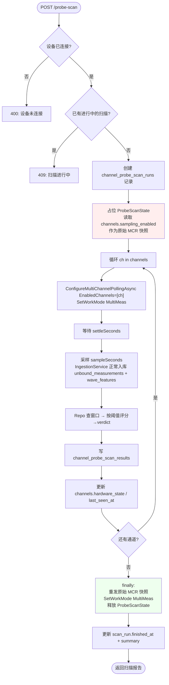
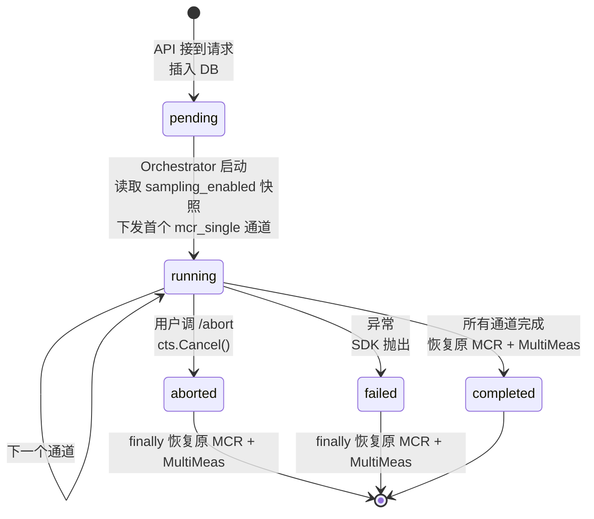

# 通道自动检测（Probe Scan）设计

> 状态：**已实现并真机验证**（2026-05-27）。代码见 `src/BoltPreload.Application/Devices/ProbeScan/`、`src/BoltPreload.Infrastructure/Devices/ProbeScan/`、`src/BoltPreload.Api/Endpoints/ProbeScanEndpoints.cs`、`src/BoltPreload.Api/wwwroot/probe-scan.html`。  
> 目的：在现场不知道探头插在哪几个物理通道的情况下，由系统自动识别“哪些通道接了探头、信号质量如何”，输出供运维人工绑定的清单。**不自动绑定 bolt**。

---

## 0. 设计前提（必须先认清）

| # | 事实 | 来源 | 设计含义 |
|---|---|---|---|
| F1 | 厂家设备只测“当前被选中的通道”；软件选 2，则物理插在 1 的探头不会有数据 | 现场实测 + 用户口述（2026-05-26 11:31） | 不能一次性 `EnabledChannels=[1..40]` 当作自动检测依据，必须**逐通道选通** |
| F2 | ~~SDK 支持 `FxWorkMode.SingleMeas`，接受 `channel` 参数~~ **修正**：model=3 多通道设备的 `SingleMeas` 是**单次测量**，命令下发后只回 1 条结果就停，不循环上报 | `src/BoltPreload.Fx/IFxConnector.cs` L37、真机实测 2026-05-27 | 不能用 `SingleMeas` 做持续采样窗口。改用 `MCRConfig.EnabledChannels=[ch]` 单元素 + `MultiMeas` 模拟单通道连续上报，即 `mcr_single` 策略 |
| F3 | Watchdog 默认 60s 无 `ChannelResult` 自动重连并 `SetWorkMode(MultiMeas)` | `src/BoltPreload.Application/Ingestion/IngestionWatchdogService.cs` L97–119 | 扫描期间**必须暂停 Watchdog**，否则单通道无信号超过 60s 会被强制拉回 MultiMeas，扫描被打断 |
| F4 | `IngestionService.RunRuntimeAsync` 启动时强制 `SetWorkMode(MultiMeas)` | `src/BoltPreload.Application/Ingestion/IngestionService.cs` L59 | 扫描必须在 Ingestion 启动**之后**触发；扫描结束必须恢复 MultiMeas，否则业务停摆 |
| F5 | `channels.hardware_state` / `business_state` / `sampling_enabled` 已在 schema 中（0012） | `deploy/sql/0012_multichannel_model.sql` | 扫描结果直接写 `hardware_state`，不需要新加字段 |
| F6 | 未绑定通道的 `ChannelResult` 已经会进 `unbound_measurements` + `wave_features` | 已实现（0012 + LocalFileWaveStore） | 扫描期产生的波形会自动入库，无需新增写库路径 |
| F7 | 同一时刻一个连接器只能跑一种工作模式 | 厂家协议（MultiChIotProtocolHandler.EncodeWorkMode） | 扫描期 = 业务测量停摆；这是不可避免的代价，必须在 UI/接口里告知用户 |
| F8 | `mcr_single` 策略每次只把单通道写进 `MCRConfig.EnabledChannels`，**修改了设备端持久状态** | 真机实测 2026-05-27（扫完后业务监测停摆，只跑最后扫描的通道） | 扫描完成的 finally 必须**重新下发原始 MCR 通道集 + SetWorkMode(MultiMeas)**，否则业务监测无法自动恢复 |
| F9 | `channels` 表加了 `name` 字段（物理位置标签） | `deploy/sql/0014_channel_name.sql` | 扫描结果通过 LEFT JOIN 当前 `channels.name`，**不存历史副本**——改名后所有历史扫描自动显示最新名 |

---

## 1. 用户场景

```text
1. 运维到现场，插了 N 个探头到设备物理口，编号未知；
2. 在 UI 点 "自动检测"；
3. 系统切到扫描模式，逐通道选通、采样、评分（预计 5–8 分钟）；
4. 完成后给出报告：哪些口有信号、信号质量如何；
5. 运维对照清单，把每个有信号的物理通道绑定到对应 bolt；
6. 系统恢复 MultiMeas 业务监测。
```

**不在本期范围**：

- 自动绑定 bolt（探头编号 → 螺栓 ID 的映射只能人工确认）；
- 多台设备并发扫描（Phase 1 一次只允许一台设备扫描）；
- 扫描期间继续业务监测（设备物理不支持，不要尝试）。

---

## 2. 核心流程



**关键不变量**：

1. `E` 与 `N` 必须成对出现，包在 try/finally 里。`N` 失败不能让 ProbeScanState 永久占位、不能让设备停在错误 MCR / WorkMode。
2. **finally 的恢复用 `CancellationToken.None`**：用户 abort 不能把恢复操作也取消掉，否则 mcr_single 策略会把设备停在“只跑最后扫描通道”的脏状态。
3. 扫描期 `Watchdog.CheckRuntimeAsync` 先检查 `ProbeScanState.IsRunning(deviceId)`，是就 `return`，不重连不切模式 —— 否则 60s 单通道无信号会触发强制 `MultiMeas` 重连，扫描被打断。
4. 扫描期 `IngestionService` 的 `await foreach (var envelope in connector.Results)` 继续消费 MCR 单通道上来的数据，这是好事——波形和测量值正常入库（落到 `unbound_measurements + wave_features`），扫描器**不直接订阅 connector.Results**，只查这两张表的窗口聚合。这样不会和入库主路径抢消费。
5. 写结果用 `CancellationToken.None`：用户在最后一刻 abort 也要把已扫到的部分落库。

---

## 3. 采样窗口取值依据

| 参数 | 默认值 | 依据 |
|---|---:|---|
| `settleSeconds` | 3 | 切换 MCR 单通道后第一两包数据可能是上一个通道的尾包；3 秒经验值 |
| `sampleSeconds` | 8 | 设备 `SingleCount=1` 时多通道上报频率约 10 Hz，8 秒 ≈ 80 个 ChannelResult，够算 SNR 和 EchoTime 标准差 |
| `minSamples` | 20 | 少于 20 条不足以分辨 `active_weak` 与 `active_no_echo`，直接判 `inconclusive` |
| `defaultStrategy` | `mcr_single` | model=3 真机上 `SingleMeas` 不连续（见 F2）；`mcr_single` 是该型号唯一可用策略 |
| 单通道总耗时 | ~11 s | 3 + 8 |
| 扫 1–40 总耗时 | ~7.5 min | 40 × 11 s |
| 扫 1–10 总耗时 | ~110 s | 适合现场快速验证 |

> 总耗时是“业务监测中断时长”，必须在 API 文档和 UI 提示里写明。

---

## 4. 判定规则

针对每个被扫通道，统计这段采样窗口内的：

- `n` = 收到的 `ChannelResult` 条数
- `nWithEcho` = `EchoTime IS NOT NULL` 的条数
- `echoRate` = `nWithEcho / n`
- `echoAvgNs` / `echoStdNs` = `EchoTime` 的均值与样本标准差
- `peakToPeakAvg` = 当窗口内有 `wave_features` 时取均值，否则 NULL
- `snrAvgDb` = 当窗口内有 `wave_features` 时取均值，否则 NULL

判定（**配置在 appsettings**，下表是默认值）：

| verdict | 条件 |
|---|---|
| `inconclusive` | `n < minSamples` |
| `not_reporting` | `n == 0` |
| `active_no_echo` | `n ≥ minSamples` 且 `echoRate < 0.5` |
| `active_weak` | `echoRate ≥ 0.5` 且 (`snrAvgDb < snrGoodDb` 或 `echoStdNs > echoStdGoodNs` 或 `peakToPeakAvg < peakToPeakMin`) |
| `active_good` | `echoRate ≥ 0.95` 且 `snrAvgDb ≥ 20 dB` 且 `echoStdNs ≤ 5 ns` 且 `peakToPeakAvg ≥ 600` |

> 阈值 20 dB / 5 ns / 600 来自 `docs/lab-torque-step-report-2026-05-22.md` 实验室验证的“健康通道”基线，不是拍脑袋。

`hardware_state` 同步映射规则：

| verdict | → `channels.hardware_state` |
|---|---|
| `active_good` | `healthy` |
| `active_weak` | `noisy` |
| `active_no_echo` | `suspect` |
| `not_reporting` | `no_data` |
| `inconclusive` | 不更新（保留旧值） |

---

## 5. 数据模型

新增两张表 + `channels.name` 字段。最终落地的 schema（与 `deploy/sql/0013_channel_probe_scan.sql` 和 `0014_channel_name.sql` 一致）：

```sql
-- deploy/sql/0013_channel_probe_scan.sql

CREATE TABLE IF NOT EXISTS channel_probe_scan_runs (
    id                  bigint GENERATED ALWAYS AS IDENTITY PRIMARY KEY,
    device_id           bigint NOT NULL REFERENCES devices(id),
    requested_by        bigint REFERENCES users(id),
    requested_at        timestamptz NOT NULL DEFAULT now(),
    started_at          timestamptz,
    finished_at         timestamptz,
    status              varchar(16) NOT NULL DEFAULT 'pending',
    strategy            varchar(32) NOT NULL DEFAULT 'single_meas',
    requested_channels  smallint[] NOT NULL,
    settle_seconds      smallint NOT NULL,
    sample_seconds      smallint NOT NULL,
    thresholds_jsonb    jsonb NOT NULL,
    summary_jsonb       jsonb,
    error_message       text,
    CHECK (status IN ('pending','running','completed','failed','aborted')),
    CHECK (strategy IN ('single_meas','mcr_single')),
    CHECK (settle_seconds BETWEEN 0 AND 30),
    CHECK (sample_seconds BETWEEN 1 AND 60)
);

CREATE INDEX IF NOT EXISTS idx_probe_scan_runs_device
    ON channel_probe_scan_runs(device_id, requested_at DESC);

-- 部分索引：方便 FindOpenRunAsync 快速拦截重复发起
CREATE INDEX IF NOT EXISTS idx_probe_scan_runs_open
    ON channel_probe_scan_runs(device_id)
    WHERE status IN ('pending','running');

CREATE TABLE IF NOT EXISTS channel_probe_scan_results (
    id                  bigint GENERATED ALWAYS AS IDENTITY PRIMARY KEY,
    scan_run_id         bigint NOT NULL REFERENCES channel_probe_scan_runs(id) ON DELETE CASCADE,
    channel_no          smallint NOT NULL,
    channel_id          bigint REFERENCES channels(id),
    verdict             varchar(24) NOT NULL,
    samples             int NOT NULL DEFAULT 0,
    samples_with_echo   int NOT NULL DEFAULT 0,
    echo_rate_pct       numeric(5,2),
    echo_avg_ns         numeric(12,2),
    echo_std_ns         numeric(12,3),
    peak_to_peak_avg    numeric(10,1),
    snr_avg_db          numeric(6,2),
    bound_bolt_code     varchar(64),
    started_at          timestamptz NOT NULL,
    finished_at         timestamptz NOT NULL,
    CHECK (verdict IN ('active_good','active_weak','active_no_echo','not_reporting','inconclusive'))
);

-- 一次扫描同一通道只能写一行（用 upsert 保证幂等）
CREATE UNIQUE INDEX IF NOT EXISTS ux_probe_scan_results_run_channel
    ON channel_probe_scan_results(scan_run_id, channel_no);

-- deploy/sql/0014_channel_name.sql
ALTER TABLE channels
    ADD COLUMN IF NOT EXISTS name varchar(64);
CREATE INDEX IF NOT EXISTS idx_channels_name
    ON channels(name) WHERE name IS NOT NULL AND deleted_at IS NULL;
```

**设计决定**：

- **为什么不复用 `unbound_measurements`**：那是时序表，会被压缩/归档；扫描报告是一次性诊断快照，需永久保留供溯源。
- **`channels.name` 不存历史副本**：扫描结果通过 LEFT JOIN 当前 `channels.name` 显示。改名后所有历史扫描立刻显示最新名 —— 运维不会看到一个螺栓位置在不同时间扫描里有不同名字。
- **`channel_id` 在 `channel_probe_scan_results` 是 nullable**：扫描时若该 channel 行已被删除（虚拟数据/迁移场景），结果还是要落库，channel_id 写 NULL 即可。channel_no 是真实保留的硬件标识。

---

## 6. API 设计

所有接口都要求 `WriteAccess` 授权（扫描会中断业务监测，不能让任何 ReadOnly 触发）。

### 6.1 启动扫描

```http
POST /api/devices/{deviceId}/channels/probe-scan
Authorization: Bearer <token>
Content-Type: application/json

{
  "channels": [1,2,3,4,5,6,7,8,9,10],  // 不传则默认 1..40
  "settleSeconds": 3,
  "sampleSeconds": 8,
  "strategy": "mcr_single",             // 可选，默认从 appsettings ProbeScan.DefaultStrategy 取
  "minSamples": 20,                     // 以下阈值可选，不传走 appsettings 默认
  "snrGoodDb": 20,
  "echoStdGoodNs": 5,
  "peakToPeakMin": 600
}
```

响应（**异步语义**，立即返回 scan_run_id，不阻塞 HTTP）：

```json
{
  "scanRunId": 42,
  "deviceId": 1,
  "status": "running",
  "requestedChannels": [1,2,3,4,5,6,7,8,9,10],
  "estimatedSeconds": 110,
  "startedAt": "2026-05-26T06:30:00Z",
  "warning": "扫描期间设备业务监测会中断，预计 110 秒"
}
```

错误：

- `400` — 设备未连接 / channels 为空 / 通道号超出 device.channel_count
- `409` — 该设备已有进行中的扫描（`status IN ('pending','running')`）
- `503` — 当前没有 IFxConnector 可用

### 6.2 查询扫描状态/报告

```http
GET /api/devices/{deviceId}/channels/probe-scan/{scanRunId}
```

响应：

```json
{
  "scanRunId": 42,
  "deviceId": 1,
  "status": "completed",
  "startedAt": "2026-05-26T06:30:00Z",
  "finishedAt": "2026-05-26T06:31:50Z",
  "summary": {
    "activeGood": 5,
    "activeWeak": 1,
    "activeNoEcho": 0,
    "notReporting": 4,
    "inconclusive": 0
  },
  "results": [
    {
      "channelNo": 8, "name": "塔筒法兰-北侧主螺栓",
      "verdict": "active_good",
      "samples": 80, "samplesWithEcho": 80, "echoRatePct": 100,
      "echoAvgNs": 32276.40, "echoStdNs": 1.43,
      "peakToPeakAvg": 1289.4, "snrAvgDb": 24.78,
      "boundBoltCode": "M20-001"
    },
    {
      "channelNo": 10, "name": null,
      "verdict": "active_no_echo",
      "samples": 50, "samplesWithEcho": 0,
      "boundBoltCode": null
    }
    // ... 其余通道
  ]
}
```

`status=running` 时 `results` 字段返回**已完成部分**，前端可轮询渲染进度条。`name` 字段每次查询时 LEFT JOIN 当前 `channels.name`，改名后立刻在所有历史扫描里反映。

### 6.3 中止扫描

```http
POST /api/devices/{deviceId}/channels/probe-scan/{scanRunId}/abort
```

把 `status` 置为 `aborted`，立刻跳出循环，进入 `finally` 恢复 MultiMeas + Watchdog。

### 6.4 最近一次扫描（便捷接口）

```http
GET /api/devices/{deviceId}/channels/probe-scan/latest
```

直接返回该设备最后一条 `channel_probe_scan_runs` 的详情，前端首屏用。

### 6.5 通道命名（独立 endpoint）

```http
GET   /api/devices/{deviceId}/channels                       # 通道列表（含 name + hw_state + 当前 bolt）
PATCH /api/devices/{deviceId}/channels/{channelNo}/name      # 设置/清除通道位置名
```

`PATCH` body `{ "name": "塔筒法兰-北侧主螺栓" }`，空字符串或 null 表示清除。改名走 `IChannelResolver.Invalidate` 让缓存失效。

---

## 7. 代码组织

实际落地的文件结构：

```text
src/BoltPreload.Application/Devices/ProbeScan/
├── ProbeScanOptions.cs              # appsettings 绑定（默认阈值、默认策略 mcr_single）
├── ProbeScanState.cs                # 进程内单例：当前正在跑的扫描 + Watchdog 跳过判断
├── ProbeScanResultJudge.cs          # 纯函数：评分规则 + verdict→hardware_state 映射
├── ProbeScanModels.cs               # Request / View / Slot / Repo 接口
└── ProbeScanOrchestrator.cs         # 主流程；finally 用 CancellationToken.None 恢复 MCR + MultiMeas

src/BoltPreload.Infrastructure/Devices/ProbeScan/
└── PostgresProbeScanRepository.cs   # CRUD + 窗口聚合（measurements ∪ unbound_measurements ∪ wave_features）+ LEFT JOIN channels.name

src/BoltPreload.Application/Ingestion/
└── IngestionWatchdogService.cs       # 注入 ProbeScanState，扫描中跳过该设备

src/BoltPreload.Api/Endpoints/
├── ProbeScanEndpoints.cs             # 4 个 API：启动/查询/最近/中止
├── ChannelEndpoints.cs               # 通道列表 + 改名 PATCH
└── DiagnosticEndpoints.cs            # configure-multichannel-polling / set-mode / recalibrate
                                       # 三处都加了 ProbeScanState.IsRunning 检查，409 拒绝并发

src/BoltPreload.Api/wwwroot/
└── probe-scan.html                   # 浏览器演示页：登录 / 启动扫描 / 进度 / 表格 / 点格改名

deploy/sql/
├── 0013_channel_probe_scan.sql       # 两张表
└── 0014_channel_name.sql             # channels.name 字段

```

### 7.1 暂停 Watchdog 的实现

不需要给 `IFxConnector` 加 `Pause/Resume` —— 那会污染抽象。**在 `IngestionWatchdogService` 里读 `ProbeScanState`**：

```csharp
private async Task CheckRuntimeAsync(DeviceRuntimeContext runtime, CancellationToken ct)
{
    // 扫描期间该设备由 ProbeScanOrchestrator 独占工作模式，
    // Watchdog 完全跳过它（包括重连），扫描结束后下一个 tick 自然恢复。
    if (_probeScanState.IsRunning(runtime.DeviceId))
        return;

    // ...原有逻辑
}
```

`ProbeScanState` 是 DI singleton，内部一个 `ConcurrentDictionary<long, ScanRunHandle>`。

### 7.2 防并发

```csharp
public sealed class ProbeScanState
{
    private readonly ConcurrentDictionary<long, ScanRunHandle> _running = new();

    public ScanRunHandle? TryBegin(long deviceId, long scanRunId, CancellationTokenSource cts)
    {
        var handle = new ScanRunHandle(scanRunId, cts);
        return _running.TryAdd(deviceId, handle) ? handle : null;
    }
    public bool IsRunning(long deviceId) => _running.ContainsKey(deviceId);
    public void End(long deviceId) => _running.TryRemove(deviceId, out _);
    public bool TryAbort(long deviceId)
    {
        if (!_running.TryGetValue(deviceId, out var h)) return false;
        h.Cts.Cancel();
        return true;
    }
}
```

API 启动扫描时 `TryBegin`，返回 null 就 409。

### 7.3 主流程骨架（最终实现）

```csharp
public async Task RunInternalAsync(ProbeScanRequest req, long runId, CancellationToken ct)
{
    var connector = _deviceManager.Find(req.DeviceId)!.Connector;
    var address = ...;
    const FxWorkMode originalMode = FxWorkMode.MultiMeas;

    // 关键：扫描前快照 sampling_enabled=true 的通道。mcr_single 策略每次只下发单通道
    // 进 MCRConfig.EnabledChannels，扫完必须恢复这份快照，否则业务监测只跑最后一个扫描通道。
    var originalEnabledChannels = await _repo.LoadEnabledChannelsAsync(req.DeviceId, ct);

    try
    {
        await _repo.MarkRunningAsync(runId, DateTimeOffset.UtcNow, ct);
        foreach (var ch in req.Channels)
        {
            if (ct.IsCancellationRequested) { aborted = true; break; }
            var slot = await ScanOneChannelAsync(connector, address, req, ch, ct);
            // 写库用 CancellationToken.None：abort 也要把已扫部分落库
            await _repo.SaveResultAsync(runId, req.DeviceId, slot, CancellationToken.None);
            await _repo.UpdateChannelHardwareStateAsync(
                req.DeviceId, ch, slot.Verdict, slot.FinishedAt, CancellationToken.None);
        }
    }
    catch (Exception ex) { failure = ex; }
    finally
    {
        // 全部恢复操作用 CancellationToken.None
        try
        {
            if (req.Strategy == "mcr_single" && originalEnabledChannels.Count > 0)
            {
                await connector.ConfigureMultiChannelPollingAsync(
                    originalEnabledChannels, singleCount: 1, dailyCount: 0,
                    cancellationToken: CancellationToken.None);
            }
            await connector.SetWorkModeAsync(originalMode, 0, address, CancellationToken.None);
        }
        catch (Exception ex) { _logger.LogError(ex, "恢复失败 — Watchdog 接管"); }

        _state.End(req.DeviceId);
        // 三个终态在同一 finally 收尾
        if (failure is not null) await _repo.MarkFailedAsync(...);
        else if (aborted)        await _repo.MarkAbortedAsync(...);
        else                     await _repo.MarkCompletedAsync(...);
    }
}

private async Task<ProbeScanResultSlot> ScanOneChannelAsync(
    IFxConnector connector, ushort address, ProbeScanRequest req, ushort channel, CancellationToken ct)
{
    if (req.Strategy == "mcr_single")
    {
        // 每次只启用单通道。设备在 MultiMeas 下连续上报该通道
        await connector.ConfigureMultiChannelPollingAsync(
            new[] { channel }, singleCount: 1, dailyCount: 0, cancellationToken: ct);
        await connector.SetWorkModeAsync(FxWorkMode.MultiMeas, 0, address, ct);
    }
    else // single_meas — 见 F2，model=3 上不可用
    {
        await connector.SetWorkModeAsync(FxWorkMode.SingleMeas, channel, address, ct);
    }

    await Task.Delay(TimeSpan.FromSeconds(req.SettleSeconds), ct);

    var sampleStart = DateTimeOffset.UtcNow;
    await Task.Delay(TimeSpan.FromSeconds(req.SampleSeconds), ct);
    var sampleEnd = DateTimeOffset.UtcNow;

    // 扫描器不订阅 connector.Results，避免和 IngestionService 抢消费。
    // 数据由 IngestionService → MeasurementSink/WaveStore 正常落库到
    // measurements/unbound_measurements/wave_features，扫描器只查这个时间窗口的聚合。
    var stats = await _repo.LoadWindowStatsAsync(req.DeviceId, channel, sampleStart, sampleEnd, ct);
    var verdict = ProbeScanResultJudge.Judge(stats, req.Thresholds);
    return new ProbeScanResultSlot(channel, verdict, stats, sampleStart, sampleEnd);
}
```

### 7.4 长任务执行方式

API 接到请求 → 立刻插入 `channel_probe_scan_runs (status=pending)` → 启动 `Task.Run` 后台跑 `ProbeScanOrchestrator.RunAsync` → HTTP 立刻返回 `scanRunId`。

**不要让 HTTP 持续 7 分钟**：

- 容易被反向代理超时；
- 客户端断开会导致 ct 取消，触发 abort；
- 没法做进度查询。

Phase 1 直接 `Task.Run` 就行，不需要引入 Hangfire / Quartz。进程崩溃了，下次启动时 `ProbeScanState` 是空的，但 DB 里残留 `status=running` 的脏记录 —— 启动时清理：

```sql
-- 启动时执行：把所有 running/pending 的扫描标为 failed
UPDATE channel_probe_scan_runs
   SET status = 'failed',
       finished_at = COALESCE(finished_at, now()),
       error_message = 'API restarted while scan was running'
 WHERE status IN ('running','pending');
```

---

## 8. 状态机



`finally` 是唯一的恢复入口，三个终态共用：“**重发原始 MCR 通道集 + SetWorkMode(MultiMeas)**”（均用 `CancellationToken.None`）。

---

## 9. 风险与规避

| # | 风险 | 规避 | 状态 |
|---|---|---|---|
| R1 | 扫描中 API 进程崩了，设备停在错误 MCR / WorkMode | 启动时清理 `pending/running` 脏 run；Watchdog 60s 无数据时 `ProbeScanState` 已空，会自动重连 + MultiMeas（但 MCR 仍是脏的，要靠下次正常下发恢复，已写在 troubleshooting） | 已实现 |
| R2 | 扫描期间 Watchdog 还在跑、强制切回 MultiMeas | 已在 7.1 跳过：`if (_probeScanState.IsRunning(deviceId)) return;` | 已实现 |
| R3 | 用户在扫描中调其他 Diagnostic API（如 `/configure-multichannel-polling`、`/set-mode`、`/recalibrate`）冲突 | 所有写 WorkMode/MCRConfig/RefTime 的 endpoint 加同一个 `ProbeScanState.IsRunning` 检查，409 拒绝 | 已实现 |
| ~~R4~~ | ~~`SingleMeas` 在某些固件版本不稳定~~ | **2026-05-27 现场实测确认**：model=3 多通道设备的 `SingleMeas` 是单次测量，扫描全 `inconclusive`。默认策略改为 `mcr_single`，`single_meas` 选项保留给未来其他型号设备 | 已实现 |
| R5 | 扫描中断业务监测 7 分钟，业主不可接受 | API 响应里返回 `estimatedSeconds` + `warning` 字段；UI 显式提示；`channels` 参数允许只扫小范围（如怀疑的 1-10，约 110 秒） | 已实现 |
| R6 | 阈值（SNR 20 / Std 5 ns）在某些低频探头偏严 | 阈值进 `appsettings ProbeScan.*` + 请求体可覆盖 | 已实现 |
| R7 | 扫描结果误导用户绑定到错探头 | 报告里**不自动绑定**，仅显示 verdict + boundBoltCode（既有绑定）；运维通过单独的 `POST /api/channels/{id}/bind` 显式绑定 | 已实现 |
| R8 | `mcr_single` 扫完忘了恢复原 MCR，业务监测只跑最后一个扫描通道（2026-05-27 实际发生过的 bug） | finally 里先 `ConfigureMultiChannelPollingAsync(originalEnabledChannels)`，再 `SetWorkMode(MultiMeas)`；用 `CancellationToken.None` 不能跟着 abort 一起取消 | 已修复（新增测试 `RunAsync_McrSingleStrategy_RestoresOriginalMcrAndMultiMeas`） |

---

## 10. 验收

1. **单元测试** `ProbeScanResultJudge`：5 种 verdict + 边界条件 + `ToHardwareState` 映射，**10 条**
2. **进程内并发** `ProbeScanState`：占位/重入/释放/abort，**7 条**
3. **Orchestrator 不变量**（用 FakeConnector + FakeRepository）：
   - 正常完成：每通道收到 mode 调用，最后必为 MultiMeas
   - abort 中途也必须恢复 MultiMeas
   - `mcr_single` 策略：最后一次 MCR 必为原始通道集
   - 已有 open run 时抛 `ProbeScanConflictException`
4. **真机现场实测**（2026-05-27）：
   - 扫 1-10，mcr_single 策略 → 5/6/7/8 出现 `active_good`/`active_weak`/`active_no_echo` 区分清晰
   - 扫描完成 15s 内业务监测恢复（1-40 通道再次正常上报）
   - 在扫描期间发 `POST /set-mode` → 409 拒绝
5. **并发拒绝**：连续两次 `POST /probe-scan`，第二次 409
6. **改名 LEFT JOIN**：8 号改名后立刻在已完成扫描的 `results[8].name` 出现

测试合计 38/38 全绿（2026-05-27 13:14 UTC）。

---

## 11. 不做的事（明确划界）

- **不做自动绑定 bolt**。即使某通道 `active_good` 且 `boundBoltCode` 为空，系统也只在报告里显示“未绑定”，不直接写 `bolts.channel_id`。
- **不做多设备并发扫描**。Phase 1 假设一台设备；多设备时排队 / 排序由调用方负责。
- **不持久化原始波形到扫描结果表**。波形已经被 `LocalFileWaveStore` 在常规链路写过了，扫描器只统计 `wave_features` 的聚合。
- **不动 `measurements` / `unbound_measurements` 写库逻辑**。扫描期间数据通过 IngestionService 正常入库；扫描器只读统计这两张表。
- **不锁住扫描结果里的 `name`**。`channels.name` 改了，所有历史扫描的展示同时更新。这是有意为之，避免一个物理位置在不同时间扫描里有不同名字。

---

## 12. 实际落实顺序（已完成）

| 步骤 | 提交时间 | 内容 |
|---|---|---|
| 1 | 2026-05-26 14:00 | 设计文档稿（本文档） |
| 2 | 2026-05-26 22:00 | SQL 0013 + ProbeScanState/Options/Judge/Repository/Orchestrator/Endpoints + 24 条新单测 |
| 3 | 2026-05-27 09:30 | **重标定 endpoint 加 ProbeScanState 锁** + `wwwroot/probe-scan.html` 浏览器演示页 |
| 4 | 2026-05-27 10:10 | **真机端到端验证**，发现 `SingleMeas` 不连续上报问题 → 切到 `mcr_single` 默认策略 |
| 5 | 2026-05-27 10:15 | **修复**：mcr_single 策略 finally 必须重发原始 MCR 通道集（之前业务监测被打断） + 新增对应测试 |
| 6 | 2026-05-27 13:30 | SQL 0014 channels.name + ChannelEndpoints（列表 + 改名 PATCH）+ probe-scan.html 加 "名称" 列点击改名 |
| 7 | 2026-05-27 17:30 | 设计文档同步到代码现状（本次） |

合计：纯后端约 1.5 工作日，前端 0.5 工作日，与原估算吻合。**最大坑**是 `SingleMeas` 在 model=3 真机上不连续上报，这只有现场实测才能发现；好处是 `mcr_single` 退路在文档第一稿已经规划，没有返工。

## 13. 后续追查项

- **3 号通道异常**：scanRunId=7 显示已绑定 M16-003 但 `not_reporting`。可能那次扫描时探头连接松了、或被前一次扫描的 SetWorkMode 残留状态影响。单独 `POST /probe-scan {"channels":[3]}` 复测确认。
- **dashboard.html 集成**：当前 probe-scan 入口在独立页面，建议主 dashboard 顶部加一个 "扫描通道" 快捷按钮 + 最近扫描状态徽章。
- **`bolts.position_label` vs `channels.name` 关系**：现有 `bolts` 表已有 `position_label`（"塔筒-北 #3"），新加的 `channels.name` 也是位置标签。两者语义有重叠 — 建议长期 `channels.name = 物理插口的固定标签`、`bolts.position_label = 螺栓本身的逻辑位置`（同一插口换装不同螺栓时 position_label 可变）。当前没有强一致约束，靠人工。
