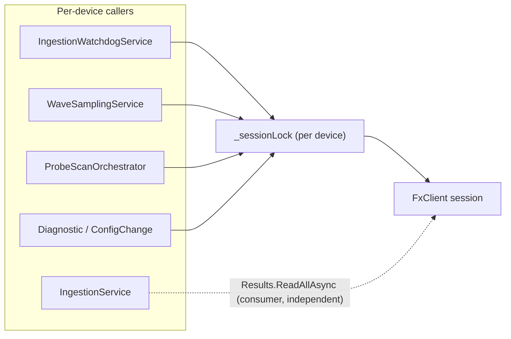

# 并发模型与跨模块的硬约定

这是个 7×24 跑着的监测服务，后台服务一堆，设备 I/O 和写库同时在跑。设备会话要串行、
后台服务之间不能打架、软删的行不能混进统计——这些约定原来只存在于写代码的人脑子里，
这里写下来。动到这几块之前先看一遍。

## 1. 同一台设备的会话命令必须串行

**契约**：同一设备连接器上，所有"会话级"操作（连接/断开 + 下发命令）互斥串行执行。

- 实现：[src/BoltPreload.Fx/FxSdkConnector.cs](../../src/BoltPreload.Fx/FxSdkConnector.cs) 用单把 `_sessionLock`（`SemaphoreSlim(1,1)`）
  串行化 `ConnectAsync` / `DisconnectAsync`、**连接建立后的会话 provisioning**（`OnSdkConnectedAsync`）以及所有下发命令：
  `SetWorkModeAsync` / `ReadDeviceParamAsync` / `ReadChannelParamAsync` / `ConfigureMultiChannelPollingAsync` /
  `ConfigureChannelAsync` / `RecalibrateChannelAsync`。
- 原因：这些命令都用 `_sessionId` 调 SDK。若不串行，`ReconnectAsync` 把 `_sessionId` 置空/换新会话的瞬间，
  并发命令可能读到过期会话（看门狗重连 + 波形采样 + 通道扫描会在同一设备会话上交错）。
- **Provisioning 也在锁内**：`OnSdkConnectedAsync` 由 SDK 的 OnConnected 事件以 fire-and-forget（线程池）触发，会写 `_sessionId`
  并向 SessionContext 注入 Device/Channel 配置（`ConfigureDeviceAsync`/`ConfigureChannelAsync`，`sendCommand:false`）——这同样是
  会话级写操作，须与命令/重连串行，否则开机/重连瞬间的命令会与 provisioning 在同一 session 上交错。`State=Connected` 在
  provisioning 完成后于锁内置位（IngestionService 见 Connected 才发 SetWorkMode，避免注入未完成就采集导致 EchoTime=null）。
- 无重入：命令方法与 provisioning 内部都只调 `_client.*`（SDK），不回调本类的其它公开方法，故不会自锁。
  `ReconnectAsync` 也不自持锁，而是顺序调用各自持锁的 `DisconnectAsync` + `ConnectAsync`。

**调用方须知**：
- 单个命令是原子的；**跨多个命令的序列不是原子的**。需要"读回-判断-再写"这类原子序列时，
  应放进连接器内部的一个方法里（如 `RecalibrateChannelAsync` 在锁内完成 ReadChannelParam→整组写 RefTime）。
- **消费与下发相互独立**：`IngestionService` 持续 `connector.Results.ReadAllAsync` 消费测量，
  这条读路径**不走** `_sessionLock`，与命令下发互不阻塞。

## 2. 扫描期间这台设备归扫描独占

**契约**：一台设备在跑通道扫描（`ProbeScanOrchestrator`）期间，独占其工作模式；
其它按设备巡检的后台服务必须整机跳过该设备。

- 单一守卫：[src/BoltPreload.Application/Devices/ProbeScan/ProbeScanState.cs](../../src/BoltPreload.Application/Devices/ProbeScan/ProbeScanState.cs) 的 `IsRunning(deviceId)`。
- 三处调用方一致跳过：`IngestionWatchdogService`、`WaveSamplingService`、`SignalHealthService`
  （均在遍历设备/螺栓时 `if (probeScan.IsRunning(deviceId)) continue;`）。新增按设备的后台巡检必须沿用此守卫。
- 扫描生命周期不变量：`ProbeScanOrchestrator` 的主体用 `Task.Run(..., CancellationToken.None)` 调度，
  保证方法体一定执行、`finally` 一定 `_state.End(deviceId)`，即使在调度前一刻被 `TryAbort` 取消也不会永久卡 `IsRunning`。
  `mcr_single` 策略读取原始 MCR 快照失败时，在改动任何 MCR 之前直接失败（避免扫完只留最后一个通道）。

## 3. 看门狗什么时候才该重连

**契约**：连接断开、或"本次连接会话内"长时间无 `ChannelResult` 才重连；慢写库、扫描期不重连。

- 纯判定抽为可测方法 `IngestionWatchdogService.ShouldReconnect(...)`（单测见 `IngestionWatchdogDecisionTests`）：
  - `ProbeScanRunning` → 不重连；未连接 → 重连；`IsWriting`（消费者正卡在慢 DB 写）→ 不重连。
  - "无数据时长"按**本次连接起点**计（`_connectedSince`）：只有发生在本次连接之后的 `ChannelResult` 才算数据，
    连接前的旧时间戳不算——避免刚（重）连、还没出新数据时被误判无穷陈旧而重连风暴。
- `IsWriting` 由 `IIngestionRuntimeStatus.MarkWriteStart/End` 在 `IngestionService` 的 `WriteAsync` 前后置位。

## 4. 测试替身不承担并发契约

进程内仿真连接器已整体移除，`IFxConnector` 唯一的生产实现是 `FxSdkConnector`，其会话并发保证见第 1 节。

测试里的替身（`BoltPreload.Tests` 的 `FakeConnector`、`RawFrameReplay`）**不复刻**上面这些锁：
它们由单个测试方法独占驱动，不存在并发访问，因此也不能拿它们的行为去推断生产路径的线程安全。
凡是要验证会话锁、重连串行化这类并发契约的，必须针对 `FxSdkConnector` 或其纯判定方法写测试。

## 5. 软删掉的行不能混进任何统计

**契约**：所有健康/告警聚合都必须排除软删实体（`deleted_at IS NULL`）。

- 健康聚合的单一事实源：[src/BoltPreload.Api/Endpoints/AssetEndpoints.cs](../../src/BoltPreload.Api/Endpoints/AssetEndpoints.cs) 的 `BoltStatusCte`
  （对 channels / monitor_groups / turbines / bolts 均加 `deleted_at IS NULL`）。
- 跨切面 `open_alarms` 子查询（/projects、/turbines、/groups）与 `DashboardEndpoints` 的按 severity 计数
  也统一按 `bolts.deleted_at IS NULL` 过滤，与告警列表口径一致。
- 单实体详情查询（如某螺栓的 channel-config）可不强加通道级 deleted_at（不隐藏实体，仅 404），按需决定。

新增聚合请遵守：能软删的实体 + 未被上游过滤 → 加 `deleted_at IS NULL`；列表类若会"隐藏实体"，需显式决定是否改 LEFT JOIN 保留。

## 6. 标定从提交到失效的几条硬规矩

**契约**：通道当前"生效标定" = 该 bolt 上 `superseded_by IS NULL AND review_state IN ('approved','self_signed')` 的记录；
`pending` / `rejected` 一律不算生效。

- **生效口径统一**：标定中心 `active_count`、预测窗口"最近一次生效标定 `max(created_at)`"过滤均按此定义
  （[CalibrationEndpoints](../../src/BoltPreload.Api/Endpoints/CalibrationEndpoints.cs) / [BoltEndpoints](../../src/BoltPreload.Api/Endpoints/BoltEndpoints.cs) / [DashboardEndpoints](../../src/BoltPreload.Api/Endpoints/DashboardEndpoints.cs)）。
  `pending` 不得进入生效集，否则整定窗口/计数会被未会签的草稿污染。
- **有效期从【激活】起算**：正式载荷标定 `expires_at` 在会签（countersign）时按 `CURRENT_DATE + (expires_at - created_at::date)` 重锚，
  审核期不消耗有效期（久审后的标定不会一激活就临近过期）。
- **通道标定缓存随绑定关系清理**：unbind 与 move 的【源通道】都要清空 `k_l / k_l_uncertainty / k_l_intercept_ns / active_calibration_id`
  （[BoltBindingEndpoints](../../src/BoltPreload.Api/Endpoints/BoltBindingEndpoints.cs)），避免空通道仍显示 calibrated 或下次绑定误用旧 K_L。
- **状态机闭环**：`pending` 有两条出口——countersign（异人激活，写通道 + supersede 旧标定）或 reject（置 `rejected`，不激活、不动通道）；
  两条出口都写审计。四眼底线：countersign 会签人必须 ≠ 提交人。

## 7. 状态变更与审计同事务（§0 责任链不可断）

**契约**：任何"安全攸关的状态变更"与其审计留痕必须在**同一数据库事务**内提交，不允许"改了但没留痕"或"留痕了但没改"的半提交。

- 例：`configure-channel` 的变更请求写入 + 管理员免审批的 `config_change_approve` 审计条目现在同一 `conn/tx` 提交
  （[DiagnosticEndpoints](../../src/BoltPreload.Api/Endpoints/DiagnosticEndpoints.cs)）；标定会签/驳回、同步通道配置等均在各自事务内连同审计一并提交或回滚。
- 落盘副作用要能回滚：报告 HTML 落盘 + DB 记录，若 DB 失败要在 catch 内 `File.Delete` 清理孤儿文件（[ReportEndpoints](../../src/BoltPreload.Api/Endpoints/ReportEndpoints.cs)）。

## 8. 前端"几分钟前"这类显示要自己随时间走

**契约**：任何"距今多久"派生的 UI（陈旧/离线判定、"N 分钟前"、状态灯 `nodata`）必须依赖一个随时间前进的响应式 `now`，
不能用一次性的 `Date.now()`——否则无新数据时会永久卡在渲染时刻。

- 单一实现：[web/src/utils/useNow.ts](../../web/src/utils/useNow.ts) 的 `useNow(intervalMs)` 返回按间隔自增的 `now` ref。
- `computePreloadHealth(inp, nowMs)` / `fmtAgo(iso, nowMs)` 接受时间入参；`BoltDetail` / `AssetMonitor` / `Alarms` / `LivePreload`
  传入 `useNow()` 的值，使状态灯与相对时间随时间刷新。
- `LivePreload` 通道表只按"当前仍已标定"的 API 结果重建（剔除失标定/解绑通道，保留滚动序列），主图 cutoff 依赖 `now` 平滑左移。
- 数值净化：各视图 `num()` 统一挡住 `NaN/Infinity`（防脏值流进图表/计算）；路由 `boltId` 非数字直接报错返回，不用 `NaN` 发起请求。
