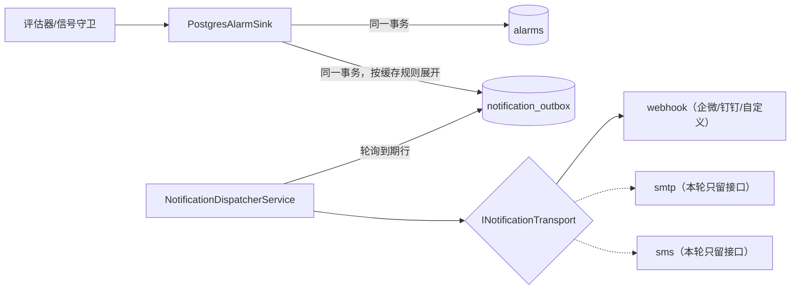

# 产品设计：缺失功能补齐（P0–P3）

> 状态：设计稿（2026-08-05）。已实施落地：P0-1 见 §2（0028 迁移 + 规则端点 + 前端规则页）、P0-2 见 §3（setup-https / register-backup-task 两脚本 + 手册两节，待 Windows 实机跑通）、P1-A 见 §4（0029 三表 + 事务性发件箱 + 派发/webhook + 通知页，真机联调列入交付验收）、P1-B 见 §5（supervisor 对账 + 设备 CRUD/容量热重估/连带清理，偏差记录在 §5.9）；P1-C 起待排。
> 定位：`commercialization-roadmap.md` 盘点了“已具备 / 仍不具备”；本文把“仍不具备”的部分逐项落成可实施的设计——改哪些文件、加什么表、挂哪个接缝、怎么验收。所有设计点写之前都逐条核过源码，引用的文件、表、配置键在当前代码库里真实存在。
> 相关：`delivery-master-plan.md`（交付验收清单）、`phase2-backlog.md`（技术债台账）、`probe-scan-design.md`（同类设计文档的先例）。

---

## 1. 现状与分期

### 1.1 已经硬的部分

主干链路经过交接前整备（见 `delivery-master-plan.md`），下列能力按“已交付”对待，本文不再重复设计：

- 采集：SDK 断线重连、坏帧重同步、WAL 落盘重放、背压降级、看门狗、探头热插拔自动建档、通道验收；
- 算法：GB/T 43232 单波法 + 温度补偿 + JJF 1059.1 不确定度合成，简化算法并行可选；
- 告警：静态阈值状态机（回差 + on/off-delay + 分级）、维护抑制（shelve）、信号丢失守卫、接线指纹守卫、WAL 重放补发 critical 的兜底；
- 平台：JWT + 角色 + License 容量执法、通道参数四步审批流、审计日志、报告签发与防篡改下载；
- 部署：账本式迁移（`deploy/windows/apply-migrations.ps1`）、Windows 服务脚本、备份/诊断脚本。

### 1.2 缺口的分布

不成熟的不是监测内核，是围绕内核的三圈：

1. **规模圈**——多设备“能跑”（`DeviceConnectorManager` 表驱动加载）但“不能管”：没有任何设备增删改端点，生产上加一台设备只能手工 SQL 插行再重启进程；
2. **专业工具圈**——载荷标定、波形诊断这两道决定数据可信度的工序，后端 API 齐了，缺现场工程师能独立操作的工作台；
3. **对外圈**——告警出不了站（值班的人不盯屏幕就收不到任何东西）、数据进不了客户 SCADA、软件装不进不通外网的工控机。

### 1.3 分期总览

| 批次 | 内容 | 解决什么问题 | 预估 |
|---|---|---|---|
| P0 交付硬化 | 告警阈值进库（§2）、HTTPS 定稿 + 备份计划任务（§3） | 阈值现场可调、改动可追溯 | 3–4 人天 |
| P1 商用第一版 | 告警出站通知（§4）、多设备生命周期（§5）、载荷标定中心（§6）、离线安装包（§7） | 卖得出去，客户自己装得起来、用得起来 | 约 28–30 人天 |
| P2 监测深度 | 波形诊断中心、趋势告警、Modbus 从站、定时报表（§8） | 长期用得住、接得进电场系统 | 立项时再细化 |
| P3 规模化 | 风场层级、性能物化、双波法、多站点汇聚（§9） | 卖得多 | 有订单再动 |

写作口径：P0/P1 给实施级设计（表 DDL 草案、端点清单、改动文件、验收标准），P2 给方案级概要，P3 只记方向——不为没排期的东西写空设计。

---

## 2. P0-1 告警阈值进库（已实施）

### 2.1 现状与问题

- 静态阈值八个参数全在 `src/BoltPreload.Api/appsettings.json` 的 `Alarm:StaticThreshold` 节：`TriggerLowRatio` 0.70、`ClearLowRatio` 0.72、`TriggerHighRatio` 1.10、`ClearHighRatio` 1.08、`TriggerConsecutive` 5、`ClearConsecutive` 10、`CriticalDeviation` 0.30、`PreloadLossRatio` 0.05。`StaticThresholdAlarmEvaluator` 经 IOptions 读取，进程起来后不再变。
- 全局一套，没有按法兰（监测组）或单螺栓的覆盖；只有分母 `bolts.target_preload_n` 是每颗螺栓自己的。
- 该配置节自己的注释写着“阈值/规则修改须可追溯至国标或现场标定”，但改 appsettings 既不留痕、也要重启才生效——和通道参数已经有四步审批流的定位不一致。

现实场景：主轴法兰和塔基法兰的报警限未必一样，客户合同也可能约定专门的限值；现场想把某组下限收紧 5%，现在的做法是改配置文件、重启 Windows 服务，审计里什么都不留。

### 2.2 数据模型

新表 `alarm_rules`，三级 scope，字段与 `StaticThresholdAlarmOptions` 一一对应：

```sql
CREATE TABLE alarm_rules (
    id                  bigint GENERATED ALWAYS AS IDENTITY PRIMARY KEY,
    scope               varchar(8)   NOT NULL,   -- 'global' / 'group' / 'bolt'
    group_id            bigint REFERENCES monitor_groups(id),
    bolt_id             bigint REFERENCES bolts(id),
    trigger_low_ratio   numeric(6,4) NOT NULL,
    clear_low_ratio     numeric(6,4) NOT NULL,
    trigger_high_ratio  numeric(6,4) NOT NULL,
    clear_high_ratio    numeric(6,4) NOT NULL,
    trigger_consecutive integer      NOT NULL,
    clear_consecutive   integer      NOT NULL,
    critical_deviation  numeric(6,4) NOT NULL,
    preload_loss_ratio  numeric(6,4) NOT NULL,
    reason              text NOT NULL,           -- 修改依据：国标条款/合同条款/标定记录编号，强制填
    review_state        varchar(16)  NOT NULL DEFAULT 'pending',  -- pending/active/rejected/superseded
    created_by          bigint NOT NULL REFERENCES users(id),
    created_at          timestamptz  NOT NULL DEFAULT now(),
    approved_by         bigint REFERENCES users(id),
    approved_at         timestamptz,
    CHECK (clear_low_ratio  > trigger_low_ratio),    -- 回差方向不许配反
    CHECK (clear_high_ratio < trigger_high_ratio),
    CHECK ((scope = 'global' AND group_id IS NULL     AND bolt_id IS NULL)
        OR (scope = 'group'  AND group_id IS NOT NULL AND bolt_id IS NULL)
        OR (scope = 'bolt'   AND bolt_id  IS NOT NULL AND group_id IS NULL))
);
-- 同一目标同时只允许一条生效规则
CREATE UNIQUE INDEX ux_alarm_rules_active_global ON alarm_rules((1))      WHERE review_state = 'active' AND scope = 'global';
CREATE UNIQUE INDEX ux_alarm_rules_active_group  ON alarm_rules(group_id) WHERE review_state = 'active' AND scope = 'group';
CREATE UNIQUE INDEX ux_alarm_rules_active_bolt   ON alarm_rules(bolt_id)  WHERE review_state = 'active' AND scope = 'bolt';
```

### 2.3 解析与缓存

- 生效顺序：bolt 覆盖 > group 覆盖 > global > appsettings 出厂兜底。表里一条规则都没有时行为与今天完全相同。
- 评估在测量热路径上（每条测量一次），不能查库：新增 `IAlarmRuleProvider`（Application 层）+ Postgres 实现（Infrastructure 层），整表快照进内存字典、30–60 秒刷新一次，批准/驳回时显式失效——规则总量最多几百条，不需要逐键缓存，做法比 `CachedChannelResolver` 还简单。
- `StaticThresholdAlarmEvaluator` 的状态机不动，只把“本次评估用哪组阈值”从构造期单例改为评估时按 boltId 向 provider 取。规则切换时 streak 计数保留、按新阈值继续判：语义等价于运行中调整阈值，不重置状态机，回差带保证边界不抖。

### 2.4 修改管控

两步异人复核，语义照抄标定的 `review_state`（提案 pending → 批准 active / 驳回 rejected；新 active 落地时同目标旧 active 置 superseded）。不复用通道参数那套四步流（`channel_config_change_requests` 含设备执行、读回验证两步，纯库内变更用不上）。批准人不得是提案人，校验口径与标定会签相同。全程写 `audit_log`，动作码登记进 `DisplayLabels.cs`（G7 门禁盯着）。

### 2.5 端点与前端

- `GET /api/alarm-rules`（LoggedIn）：全部规则含状态；`GET /api/bolts/{id}/effective-alarm-rule`：某颗螺栓的生效链（页面展示“该螺栓当前用哪套阈值、来自哪级”）。
- `POST /api/alarm-rules`（Reviewer）提案；`POST /api/alarm-rules/{id}/approve|reject`（Reviewer，异人）。
- 前端 `web/src/views/Alarms.vue` 加“规则”标签页：生效规则列表、提案表单、待审队列；`BoltDetail.vue` 显示生效阈值及其来源级别。

有意不做：`SignalHealth`、`WiringGuard` 的参数继续留在 appsettings——一站一套、不按螺栓差异化，进库只会多一层没人用的管理面。等真出现按组差异化的需求再挪。

### 2.6 验收与工作量

- 改组级阈值获批后 60 秒内生效，全程不重启进程；
- 提案人自批被后端拒绝（不只前端禁按钮）；
- 三级解析顺序、回差 CHECK、异人校验各有集成测试；
- 审计页与 CSV 导出上动作显示中文名。

工作量 2–3 人天（表 + provider + 端点 1.5 天，前端 1 天）。

---

## 3. P0-2 交付硬化小项（已实施）

### 3.1 HTTPS 定稿

部署形态是集控室/塔基工控机、纯局域网，公网证书拿不到。已按下述方案落地为
`deploy/windows/setup-https.ps1`（P1-D 安装器届时直接调它，不重写）：

- 自签服务器证书（带 SAN，默认 5 年）导入本机“受信任的根证书颁发机构”，Kestrel 节写进 `appsettings.Production.json`（pfx 路径与口令；口令由 collect-diagnostics 脱敏正则覆盖）；SignalR 随之走 wss。实施取舍：不养“自签 CA + 服务器证书”的小 PKI——单机部署多一层 CA 只多一个可弄丢的私钥，一张服务器证书直接进受信根即可。
- 客户自有 PKI 的场合直接替换 pfx，不改代码。
- 保留仅绑定 127.0.0.1 的 HTTP 端点做本机诊断（`curl` 健康检查、诊断脚本用），对外只开 HTTPS 端口。
- 落点：`setup-https.ps1` + `deployment-guide.md` §5。Windows 实机跑通一遍列在手册 §10。

### 3.2 备份计划任务

`deploy/windows/backup-postgres.ps1` 已能产出 `-F c` 格式备份，缺的只是没人定时跑。已落地：

- `register-backup-task.ps1` 注册每日 02:00 计划任务（SYSTEM 账户，`-RunNow` 当场验证一次）；`backup-postgres.ps1` 补了“保留最近 14 份、滚动删除”与“pg_dump 失败清掉半截文件”；
- 恢复演练步骤（Timescale pre/post_restore + `pg_restore` 到临时库 + 抽查行数）写进 `deployment-guide.md` §7.1——没演练过的备份不算备份。

---

## 4. P1-A 告警出站通知（已实施）

### 4.1 现状与问题

告警现在只有两个出口：SignalR 推给已打开的页面（`SignalRAlarmPublisher`）+ 页面提示音。夜里两点一颗螺栓 `preload_loss`，值班室没开着浏览器就等于什么都没发生。监测系统交付给客户，这是第一个会被问到的缺口。

### 4.2 为什么不挂在现成的 IAlarmPublisher 上

`IAlarmPublisher` 是内存接缝，约定实现不抛异常（`SignalHealthService.cs` 里调用处的注释写明了这一点），推完即忘：进程重启、网络抖动、对端限流，事件就没了。通知作为商用功能要求“落库的告警必然有对应的发送记录”，所以走事务性发件箱，不走内存接缝；SignalR 推送保持原样不动。

### 4.3 结构



改动核心在 `PostgresAlarmSink.PersistAsync`：从 `_dataSource.CreateCommand` 单条命令改为连接级事务——`INSERT INTO alarms ... RETURNING id`，随后按缓存的通知规则给每个命中渠道插一行 `notification_outbox`，一起提交。`PersistCriticalIfAbsentAsync`（WAL 重放补发 critical 的路径）同样处理：补发的告警恰恰是断网期间漏掉的，更要通知。失败整体回滚，维持现有“落库失败抛给调用方回滚状态机”的契约不变。

被 shelve 抑制的告警在评估器和 SignalHealth 里就不会走到 PersistAsync，发件箱天然不会收到，无需额外判断。

### 4.4 数据模型

```sql
CREATE TABLE notification_channels (
    id                   bigint GENERATED ALWAYS AS IDENTITY PRIMARY KEY,
    name                 varchar(64) NOT NULL UNIQUE,
    kind                 varchar(16) NOT NULL,     -- 'webhook'；'smtp'/'sms' 预留
    config_jsonb         jsonb NOT NULL,           -- webhook: {url, format, secret}；format: raw/wecom/dingtalk
    min_interval_seconds integer NOT NULL DEFAULT 60,   -- 渠道级限流：两次发送最小间隔
    enabled              boolean NOT NULL DEFAULT true,
    created_at           timestamptz NOT NULL DEFAULT now(),
    updated_at           timestamptz NOT NULL DEFAULT now()
);

CREATE TABLE notification_rules (
    id              bigint GENERATED ALWAYS AS IDENTITY PRIMARY KEY,
    channel_id      bigint NOT NULL REFERENCES notification_channels(id),
    min_severity    varchar(16) NOT NULL DEFAULT 'warn',   -- 该级别及以上才发；设 critical 则只发最高级
    alarm_types     text[],                                -- NULL = 全部类型
    group_id        bigint REFERENCES monitor_groups(id),  -- NULL = 全站
    notify_on_clear boolean NOT NULL DEFAULT false,        -- 恢复也通知
    quiet_start     time,                                  -- 本地时区静默窗；critical 无视静默
    quiet_end       time,
    enabled         boolean NOT NULL DEFAULT true
);

CREATE TABLE notification_outbox (
    id              bigint GENERATED ALWAYS AS IDENTITY PRIMARY KEY,
    alarm_id        bigint NOT NULL REFERENCES alarms(id),
    channel_id      bigint NOT NULL REFERENCES notification_channels(id),
    event_kind      varchar(8) NOT NULL,          -- 'trigger' / 'clear'
    payload_jsonb   jsonb NOT NULL,               -- 事件快照：螺栓/组/类型/级别/值/时间，发送时不回查业务表
    status          varchar(8) NOT NULL DEFAULT 'pending',   -- pending / sent / dead
    attempts        integer NOT NULL DEFAULT 0,
    next_attempt_at timestamptz NOT NULL DEFAULT now(),
    last_error      text,
    created_at      timestamptz NOT NULL DEFAULT now(),
    sent_at         timestamptz
);
CREATE INDEX idx_notification_outbox_due ON notification_outbox(next_attempt_at) WHERE status = 'pending';
```

规则匹配放在入队侧（规则由内存快照缓存提供，同 §2.3 的做法），发件箱一行就是“一个事件发给一个渠道”，重试互不牵连。规则没命中任何渠道就不插行，热路径零额外查询。

### 4.5 派发服务

`NotificationDispatcherService`（BackgroundService，注册进 `BackgroundServiceHealth` 心跳）：

- 每 5 秒取 `status = 'pending' AND next_attempt_at <= now()` 的行，按渠道分组；
- **风暴合并**：同一渠道本轮所有到期事件合成一条消息发出（设备掉线时 12 颗螺栓同时 `signal_lost`，收到的是一条 12 行的消息，不是 12 条轰炸），配合 `min_interval_seconds` 限流；
- 失败退避：1 → 5 → 15 → 60 分钟，第 6 次失败置 `dead` 并记 `last_error`，日志 Error 级；`dead` 行在管理页可见、可手工重发；
- 进程重启后 pending 行自然续跑，不丢。

### 4.6 渠道适配器

`INotificationTransport` 按 `kind` 分发。本轮只实现 webhook：POST JSON，`format` 字段决定报文形状——`raw`（通用 JSON，给客户自有系统对接）、`wecom`（企业微信群机器人 markdown）、`dingtalk`（钉钉机器人）。短信、SMTP 只定义接口不实现，等渠道定了再补（每个适配器预计 0.5–1 人天）。

消息内容用交付件的中文口径：组/螺栓、级别、评估器生成的中文 message（自带类型与数值）、触发时间；级别叫法与前端告警中心一致（严重/预警/提示）。`config_jsonb` 里的 secret 在 API 返回时抹掉（只回 hasSecret 布尔）。实施时核过：`collect-diagnostics.ps1` 只打包配置与日志、不导出数据库，secret 又只存库不进 appsettings，脱敏正则无需扩展——设计稿里"同步覆盖新表"一条实际无事可做。企微/钉钉的一个坑在适配器里处理了：HTTP 200 里带 errcode≠0 也是失败（key 错、被限流），解析响应体判定，否则发丢了记录还显示成功。

### 4.7 端点与前端

- 渠道与规则 CRUD：`/api/notification-channels`、`/api/notification-rules`（Admin）；
- `POST /api/notification-channels/{id}/test`：发一条测试消息，当场看通不通；
- `GET /api/notification-outbox?limit=50`（Reviewer）：最近发送记录，含失败原因；`POST /api/notification-outbox/{id}/retry` 手工重发 dead 行；
- 前端在 `Alarms.vue` 加“通知”标签页：渠道列表 + 测试按钮 + 规则编辑 + 发送记录。配置变更写 `audit_log`。

### 4.8 验收与工作量

- 触发 critical 告警，webhook 端 5 秒内收到；断网 10 分钟内触发的告警，恢复后全部补达；
- 模拟器 12 通道同时静默，渠道只收到合并消息（1–2 条）；
- 杀进程重启，pending 不丢、不重复发（发送成功与置 sent 之间的窗口接受“至少一次”语义，写进文档）；
- 集成测试：入队事务性（告警回滚则发件箱回滚）、规则匹配、退避与 dead。

实施状态：集成测试 9 条全过（入队事务性含"快照过期指向已删渠道→告警行一起回滚"、级别/类型/部位/恢复/静默窗匹配、风暴合并、退避置 dead、渠道限流只顺延不计失败、secret 不回显）；真机 webhook 联调（真实企微/钉钉群收消息、断网补达）需要现场网络环境，列入交付验收清单。

---

## 5. P1-B 多设备生命周期管理（已实施）

### 5.1 设计前提（逐条核过源码）

| # | 事实 | 出处 | 设计含义 |
|---|---|---|---|
| F1 | `DeviceConnectorManager` 在构造函数里查一次 `devices` 表（`enabled AND deleted_at IS NULL`），此后字典固定；唯一可变操作是 `TryUpdateChannelCount` | `src/BoltPreload.Api/Runtime/DeviceConnectorManager.cs` | 加/删设备 = 改表 + 重启进程。要热增删，先给 manager 补写侧 |
| F2 | `IngestionService.ExecuteAsync` 开头 `Runtimes.ToArray()` 只取一次，每设备一条长活消费任务持有引用 | `src/BoltPreload.Application/Ingestion/IngestionService.cs` | 热增删的最大障碍：热加的设备没人采，热删的任务还在跑 |
| F3 | 看门狗、在位轮询、波形采样每轮循环重新取 `Runtimes` 快照；诊断端点每请求 `Find` | `IngestionWatchdogService.cs`、`ChannelPresenceService.cs`、`WaveSamplingService.cs` | 读侧天然兼容热增删，不用动 |
| F4 | 全库没有设备增删改端点；唯一“改设备 + 同步运行时”的完整样板是重建通道目录 | `src/BoltPreload.Api/Endpoints/ChannelCatalogEndpoints.cs`（事务 → 缓存失效 → `TryUpdateChannelCount` → 补配会话 → 重发 MCR） | CRUD 端点照这个样板写 |
| F5 | License 容量（设备数 + 通道数）只在启动时 `enforcement.Set` 一次 | `src/BoltPreload.Api/Program.cs` | 热加设备后容量执法失真，必须随变更重估 |
| F6 | `SignalHealthService` 的监测查询不看 `devices.enabled`：禁用设备后 120 秒起名下螺栓逐颗 `signal_lost`，滑出 360 分钟监测窗后告警永久挂开 | `src/BoltPreload.Api/Runtime/SignalHealthService.cs` | 禁用/删除必须连带处理告警与监测范围 |
| F7 | `channels.device_id` 外键无级联；`CachedChannelResolver` 缓存键 `chan:{deviceId}:{channelNo}`，无设备级失效；`ChannelPresenceService` 内部 `_mcrConfigured` 字典按设备残留 | `deploy/sql/0001_initial_schema.sql`、`CachedChannelResolver.cs` | 只做软删；删除路径要清缓存和状态残项 |

### 5.2 运行时改造：从固定字典到可变集合

`IDeviceConnectorManager` 增加写侧：

- `AddAsync(deviceId)`：读 `devices` 行建运行时（把构造函数里的 `BuildRealRuntimeFromDb` 抽成可单独调用），只建不连——连接、下发工作模式仍由 `IngestionService` 拉起，职责分工不变；
- `RemoveAsync(deviceId)`：字典摘除（数据路由立即断）→ 等 `IngestionService` 停掉该设备任务 → `Connector.DisposeAsync()`（不释放会留半开 TCP 会话，`DisposeAsync` 现有注释已写明后果）；
- `RestartAsync(deviceId)` = Remove + Add，改连接参数后用；
- `Version` 属性单调递增，字典每次变更 +1，供对账循环感知。

primary 语义：primary 是不带 deviceId 的旧端点的默认路由，不允许直接删除——先把 primary 显式转移给另一台启用设备（PATCH 支持），再删。删除是低频操作，显式转移比自动挑选好排查。Simulated 模式不支持热增删，模拟设备数量维持 `Fx:Simulator:DeviceCount` 配置，开发场景用不上。

### 5.3 采集服务改成对账循环

`IngestionService.ExecuteAsync` 从“启动取一次数组”改为 supervisor：

- 维护 `deviceId → (任务, CancellationTokenSource)` 表；每 5 秒（或 `manager.Version` 变化时）对账：manager 有而任务表没有 → 起 `RunRuntimeAsync`；任务表有而 manager 没有 → 取消、等退出、清表；
- `RunRuntimeOnceAsync` 内部（连接、SetWorkMode、消费 Results、WAL 溢出接线）一行不动；
- 摘除顺序：先摘字典断路由，supervisor 下一拍取消任务，`finally` 走现有清理，最后释放连接器。主动禁用瞬间在途的几条测量丢弃可接受——WAL 兜的是入库失败，不兜人为摘除，这一点写进操作文档。

这是采集主干第一次结构性改动，实施拆成两个提交：第一个只做 supervisor 重构，行为与现状等价（启动对账出与今天相同的任务集），全量测试加模拟器多设备跑通后，第二个提交才开放 CRUD 端点。出问题时能立刻定位是重构引的还是新功能引的。

### 5.4 设备管理端点

在 `src/BoltPreload.Api/Endpoints/` 下新建 DeviceEndpoints 端点组（Admin 权限，全部写 `audit_log`，动作码登记 `DisplayLabels.cs`）：

- `GET /api/devices`：表视角列表（含禁用/软删筛选），与现有 `/api/runtime/devices`（内存快照）在页面合并展示；
- `POST /api/devices`：插行 → License 容量预检（§5.5）→ `AddAsync` → 建通道目录（复用 channel-catalog 建档逻辑）；
- `POST /api/devices/{id}/test-connection`：临时连接器试连（5 秒超时、不入字典、用完即弃），建档前先确认通不通；
- `PATCH /api/devices/{id}`：改连接参数 → 在跑则 `RestartAsync`；支持转移 primary；
- `POST /api/devices/{id}/disable | enable`：禁用 = `RemoveAsync` + 连带清理（§5.6）+ 落表；启用反向；
- `DELETE /api/devices/{id}`：软删，前置条件必须已禁用；不提供硬删（F7 的外键决定历史测量按通道挂着，删行只会爆 FK）。

### 5.5 License 容量热重估

- 现有 `LicenseEnforcementState.Set` 只是调用时机问题：manager 每次变更后重算设备数/通道数再 Set 一次；
- 新增/启用前预检，超 `MaxDevices`/`MaxChannels` 直接 409（`license_capacity_exceeded`），不让配置先落库再被中间件把所有写请求 403 掉；
- 顺手统一 `/api/runtime/devices` 里的口径：`overDeviceLimit` 已是实时算，`withinLimits` 还是启动快照，两口径并存容易误读。

### 5.6 禁用/删除的连带清理

按顺序执行，写成一个共用的清理方法：

1. `RemoveAsync`（停采集、断 TCP）；
2. 闭合该设备名下开启的 `signal_lost`：`cleared_reason = 'device_disabled'`（新原因码，登记 DisplayLabels）——不清的话按 F6 会永久挂开；
3. `SignalHealthService` 监测查询补上 `JOIN devices ... AND d.enabled AND d.deleted_at IS NULL`，禁用期间不再产生新误报；
4. `CachedChannelResolver` 加 `InvalidateDevice(deviceId)`（按键格式清该设备全部通道号）；
5. 清 `ChannelPresenceService` 的 `_mcrConfigured` 残项，重新启用时才会重新收敛 MCR。

preload 类告警有意不动：螺栓还在法兰上，只是数据停了，预紧力真实状态未知，保持最后已知状态比伪装成“已恢复”诚实。设备禁用状态在页面可见即可。

### 5.7 前端

`web/src/views/Devices.vue` 从“看”升级为“管”：

- 列表合并表视角与运行时视角，禁用/软删设备灰卡显示；
- 新增向导：连接参数 → 试连 → 通道数建档 → 可选直接发起探头扫描（入口已有）；
- 设备卡菜单：启用/禁用/重启连接/编辑参数/转移主设备/删除（双确认，要求输入设备 code）；
- 健康数据源都是现成的（`real-health`、`channels/health`、会话统计），补 WAL 深度与最近解码错误的展示。

### 5.8 验收与工作量

- 不重启进程：新增设备 → 试连 → 采集入库全链路一分钟内打通；禁用后采集停、TCP 断、无 `signal_lost` 误报、容量计数回落；
- supervisor 重构提交单独过全量回归（与现状行为等价，看门狗/背压/WAL 交互不变）；
- 集成测试：对账循环增删、容量预检 409、连带清理（告警闭合 + 缓存失效 + 残项清零）。

工作量 8–10 人天：supervisor 重构 3、CRUD 与容量 2.5、连带清理 1、前端 2、回归联调 1.5。

### 5.9 实施状态与设计偏差

按两刀提交：第一刀只做 supervisor 对账重构（行为等价，单独全量回归 + 双模拟器冒烟：两台同时采集、
热插拔与 MCR 双双收敛），第二刀开写侧与端点。集成测试盖住对账热增删（含连接器释放）、真机模式
manager 写侧（primary 摘除守卫/转移/热重启）、端点全流程（建档目录、重名 409、禁用连带闭合
signal_lost、先禁用再删）、SignalHealth 禁用过滤、容量预检纯函数。实施与设计的偏差，都是干到那儿发现更省事的：

- 没做 `Version` 计数器：supervisor 直接按成员差异对账（几十台规模的字典每 2 秒 diff 一次成本可忽略），少维护一个要同步的计数；
- 摘除等停靠新增的 `IngestionTaskRegistry`（任务登记表）传信号，端点能确定性等到"任务真停、连接器真释放"，manager 与采集服务不互相引用；
- 试连是对已建档行（临时连接器 5 秒超时用完即弃），流程为"建档 → 试连 → 不通改参或删除"——建档前裸参数试连需要另一个无主体端点，不值；
- primary 转移是运行时动作不落库（devices 表无 is_primary 列），进程重启后按 `Fx:Real:DeviceId` 配置或 id 最小行重选，端点响应与手册都写明；
- `cleared_reason='device_disabled'` 不进词表：全系统 cleared_reason 本就无词表（manual_reset/auto_recovered 同样直显原码），单给一个登记反而两套口径。

真机验收（真实设备热增删、断电重启自愈）列入交付验收清单，与 P1-A 的 webhook 联调同批做。

---

## 6. P1-C 载荷标定中心

### 6.1 现状与问题

后端标定链路是全的：`/api/channels/{id}/load-calibrate` 多点最小二乘（`LeastSquaresFitter`，模型 Δt = K_L·F + b）、R² ≥ 0.98 硬门槛、JJF 1059.1 不确定度合成、pending → 异人会签激活（有效期从会签日重算）、supersede 旧标定、回写 `channels` 并失效缓存。缺的是围绕它的操作面：

1. **采点靠手抄**。现场实际动作是“标定台加载到位 → 盯着页面抄声时 → 记到 Excel → 凑够点数往专家表单里一次性填”。抄错没有校验，原始采样过程也不进档案——`calibration_records.points_jsonb` 只存最终的 (F, Δt) 点对，出了争议查不到当时每级采了多少样、散布多大。
2. **没有实时反馈**。R² 不达标要等全部加载完、提交时才知道，标定台架已经拆了。
3. **没有证书、没有到期提醒**。`pdf_report_url` 列建库时就预留了，从没被任何代码读写；到期只有事后拦截（过期标定不出 preload）和归桶统计，没有“快到期了”的预警。

前端已有的两个入口保留：`CalibrationWizard.vue` 是扭矩法流程（另一个业务），专家对话框的 load 手工表单留给补录场景。

### 6.2 采点暂存

两张新表，字段口径照 `torque_test_points`（`deploy/sql/0005_torque_test_points.sql` 那套窗口聚合字段在真机上验证过），差别只是 `force_n` 记标定台标准载荷而不是扭矩：

```sql
CREATE TABLE calibration_sessions (
    id                  uuid PRIMARY KEY DEFAULT gen_random_uuid(),
    channel_id          bigint NOT NULL REFERENCES channels(id),
    bolt_id             bigint NOT NULL REFERENCES bolts(id),
    operator_user_id    bigint NOT NULL REFERENCES users(id),
    state               varchar(16) NOT NULL DEFAULT 'draft',   -- draft / submitted / cancelled
    ref_time_ns         numeric(14,3),
    ref_temp_c          numeric(6,2),
    loading_device      varchar(128),
    loading_device_cert varchar(64),
    env_temp_c          numeric(6,2),
    env_humidity        numeric(5,2),
    note                text,
    calibration_id      uuid REFERENCES calibration_records(id),  -- submit 后回填
    created_at          timestamptz NOT NULL DEFAULT now(),
    updated_at          timestamptz NOT NULL DEFAULT now()
);
CREATE UNIQUE INDEX ux_calibration_sessions_draft
    ON calibration_sessions(channel_id) WHERE state = 'draft';   -- 同一通道同时只准一个进行中会话

CREATE TABLE calibration_session_points (
    id              bigint GENERATED ALWAYS AS IDENTITY PRIMARY KEY,
    session_id      uuid NOT NULL REFERENCES calibration_sessions(id),
    seq             smallint NOT NULL,
    force_n         numeric(12,2) NOT NULL,     -- 标定台标准载荷（人工录入）
    sample_window_s smallint NOT NULL,
    samples         integer NOT NULL,
    avg_echo_ns     numeric(14,3) NOT NULL,
    stddev_echo_ns  numeric(10,3) NOT NULL,
    min_echo_ns     numeric(14,3) NOT NULL,
    max_echo_ns     numeric(14,3) NOT NULL,
    avg_temp_c      numeric(6,2),
    captured_at     timestamptz NOT NULL DEFAULT now(),
    excluded        boolean NOT NULL DEFAULT false,
    exclude_reason  text,
    UNIQUE (session_id, seq)
);
```

提交后会话与点集保留，就是载荷标定此前缺的“原始记录”。

### 6.3 端点

组级权限沿用 `CalibrationEndpoints.cs` 现有口径（ReviewerAccess）：

- `POST /api/channels/{id}/calibration-sessions`：开会话，`ref_time_ns/ref_temp_c` 从 `channels` 现值带入；已有 draft 会话 → 409；
- `POST /api/calibration-sessions/{id}/points`：body 带 `forceN` 与窗口秒数，服务端等稳后聚合窗口内测量出均值/标准差/极值（采点实现从 torque-test-points 抽出共用）。散布超限不硬拦，返回统计由前端标黄、人来决定重采还是保留；
- `POST /api/calibration-sessions/{id}/points/{pid}/exclude`：排除坏点（照 `0006` 的 excluded 语义，留痕不删行）；
- `GET /api/calibration-sessions/{id}/preview`：对未排除点跑 `LeastSquaresFitter` 无副作用拟合，返回 K_L、截距、R²、斜率标准误、每点残差——预览和最终提交是同一个 fitter，不会出现“预览合格、提交不合格”；
- `POST /api/calibration-sessions/{id}/submit`：点数与载荷唯一性校验后组装点集，走现有 load-calibrate 内部逻辑生成 pending 档案，会话置 submitted 回填 `calibration_id`。会签/驳回端点不动；
- `POST /api/calibration-sessions/{id}/cancel`。

### 6.4 标定证书

- `POST /api/reports/calibration-certificate/{calibrationId}`：仅 `review_state = 'approved'`（严格两人会签）可出证书，`self_signed`（快速/扭矩临时标定）不出——证书对外代表正式计量行为，口径必须硬；
- 快照内容：标定记录全字段、点集（会话明细优先，老档案退回 `points_jsonb`）、不确定度分解、所用设备及其检定证书号（`devices.calib_cert_no`）、操作与复核人；
- 渲染照 `ReportEndpoints.cs` 里 `RenderTorqueStepHtml` 的做法写一个证书版式（内联 CSS + 签字表格），签发（异人）、SHA256 防篡改下载全部复用；`report_type` 无约束，新增 `calibration_certificate` 类型不需要迁移；
- 生成后回填 `calibration_records.pdf_report_url`；报表类型中文名登记 `DisplayLabels.cs`。

### 6.5 到期提醒

- Dashboard 聚合端点加“30 天内到期”计数与清单（active 标定的 `expires_at` 落窗），`Dashboard.vue` 加一块卡片，点进标定中心按到期日排序；
- 有意不做两件事：不写 `bolts.state = 'expired'`（过期判定已有三处消费统一走 `IsExpiredAsOf` 查询时计算，再落一个状态字段就多出第四处要维护一致性）；不做到期自动告警（放到 P2 趋势告警批次，alarm type 扩展一次到位）。

### 6.6 前端向导

`web/src/components/` 下新建载荷标定向导组件（LoadCalibrationWizard），六步：

1. 选螺栓/通道，显示当前标定状态与 R²；
2. 录入环境与加载设备信息（设备名、检定证书号、温湿度）；
3. 零载确认：SignalR `OnMeasurement` 按 deviceId + channel 过滤做滑窗（照 `ChannelIdentify.vue` 的现成用法），极差 < 5 ns 亮绿灯（判据与现有向导零载步一致），必要时先走重标基线；
4. 逐级加载循环：输标准载荷 → 采集（进度条）→ 结果行，散布超限标黄，可重采或排除；
5. 点数够 2 起实时预览拟合线与残差，满 4 点且 R² ≥ 0.98 亮提交；
6. 提交 → 提示走会签（操作人不能自批），会签完成后一键出证书。

实时数据 SignalR 主路 + `channels/live` REST 兜底。现有扭矩向导 1.2 秒全通道轮询把单通道刷新率稀释到约 0.25 Hz 的问题，在新向导里不复现。

### 6.7 验收与工作量

- 台架全流程不碰 SQL、不抄数：开会话 → 五级加载采点 → 预览 → 提交 → 异人会签 → 出证书；
- 预览与档案里的 K_L/R² 一致；证书下载后改一个字节能被 SHA256 校验发现；
- 集成测试：draft 会话唯一性、排除点后拟合结果变化、submit 与直接调 load-calibrate 等价、`self_signed` 出证书被拒。

工作量约 10 人天：表与采点/预览/提交 3.5、证书 1.5、到期卡片 0.5、向导前端 3.5、联调 1。

---

## 7. P1-D Windows 离线安装包

### 7.1 前提

- 前端由 API 从 `wwwroot` 静态托管（`Program.cs` 里 `UseDefaultFiles` + `UseStaticFiles` + `MapFallbackToFile`），所以安装物只有一个 Windows 服务，没有独立的 Web 服务器要装；
- `apply-migrations.ps1` 的账本式迁移、`install-service.ps1` 的 NSSM 注册、备份与诊断脚本都已就绪并单独验证过，安装器的工作是把它们按顺序编排起来，不重写。

### 7.2 安装器设计

`deploy/windows/installer.iss`（Inno Setup 6），全程离线：

1. **打包内容**：`dotnet publish` 自包含产物（win-x64，客户机不用装 .NET）、web 构建产物（进 `wwwroot`）、`deploy/sql/` 全量迁移、PowerShell 脚本、NSSM、PostgreSQL 16 + TimescaleDB 安装包；
2. **安装流程**：检测 PostgreSQL（服务名）→ 没有则静默安装 → 建库建用户（随机口令写入 `appsettings.Production.json`）→ 跑迁移账本 → 生成自签证书导入受信根（§3.1）→ NSSM 注册服务 → 注册备份计划任务（§3.2）→ 防火墙放行端口；
3. **License 导入页**：安装尾页展示机器码，提示交付流程——发机器码回来换 `license.json`，拷入程序目录重启服务即生效（签发用现有 `LicenseSigner` 工具）；
4. **升级模式**：检测已装 → 停服务 → 先做一次数据库备份 → 替换二进制与 `wwwroot` → 重跑迁移账本（幂等，只补缺的）→ 起服务。不支持降级，迁移是单向的，写进文档；
5. **卸载**：停/删服务，保留数据库和 `data/` 目录（WAL、波形、报告），防止卸载顺手删了监测数据。

### 7.3 验收与工作量

- 干净的 Windows 10 / Server 虚机 30 分钟内从安装到页面出数据；
- 升级彩排：装上一版本 → 造数据 → 升级 → 数据完好、迁移账本对得上；
- 断电重启后服务自启、采集自愈。

需要 Windows 实机或虚机彩排，排进 `delivery-master-plan.md` 的验证清单。工作量约 5 人天（含两轮彩排）。

---

## 8. P2 概要设计

方案级设计，立项时再细化到实施级。

### 8.1 波形诊断中心

底子都在：`wave_features`（SNR/相似度/峰峰值）、`reference_waves`（验收基准波形）、波形文件存储与按需抓波。要做的是把“波形存了 30 天”变成“能看出探头正在变坏”：A-Scan 当前波叠加验收基准波对比；单通道 SNR/相似度随时间的趋势曲线；相似度持续走低的通道在列表里标“耦合劣化”并给出重新验收的入口。先做页面标记，不做自动告警——劣化是缓变过程，人工复核一次再决定要不要升级成告警类型。约 5 人天。

### 8.2 趋势告警

静态阈值只抓绝对越限：一颗螺栓从 100% 缓慢松到 75%，只要没碰 70% 的线就永远不报。补一个独立的 `TrendAlarmEvaluator`（不动现有状态机）：按螺栓做日粒度聚合，7/30 天滑窗算线性斜率，斜率超过组配置限值且连续多窗命中 → `preload_trend` warn 告警。抑制、通知、审计全部复用；参数挂在 `alarm_rules` 的扩展列上，依赖 P0-1 先落地。约 4 人天。

### 8.3 Modbus TCP 从站

风场 SCADA 基本都吃 Modbus，REST + JWT 对组态软件是门槛。做一个只读的 Modbus TCP 从站后台服务（库选型 FluentModbus）：每螺栓固定寄存器块——预紧力（kN × 10）、比值（× 1000）、状态位、数据年龄（分钟），映射表从 `bolts` 生成、可导出 CSV 交给组态工程师。协议本身无认证，默认只绑内网网卡，部署文档写明网络边界由客户侧交换机管。约 4 人天。

### 8.4 定时报表

`ReportSchedulerService` 每周一/每月一日自动生成组级运行报告（在监数量、告警统计、预紧力分布、标定到期预警），复用现有报告管线落成 generated 态，值班人员审核签发。报告列表、防篡改下载不用动。约 3 人天。

---

## 9. P3 方向

只记方向，不做设计：

- **风场层级视图**：`turbines` 表已建（0018），数据模型支持多风机/多项目，缺的纯是 UI——风机卡片墙 → 法兰 → 螺栓三级下钻；
- **性能物化**：`bolt_status` 现在 LATERAL 实时算，几百颗以内够用；超过 500 颗或 Dashboard 明显变慢再上物化视图，提前做是负优化；
- **GB 双波法**：算法工厂里 `GbBiWave` 是占位，卡在硬件不出第二回波（EchoTime2），硬件到位后补算法与标定流程扩展；
- **多站点汇聚**：集控中心收多站数据，牵扯授权模式、数据同步、租户边界，是产品形态变化，单独立项。

---

## 10. 实施顺序与工作量

| 顺序 | 批次 | 人天 | 说明 |
|---|---|---|---|
| 1 | P0-1 告警阈值进库 | 2–3 | 已完成（0028_alarm_rules + AlarmRuleEndpoints + AlarmRulesPanel） |
| 2 | P0-2 HTTPS + 备份任务 | 1.5 | 已完成（setup-https / register-backup-task，Windows 实机验证列入手册 §10） |
| 3 | P1-A 出站通知 | 5 | 已完成（0029 三表 + 发件箱入队 + 派发/webhook + 通知页）；真机联调列入交付验收 |
| 4 | P1-B 多设备生命周期 | 8–10 | 已完成（两刀提交：supervisor 对账重构 + 设备 CRUD/容量/连带清理，见 §5.9） |
| 5 | P1-C 载荷标定中心 | 10 | 与 P1-B 无硬依赖，可换序 |
| 6 | P1-D 离线安装包 | 5 | 放最后，一次打包全部新功能；需 Windows 机 |

P0 + P1 合计约 32–35 人天。里程碑建议：

- M1（约第 2 周末）：P0 + P1-A 完成，能演示“告警发到值班群”；
- M2（约第 4 周末）：P1-B 完成，能演示不重启进程加一台设备；
- M3（约第 6 周末）：P1-C + P1-D 完成，台架标定全流程 + 一键安装。

风险与缓解：`IngestionService` 重构动采集主干（拆两提交 + 全量回归）；通知依赖对端可用性（退避重试 + dead 队列可手工重发）；安装包需要 Windows 实机（提前备虚机）；P2 各项在立项前按当时的客户反馈重排优先级。

与 `commercialization-roadmap.md` 的衔接：roadmap“仍不具备”清单里的多设备管理、标定中心、离线安装包由本文 §5/§6/§7 覆盖，波形诊断中心放在 §8.1；P1 落地后同步更新 roadmap 的盘点状态。

